# Crystalina blueprint

<!-- Generated by `npm run blueprint`. Do not edit.
     Source: docs/blueprint-content.mjs and docs/diagrams/model.mjs. -->

| | |
| --- | --- |
| Shape | Shop |
| Status | Building |
| Prepared | 2026-10-09 |
| State verified | 2026-10-09 (hosting), 2026-08-31 (database) |
| Target | Cloudflare Pages, Pages Functions and Turnstile, with Supabase kept for data and identity |
| Revised | 2026-10-11 — the drawings were rebuilt on an orthogonal router, so every arrow now leaves a named side of a card and turns at right angles rather than curving across the page. Content unchanged since 2026-10-09, when the blueprint was first written and the hosting facts were checked against the live hosts. |

What Crystalina is, what actually runs today, and the move to Cloudflare that turns two half-deployed hosts into one. Every drawing in this document is generated from one data file, and every status word on every card is one of five.

A readable version of this document, with every drawing inline, is at
[docs/blueprint.html](blueprint.html). The drawings on their own are in
[docs/diagrams/](diagrams/index.html).

## Contents

1. [Executive summary](#1-executive-summary)
2. [What runs today](#2-what-runs-today)
3. [The move to Cloudflare](#3-the-move-to-cloudflare)
4. [Channels and accounts already held](#4-channels-and-accounts-already-held)
5. [The content model](#5-the-content-model)
6. [The flows that carry money, identity or anything irreversible](#6-the-flows-that-carry-money-identity-or-anything-irreversible)
7. [Security and privacy](#7-security-and-privacy)
8. [Performance budget](#8-performance-budget)
9. [Deployment, environments and secrets](#9-deployment-environments-and-secrets)
10. [Site map and feature matrix](#10-site-map-and-feature-matrix)
11. [Risks](#11-risks)
12. [Build plan](#12-build-plan)
13. [One definition, read everywhere](#13-one-definition-read-everywhere)
14. [Post-launch, deliberately not built](#14-post-launch-deliberately-not-built)
15. [Architecture decisions](#15-architecture-decisions)
16. [Questions and unknowns](#16-questions-and-unknowns)
17. [The drawing system](#17-the-drawing-system)
18. [How this document is kept true](#18-how-this-document-is-kept-true)

---

## 1. Executive summary

Crystalina is a premium home water filtration shop for New York City: thirteen products, a catalogue with real compatibility and bundle relationships, a customer account, and four staff workspaces for admin, managers, sales and field technicians. The design is built. The database is built and protected. What is missing is the middle: one host that actually runs the server code, and a way to take money.

### The five findings that matter

|  | Finding | Severity |
| --- | --- | --- |
| 1 | Two hosts serve one project and neither serves it completely. crystalina.org is GitHub Pages, which cannot run the /api folder at all; the Vercel copy runs it but has no environment variables, so every server call returns 500. Re-checked 2026-10-09: still true, six weeks after it was first written down. | Critical |
| 2 | Nothing takes payment. There are zero Stripe references in the codebase, and the checkout button is disabled on purpose so that nobody can place an unpaid order. The shop cannot open until this exists. | Critical |
| 3 | The dashboards are gated in the browser. Row level security protects the data, which is the part that matters, but staff text reaches another staff member through innerHTML unescaped. That is a live stored-XSS route. | High |
| 4 | The catalogue is schema-complete and data-empty. Stock is 0 on all thirteen items, product_stage_options has no rows, and no faucet products exist, so the shop reads as sold out and the five, six and seven stage choice never renders. | High |
| 5 | The accounts that would bring people in already exist and are not connected. The domain, Google Search Console, the Meta Business account and the WhatsApp number are all held; there is no product feed, no analytics and no attribution on any of them. | Medium |

### The path, in four lines

1. Move to Cloudflare. One account serves the pages, runs the server code, holds the captcha, gates the preview and rate limits the API. That retires both current hosts and removes the whole class of problem in finding 1.
2. Build the payment path once, carefully, with the money recomputed on the server and the webhook keyed so a retry cannot charge twice.
3. Close the security findings while the site is still small: escape the dashboards, put the Turnstile widgets on the forms, move the rate limit to the edge.
4. Then seed the catalogue, point the DNS, and open.

> **What this document is**
>
> Not a proposal and not a snapshot that stopped being true in week two. Every decision below carries a number, a date, what it costs and when it should be replaced. Every unknown carries an owner and what it blocks. When a decision changes, this file changes in the same commit as the code.

---

## 2. What runs today

An honest inventory, including the parts that look finished and are not. Anything that could not be verified is marked unknown rather than assumed.

| What was checked | When | How |
| --- | --- | --- |
| Hosting | 2026-10-09 | Requested the live hosts. crystalina.org answers with Server: GitHub.com, crystalina.vercel.app answers with Server: Vercel, and POST /api/newsletter still returns 500, so the environment variables are still unset. Six weeks on, nothing in the hosting picture has moved. |
| Tests | 2026-10-09 | npm test: 20 tests, 20 pass. |
| Database | 2026-08-31 | Migrations, the site-media bucket and the staff-gated catalog functions were checked against the live project. Not re-checked since; treat as the older half of this record. |

### The two hosts

| Host | What it serves | State |
| --- | --- | --- |
| GitHub Pages | crystalina.org and every static page on it | Live, and structurally unable to run the /api folder. A static host has no server. |
| Vercel | crystalina.vercel.app, including the three /api functions | Deployed and answering 200 on pages. Every function returns 500 because no environment variables are set. |
| Squarespace DNS | The crystalina.org zone, four GitHub Pages A records | Unchanged. No cutover has happened. |
| Supabase | 23 tables, row level security, Auth, the site-media storage bucket | Live and working. Twelve migrations applied, last checked 2026-08-31. |

> **The shape of the problem**
>
> The repository is correct. Both deployments are correct in isolation. What is wrong is that the domain points at the half that cannot run code, and the half that can run code has never been given its keys. No amount of further building fixes that; one deployment decision does.

### What is genuinely finished

- The design system in css/styles.css: palette, type, the unified button, the components. Every page is assembled from it.
- The storefront: home, shop, product, quiz, NYC water, about, contact. All hydrate from Supabase where they should.
- The database: 23 tables with row level security, a server-authoritative create_order that reprices every line and decrements stock in one transaction, and four staff-gated catalogue functions that correctly refuse anonymous callers.
- The server boundary itself: three functions with method guards, body size caps, input cleaning, Turnstile verification and an order path that never trusts a browser-supplied price.
- Twenty tests, all passing, run on 2026-10-09.

### What looks finished and is not

- The shop. Every product renders, and stock is 0 on all thirteen, so a visitor sees a catalogue of sold-out items.
- The product page. The five, six and seven stage choice and the faucet upgrade are both built and both have no data behind them, so neither control appears.
- Checkout. The whole order path works except the part that takes money, and the button is disabled so that the gap cannot be reached by accident.
- The contact and newsletter forms. They validate, they are rate limited, they verify a captcha, and in production they return 500.
- Sign-in. Real Supabase Auth on /signin/ only. The other five pages that need a session still read local state, and the old Store.signUp and Store.signIn stubs are still exported.

---

## 3. The move to Cloudflare

One platform for the pages, the server code, the captcha, the preview gate and the rate limit, with the database left exactly where it is. This is the smallest change that removes the largest problem.

### What moves, and what deliberately does not

| Job | Today | After | Why |
| --- | --- | --- | --- |
| Serving the pages | GitHub Pages | Cloudflare Pages | Static files served from the edge, and the same project can run server code. One host instead of two. |
| Server code | Vercel functions | Pages Functions | Three routes, already dependency free and already written against the standard fetch and crypto APIs. The port is small. |
| DNS | Squarespace | Cloudflare DNS | The zone has to be on Cloudflare for Access, WAF rules and Web Analytics to apply. The registrar can stay where it is. |
| Captcha | Cloudflare Turnstile | Cloudflare Turnstile | Already the choice. It simply comes home to the same account and dashboard. |
| Rate limiting | An in-process counter | WAF rate limiting on /api/* | A counter inside a serverless instance does not survive the instance. The edge is the only place this can be true. |
| Preview protection | None | Cloudflare Access | A staging site that a search engine can index is a known hazard. Access closes it, free, including on the pages.dev address. |
| Database, auth, storage | Supabase | Supabase, unchanged | See AD3. Moving to D1 would be a rewrite of everything that currently works. |
| Analytics | None | Cloudflare Web Analytics | No cookie, so no consent banner, so no third thing to build. |

> **The rule that survives the choice**
>
> Two environments, secrets per environment, a deploy that is one command and a rollback that is one more. Cloudflare Pages gives all four. If a platform ever makes one of them hard, that is the signal to look again rather than to work around it.

#### What the owner does, and what the agent does

1. The owner creates the Cloudflare account and turns on two-step sign-in.
2. The owner creates a scoped API token with Pages edit permission, and stores it with the account id as repository secrets. The agent never sees a password.
3. The owner adds every secret in section 10 to the Pages project, per environment. The agent names them; it does not hold them.
4. The owner moves the crystalina.org nameservers to Cloudflare when, and only when, a preview has passed.
5. The agent does everything else, and lists in a handoff exactly which names were set and which were not.

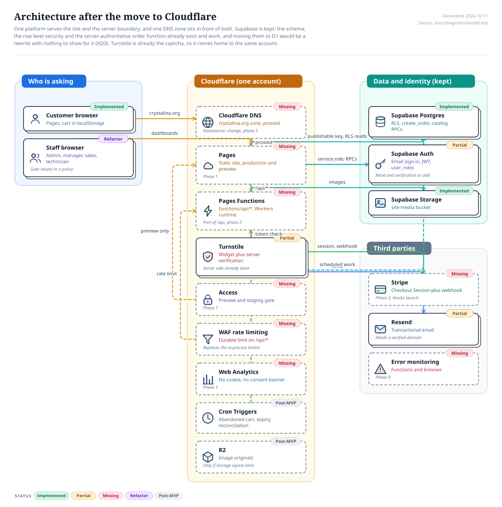

_**Architecture after the move to Cloudflare.** One platform serves the site and the server boundary, and one DNS zone sits in front of both. Supabase is kept: the schema, the row level security and the server-authoritative order function already exist and work, and moving them to D1 would be a rewrite with nothing to show for it (AD3). Turnstile is already the captcha, so it comes home to the same account._

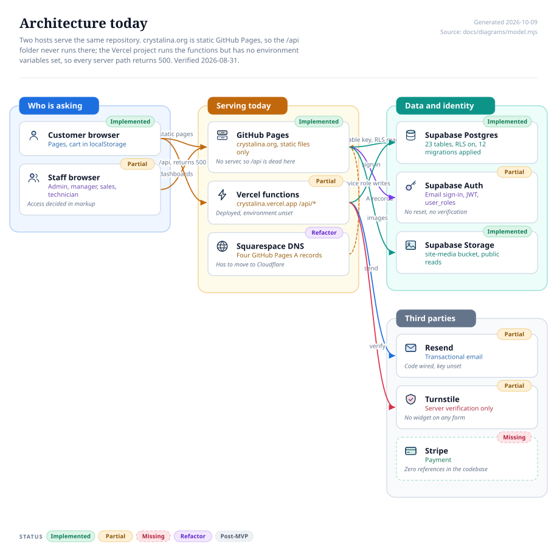

_**Architecture today.** Two hosts serve the same repository. crystalina.org is static GitHub Pages, so the /api folder never runs there; the Vercel project runs the functions but has no environment variables set, so every server path returns 500. Verified 2026-08-31._

---

## 4. Channels and accounts already held

Crystalina is not a new project, so most of the "go and open an account" work in a normal build is already done. The domain is owned, Search Console is verified, the Meta Business account exists, and the WhatsApp number is live and linked from every page. The question for each one is not whether it exists; it is whether the site actually uses it, and whether the move breaks it.

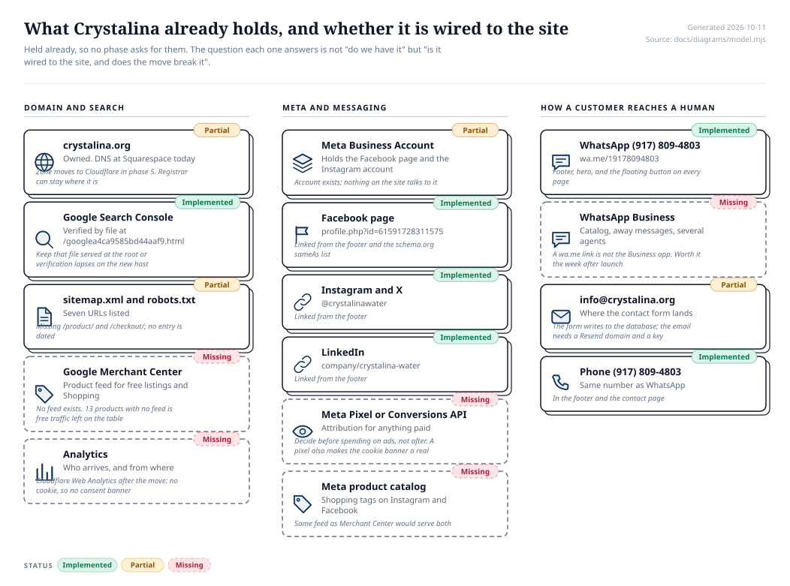

_**Channels and accounts already held.** The domain, Search Console, the Meta Business account and the WhatsApp number exist. The status on each card is whether the site actually uses it._

### What the move must not break

- Google Search Console is verified by a file served at /googlea4ca9585bd44aaf9.html. That file has to keep being served from the root on the new host, or verification lapses silently. Once the zone is on Cloudflare, adding the DNS TXT method as a second, host-independent proof costs nothing and is worth doing.
- sitemap.xml lists seven URLs and no dates. It is missing /product/ and /checkout/ and has no lastmod on any entry. Worth fixing in the same change as the cutover.
- The WhatsApp link is a plain wa.me link, so it is unaffected by hosting. It appears in the footer, in the hero and as a floating button on every page.
- The footer social links and the schema.org sameAs list in index.html both name the same four profiles, in two places. That is a second copy; see section 13.

> **The gap worth naming**
>
> Three accounts that are held and unconnected: there is no product feed for Google Merchant Center or the Meta catalogue, no analytics of any kind, and no Meta Pixel or Conversions API. Thirteen products with no feed is free traffic left on the table, and a pixel added after an ad campaign starts cannot report on the days before it. None of this blocks launch, and all of it is cheaper to decide now than to retrofit. Note that adding a pixel also turns the cookie banner into a real question; Cloudflare Web Analytics on its own does not.

---

## 5. The content model

Twenty three tables in one Supabase project, grouped by what they are for. The fields shown in the drawing are the ones another part of the system depends on, not every column.

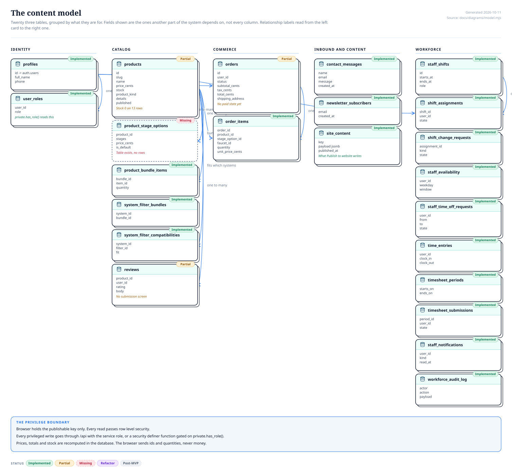

_**The content model.** What exists in Supabase, which tables are still empty, and where the privilege boundary sits._

### The privilege boundary

- The browser holds the publishable key only. Every read it makes passes row level security, and the key is safe in public for exactly that reason and no other.
- Every privileged write goes through /api with the service role, or through a security definer function gated on private.has_role(). There is no third path.
- Prices, totals and stock are recomputed in the database. The browser sends ids and quantities and never money. create_order prices stage options and faucet upgrades server-side, so the payment work in phase 3 reuses it rather than recalculating anything in JavaScript.

### What is empty

| Table | State | Consequence |
| --- | --- | --- |
| products.stock | 0 on all 13 rows | Every product card reads as out of stock. |
| product_stage_options | No rows | No 5, 6 or 7 stage choice renders on any product page. |
| products where product_kind = faucet | No rows | available_as_upgrade and default_faucet_id have nothing to point at, so the upgrade control never appears. |
| reviews | No submission screen | The table is read but nothing writes to it. |

> **Migrations**
>
> Additive and re-runnable: create or replace, if not exists, drop-then-create for policies. Forward only, numbered, applied as a job rather than by hand. Keep it that way: a migration that cannot be run twice will eventually be run twice.

---

## 6. The flows that carry money, identity or anything irreversible

Five flows, each with the happy path numbered and the failure path drawn beside it rather than left in a footnote. These are the only flows drawn, because these are the only ones where being wrong costs something that cannot be undone with a reload.

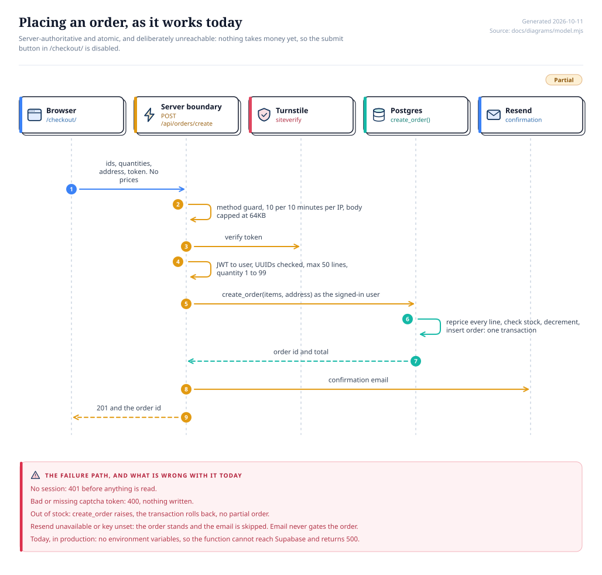

_**Placing an order, as it works today.** Server-authoritative and atomic, and deliberately unreachable: nothing takes money yet, so the submit button in /checkout/ is disabled._

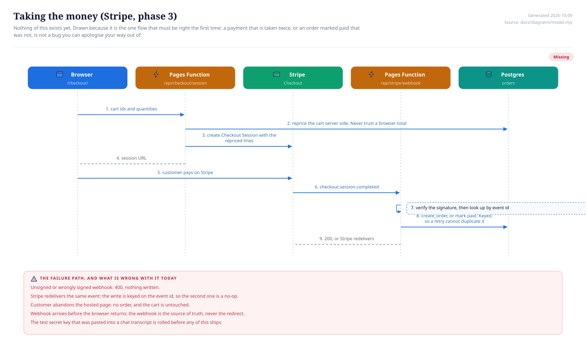

_**Taking the money (Stripe, phase 3).** Nothing of this exists yet. Drawn because it is the one flow that must be right the first time: a payment that is taken twice, or an order marked paid that was not, is not a bug you can apologise your way out of._

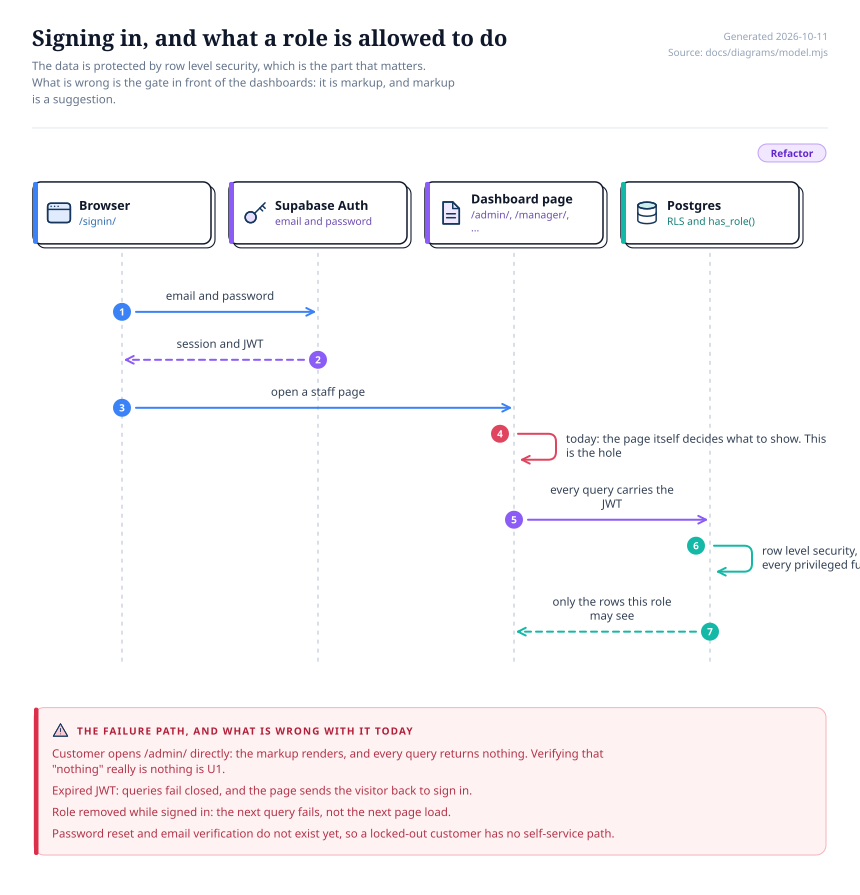

_**Signing in, and what a role is allowed to do.** The data is protected by row level security, which is the part that matters. What is wrong is the gate in front of the dashboards: it is markup, and markup is a suggestion._

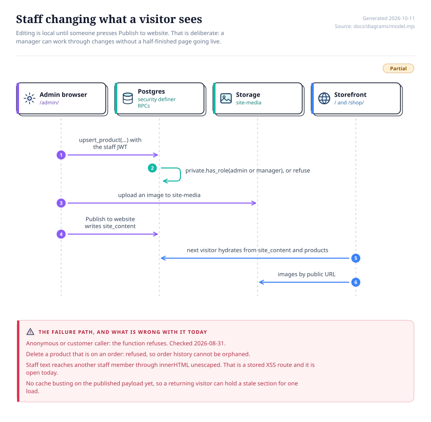

_**Staff changing what a visitor sees.** Editing is local until someone presses Publish to website. That is deliberate: a manager can work through changes without a half-finished page going live._

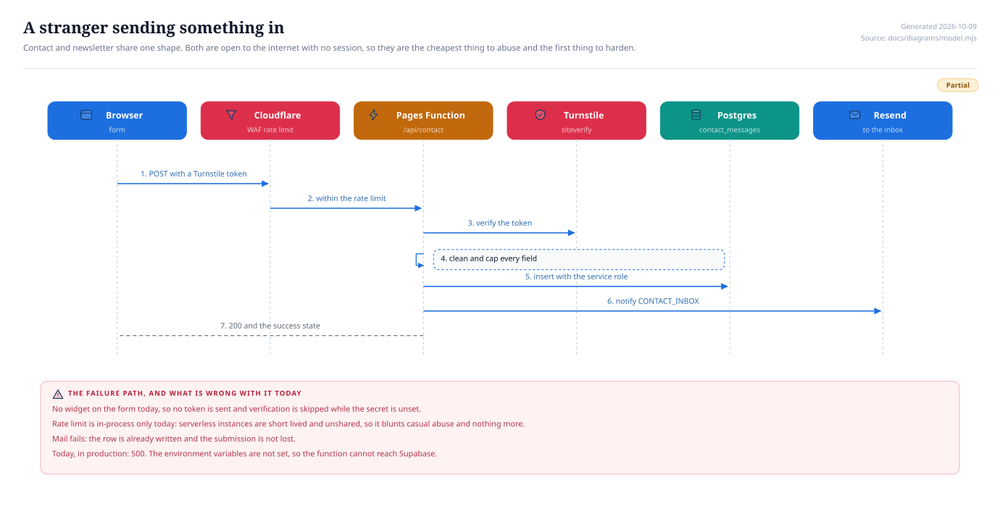

_**A stranger sending something in.** Contact and newsletter share one shape. Both are open to the internet with no session, so they are the cheapest thing to abuse and the first thing to harden._

---

## 7. Security and privacy

### The threats that actually apply

| Threat | What mitigates it | State |
| --- | --- | --- |
| A visitor reads another customer's orders | Row level security on every table, every query carrying the signed-in JWT | Implemented. Policies are in place and were checked on 2026-08-31. |
| A visitor pays less than the price | create_order reprices every line in the database. The browser sends ids and quantities only | Implemented, and unreachable until payment exists. |
| Staff text reaching another staff member as script | escapeHTML in js/main.js, used on every interpolation | Partial. The storefront paths are escaped; the four dashboards and the schedule modules are not. This is the open hole. |
| A customer opening a staff dashboard | A policy, not markup | Refactor. The data is protected; the gate in front of it is browser-side and has not been tested against a real customer account (U1). |
| Form spam and abuse | Turnstile, plus a rate limit | Partial. Server verification is wired and enforces as soon as the secret is set. No widget is on any form, and the rate limit does not survive a serverless instance. |
| A leaked key | Secrets per environment in the platform store, never in the repository | Partial. The .gitignore covers .env*. One Stripe test key was pasted into a chat transcript and has to be rolled. |
| Payment taken twice | A webhook write keyed on the Stripe event id | Missing, with the rest of payment. It has to exist before the first real charge, not after. |

### Personal data held

| What | Where | How long |
| --- | --- | --- |
| Name, email, phone, delivery address | Supabase: profiles and orders.shipping_address | For the life of the account. No deletion flow exists yet; see section 12. |
| Contact form messages | Supabase: contact_messages, and a copy emailed to info@crystalina.org | Indefinite. Worth a retention rule before volume makes one urgent. |
| Newsletter addresses | Supabase: newsletter_subscribers | Until unsubscribed. No unsubscribe path is built. |
| Card details | Never touched. Stripe holds them on its own hosted page | Not applicable, and it must stay that way. |
| Staff hours, shifts, time off | Supabase workforce tables | For the life of employment, plus whatever payroll law requires. Unresolved: U5. |

> **Deliberately accepted**
>
> The security headers in vercel.json (nosniff, strict referrer, DENY framing, a closed permissions policy, HSTS with preload) are carried over unchanged to Cloudflare as a _headers file. There is no Content-Security-Policy yet: the pages use inline handlers in places, so a policy added today would either break them or be weak enough to be theatre. It belongs with the XSS sweep in phase 6, not before it.

---

## 8. Performance budget

The targets are set. The bars are empty, because nothing has been measured on a served copy yet, and a guessed number in a budget is worse than an empty one: it gets believed. scripts/verify.mjs reports transferred weight per page and fills these in.

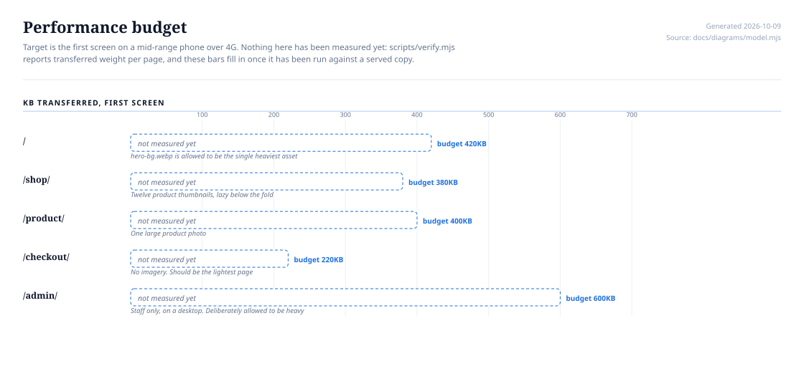

_**Performance budget.** The targets are set. The bars stay empty until the harness has rendered a served copy, because a guessed number in a budget gets believed._

- The site is static HTML, CSS and JavaScript with no build step, so there is no bundler cost to argue about and no framework runtime to pay for.
- Imagery is the whole budget. The hero is allowed to be the single heaviest asset on the site; everything below the fold is lazy.
- Cache busting is not in place. Styles and scripts are referenced without a version or a hash, so a returning visitor can hold a stale stylesheet after a deploy. This is almost always the cause when a site "looks broken" for some people and not others, and it is worth fixing with the Cloudflare move rather than after it.

---

## 9. Deployment, environments and secrets

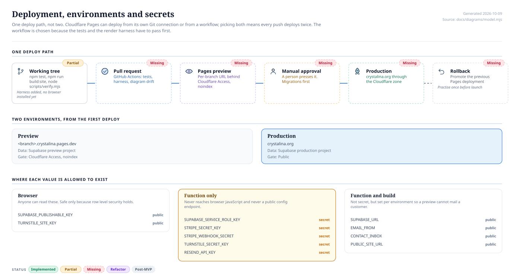

_**Deployment, environments and secrets.** One deploy path, two environments, and the three places a value is allowed to live. The middle column is the one that ends a project if it leaks._

### Every value, and where it is allowed to exist

| Name | Secret | Where it is allowed to exist |
| --- | --- | --- |
| SUPABASE_URL | No | Function and build |
| SUPABASE_PUBLISHABLE_KEY | No | Browser, safe only because RLS holds |
| SUPABASE_SERVICE_ROLE_KEY | Yes | Function only |
| STRIPE_SECRET_KEY | Yes | Function only |
| STRIPE_WEBHOOK_SECRET | Yes | Function only |
| TURNSTILE_SITE_KEY | No | Browser widget |
| TURNSTILE_SECRET_KEY | Yes | Function only |
| RESEND_API_KEY | Yes | Function only |
| EMAIL_FROM | No | Function |
| CONTACT_INBOX | No | Function |
| PUBLIC_SITE_URL | No | Function and build |

> **One deploy path, not two**
>
> Cloudflare Pages can deploy from its own Git connection or from a workflow in the repository. Pick one. With both connected, every push deploys twice, the two deployments race, and the one that wins is whichever finished last. The workflow is the choice here, because the tests and the render harness have to pass before anything is published.

### Rollback

Promoting the previous Pages deployment, which takes seconds. It has to be practised once, deliberately, before launch, by someone who is not the person who built it. A rollback nobody has run is a rollback nobody can run at two in the morning.

---

## 10. Site map and feature matrix

Every page, the state of the server work behind it, and what a visitor or a staff member actually clicks. Menu, search and footer links are left out on purpose: drawn, they turn the arrows into a web. Dashed arrows are staff actions that reach a customer page.

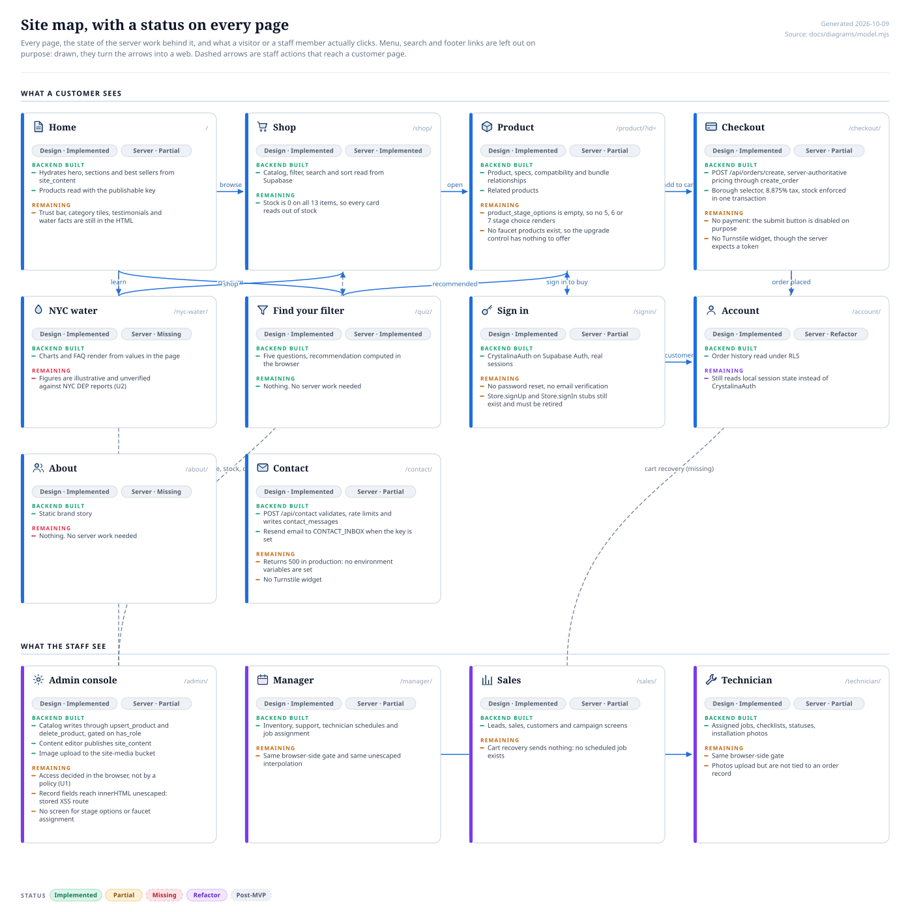

_**Site map, with a status on every page.** The one picture that answers "how far along are we". Plus signs are backend work that is built; minus signs are what remains._

### The same thing as a table

| Page | Route | Design | Server | What remains |
| --- | --- | --- | --- | --- |
| Home | / | Implemented | Partial | Trust bar, category tiles, testimonials and water facts are still in the HTML |
| Shop | /shop/ | Implemented | Implemented | Stock is 0 on all 13 items, so every card reads out of stock |
| Product | /product/?id= | Implemented | Partial | product_stage_options is empty, so no 5, 6 or 7 stage choice renders No faucet products exist, so the upgrade control has nothing to offer |
| Checkout | /checkout/ | Implemented | Partial | No payment: the submit button is disabled on purpose No Turnstile widget, though the server expects a token |
| Find your filter | /quiz/ | Implemented | Implemented | Nothing. No server work needed |
| NYC water | /nyc-water/ | Implemented | Missing | Figures are illustrative and unverified against NYC DEP reports (U2) |
| About | /about/ | Implemented | Missing | Nothing. No server work needed |
| Contact | /contact/ | Implemented | Partial | Returns 500 in production: no environment variables are set No Turnstile widget |
| Sign in | /signin/ | Implemented | Partial | No password reset, no email verification Store.signUp and Store.signIn stubs still exist and must be retired |
| Account | /account/ | Implemented | Refactor | Still reads local session state instead of CrystalinaAuth |
| Admin console | /admin/ | Implemented | Partial | Access decided in the browser, not by a policy (U1) Record fields reach innerHTML unescaped: stored XSS route No screen for stage options or faucet assignment |
| Manager | /manager/ | Implemented | Partial | Same browser-side gate and same unescaped interpolation |
| Sales | /sales/ | Implemented | Partial | Cart recovery sends nothing: no scheduled job exists |
| Technician | /technician/ | Implemented | Partial | Same browser-side gate Photos upload but are not tied to an order record |

---

## 11. Risks

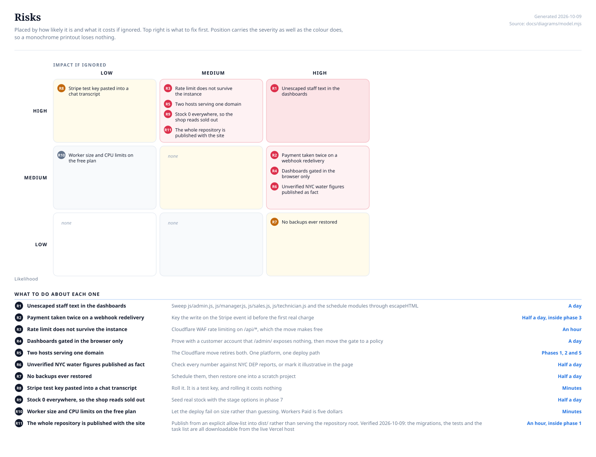

_**Risks.** Top right is what to fix first. R1 and R3 are both one short task each and both are top row._

> **How to read it**
>
> Top right is what to fix first. Two of the top-row risks, the unescaped dashboards and the rate limit that does not survive its instance, are a day and an hour of work respectively. Neither is hard. Both get much more expensive the week after the site takes public traffic.

---

## 12. Build plan

Phases, not dates. An arrow means the phase it points at cannot honestly start before the one behind it has finished. Target windows are working-day estimates, not promises.

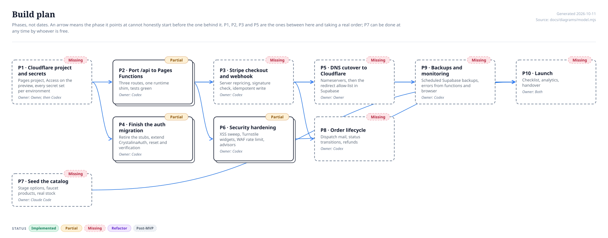

_**Build plan.** What each phase needs before it can start, and who owns it. Arrows are dependencies, not a schedule._

| Phase | What gets built | Needs first | Owner | State |
| --- | --- | --- | --- | --- |
| P1 · Cloudflare project and secrets | Pages project, Access on the preview, every secret set per environment | Nothing | Owner, then Codex | Missing |
| P2 · Port /api to Pages Functions | Three routes, one runtime shim, tests green | P1 | Codex | Partial |
| P3 · Stripe checkout and webhook | Server repricing, signature check, idempotent write | P2 | Codex | Missing |
| P4 · Finish the auth migration | Retire the stubs, extend CrystalinaAuth, reset and verification | P1 | Codex | Partial |
| P5 · DNS cutover to Cloudflare | Nameservers, then the redirect allow-list in Supabase | P2, P3 | Owner | Missing |
| P6 · Security hardening | XSS sweep, Turnstile widgets, WAF rate limit, advisors | P2 | Codex | Partial |
| P7 · Seed the catalog | Stage options, faucet products, real stock | Nothing | Claude Code | Missing |
| P8 · Order lifecycle | Dispatch mail, status transitions, refunds | P3 | Codex | Missing |
| P9 · Backups and monitoring | Scheduled Supabase backups, errors from functions and browser | P5 | Codex | Missing |
| P10 · Launch | Checklist, analytics, handover | P5, P6, P7, P9 | Both | Missing |

---

## 13. One definition, read everywhere

Anything that appears twice is built once, and a variation is a parameter rather than a second copy. This is the rule that the whole project runs on, and it is the rule that quietly breaks first.

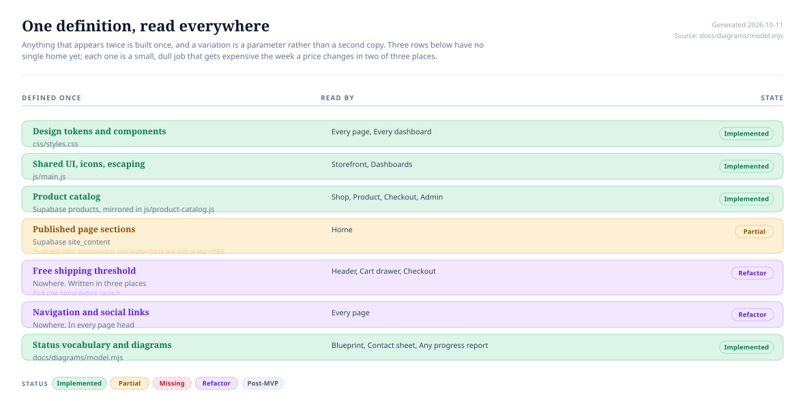

_**One definition, read everywhere.** Where each shared fact lives, who reads it, and the three that still have no home._

> **Three that have no home yet**
>
> The free shipping threshold is written in three places: the header, the cart drawer and checkout. The navigation and social links are in the head of every page. The repeatable items inside home page sections, the trust bar, the category tiles, the testimonials, the water facts and the process steps, are still in the HTML while everything around them is published from site_content. Each one is a small, dull job. Each one becomes an incident the week a price changes in two places out of three.

---

## 14. Post-launch, deliberately not built

This section exists to prevent an argument later. Each item has the condition that should trigger it.

| Not building | Build it when |
| --- | --- |
| Cloudflare R2 for images | Supabase Storage egress shows up on a bill, or image delivery becomes the slowest thing on a product page. |
| Cloudflare D1 instead of Supabase | Two writers need to scale independently, or the Supabase bill outgrows the cost of a rewrite. Not before. See AD3. |
| Cron Triggers for abandoned carts and reconciliation | Payment is live and there is at least a month of real order data to reconcile against. |
| Subscriptions and filter replacement reminders | The first cohort of customers reaches a filter change interval. The schema already carries compatibility, so the data is ready before the feature is. |
| A customer data deletion and export flow | Before any marketing to an EU or California audience, or on the first request, whichever comes first. |
| A Content-Security-Policy | After the XSS sweep in phase 6, when inline handlers are gone and a policy can be strict enough to be worth having. |
| Meta Pixel or Conversions API | Before the first paid campaign, and not before, because a pixel brings a consent banner with it. |
| Multi-language | No sign it is needed. NYC is multilingual; nobody has asked. U6. |

---

## 15. Architecture decisions

Numbered, dated, never renumbered. The last two lines of each are the ones people skip and the ones that matter in a year.

#### AD1 · Cloudflare Pages and Pages Functions, rather than staying on Vercel or on GitHub Pages

_Decided 2026-10-09._

- **What it does.** One project serves the static pages and runs the three server routes, behind one DNS zone we control.
- **Why we need it.** Today the domain points at a host that cannot run server code, and the host that can has never been given its keys. Any fix that leaves two hosts in place leaves the same confusion.
- **Why it belongs here.** Turnstile is already the captcha and is a Cloudflare product. Access closes the preview for free. WAF rate limiting fixes a security finding that cannot be fixed in application code. Web Analytics needs no cookie and therefore no consent banner. All four come with the zone.
- **What it costs.** A nameserver move, a port of three functions from the Node request and response style to the Workers fetch style, and a runtime that is not Node, so every library has to be checked. There are no libraries: the functions are dependency free.
- **Right for now.** Three routes and a static site sit far inside the free plan. Workers Paid at five dollars a month is the ceiling, not the floor.
- **Replace when.** The server work grows beyond what a Pages Function can do inside its CPU limit, or a long-running job appears that wants a real Node host.

#### AD2 · Pages Functions rather than a Worker with a framework

_Decided 2026-10-09._

- **What it does.** Each route stays one file under functions/api/, matching the existing /api layout one to one.
- **Why we need it.** The three routes are already written against standard web APIs and have no dependencies. They need a runtime, not a framework.
- **Why it belongs here.** The site has no build step, and adding one to serve three endpoints would be the largest change in the project for the smallest reason.
- **What it costs.** No file-based routing conveniences, and the Node request and response shim has to be written once and tested.
- **Right for now.** Three endpoints. A framework earns its place somewhere around twenty.
- **Replace when.** The server surface grows past roughly a dozen routes, or server-rendered pages become necessary.

#### AD3 · Supabase stays. The data does not move to D1

_Decided 2026-10-09._

- **What it does.** Postgres, row level security, Auth and Storage stay exactly where they are. Only the serving layer moves.
- **Why we need it.** Twenty three tables, twelve applied migrations, policies on every table, a server-authoritative order function and four staff-gated catalogue functions already exist and work.
- **Why it belongs here.** D1 has no row level security. Moving would mean reimplementing every policy as application code behind a data access layer, with a test for every path, to gain a network hop. The security model is the most valuable thing in the project.
- **What it costs.** A network hop from the Worker to Supabase, a second vendor, and a bill that grows with use.
- **Right for now.** The database is nowhere near being the bottleneck, and the policies are the reason the browser can safely hold a key at all.
- **Replace when.** The Supabase bill becomes material, or the latency of that hop shows up in a measurement rather than in a worry.

#### AD4 · The money is recomputed in the database, and the webhook is the source of truth

_Decided 2026-10-09._

- **What it does.** The browser sends product ids and quantities. create_order prices every line, including stage options and faucet upgrades, checks stock and decrements it in one transaction. The Stripe webhook, not the browser redirect, marks an order paid.
- **Why we need it.** A price that the browser can influence is a price a customer can choose. A redirect that the browser can skip is a payment that can be lost.
- **Why it belongs here.** Half of it already exists and is tested. The payment work extends it rather than inventing a parallel path.
- **What it costs.** The webhook has to verify its signature and be keyed on the event id, because Stripe will redeliver.
- **Right for now.** This is the one flow that has to be right the first time. Being taken twice for the same order is not something you can apologise your way out of.
- **Replace when.** Never, as long as the site takes money.

#### AD5 · Every diagram is generated from one data file

_Decided 2026-10-09._

- **What it does.** docs/diagrams/model.mjs holds the system as data. scripts/diagrams.mjs draws every SVG from it, and this document is generated too. Nothing is hand placed.
- **Why we need it.** A status picture that is two weeks old is worse than none, because it is believed. Hand-drawn diagrams are never updated after the second time.
- **Why it belongs here.** The site map with a status on every page is the one picture that answers "how far along are we", and it is read by whoever is paying rather than by whoever is building.
- **What it costs.** A renderer to maintain, and layout expressed as code rather than dragged into place.
- **Right for now.** Fifteen drawings from one file, regenerated in under a second, with npm run diagrams:check failing a pull request where the picture and the model disagree.
- **Replace when.** The drawings need art direction that layout code cannot express. Then export once to a design tool and accept that it is now a second copy.

#### AD6 · Icons are symbols, and diagram elements are components

_Decided 2026-10-09._

- **What it does.** Every icon is one SVG symbol, instanced with use. Every repeated diagram element (the card, the zone panel, the page card, the table card, the sequence lane, the note panel, the connector) is one component in scripts/lib/components.mjs, with its variants listed in a manifest.
- **Why we need it.** It is the same rule the site runs on, applied to the drawings. An icon copied into three diagrams is three icons to fix.
- **Why it belongs here.** It is also what makes the set exportable: a symbol library and a component manifest map one to one onto a design tool's components and instances, so the set can be rebuilt in Figma without being redrawn.
- **What it costs.** Layout maths lives in code, and a component change redraws everything, which is the point and is occasionally startling.
- **Right for now.** Forty one symbols and six components carry sixteen drawings, and the library sheet in section 18 shows every one of them.
- **Replace when.** The library is maintained in a design tool and exported into the repository, rather than the other way round.

#### AD7 · The site is published from an explicit allow-list, not from the repository root

_Decided 2026-10-09._

- **What it does.** npm run build:site copies a named list of directories and files into dist/, refuses to finish if anything on a forbidden list made it in, and writes a manifest. Pages publishes dist/.
- **Why we need it.** Serving the repository root publishes the repository. Verified on 2026-10-09 against the live Vercel host: the SQL migrations, the test files and the internal task list were all downloadable by anyone.
- **Why it belongs here.** Cloudflare Pages has no special case for /api, so without this it would publish the server source as well. The move forces the question, which is the good time to answer it.
- **What it costs.** Adding a file to the site means naming it in one list. That friction is the feature.
- **Right for now.** Fifteen directories and nineteen files. Small enough to read in one screen.
- **Replace when.** A real build step appears for another reason, and can own the same list.

#### AD8 · Montserrat for text, and a Canela-like serif for titles

_Decided 2026-10-09._

- **What it does.** Replaces Inter and Poppins across the site and the blueprint. Two tokens in css/styles.css and one in scripts/lib/tokens.mjs.
- **Why we need it.** The brand reads as a premium product and was set in two geometric sans faces, which read as a technology product.
- **Why it belongs here.** Changing it costs two tokens and a font link while the site is pre-launch. After launch it is a visual regression test across every page.
- **What it costs.** Montserrat is a wider face than Inter, so anything that was close to wrapping now wraps. Checked at 1280: the navigation still fits on one line. Canela is licensed, so Playfair Display stands in for it.
- **Right for now.** Both faces are on Google Fonts, so there is no licence to buy and no file to self-host yet.
- **Replace when.** Canela is licensed. Then change the one token in each place, and self-host rather than loading from a third party.

---

## 16. Questions and unknowns

Numbered, owned, with what each one blocks. An unknown with no owner is a decision nobody is making. Answered ones stay here, marked answered with the date, rather than being deleted; the trail is the value.

#### U1 · Does opening /admin/ or /manager/ while signed in as an ordinary customer expose anything at all?

- **Why it matters.** Row level security should mean the page renders and every query returns nothing. Should is not a result. Until someone signs in as a customer and looks, the browser-side gate is an assumption.
- **How to resolve.** Create a customer account on a preview, open each of the four dashboards, and read the network tab as well as the screen.
- **Owner.** Codex
- **Blocks.** Phase 6, and any claim that the dashboards are safe

#### U2 · Are the NYC water figures on /nyc-water/ defensible?

- **Why it matters.** They are presented as fact to a New York audience and were written as first-draft illustrative numbers. Publishing an unverified water quality claim is a different kind of mistake from a layout bug.
- **How to resolve.** Check every figure against the NYC DEP annual water quality reports and against lab data. Anything that cannot be sourced is either removed or labelled illustrative in the page itself.
- **Owner.** Owner, with Claude Code
- **Blocks.** Launch

#### U3 · Which Resend sending domain, and is it verified?

- **Why it matters.** EMAIL_FROM is set to noreply@crystalina.org. Mail from an unverified domain is either rejected or filed as spam, and order confirmations landing in spam look exactly like orders that were never taken.
- **How to resolve.** Verify crystalina.org in Resend, add the DNS records, and send one real test to an address outside the company.
- **Owner.** Owner
- **Blocks.** Phase 3 being believable, and phase 8

#### U4 · Is there a second Supabase project for preview, or does preview share production data?

- **Why it matters.** Two environments with one database is one environment. A test order placed on a preview would decrement real stock and send a real email.
- **How to resolve.** Decide. If the answer is one project, then preview must be read-only and say so, loudly, in the handoff.
- **Owner.** Owner, with Codex
- **Blocks.** Phase 1

#### U5 · What retention does the workforce data need, and under what rule?

- **Why it matters.** Ten tables hold staff hours, shifts, time off and an audit log. Payroll records carry statutory retention periods, and nobody has named one.
- **How to resolve.** Ask whoever handles payroll what the obligation is, then write it down as a retention policy with a job that enforces it.
- **Owner.** Owner
- **Blocks.** Nothing yet. It blocks the first audit.

#### U6 · Does the site need Spanish?

- **Why it matters.** The audience is New York City. Nobody has asked for it, and retrofitting language into a site with copy in the markup is considerably harder than planning for it.
- **How to resolve.** Ask. If the answer is yes or probably, lift the page copy out of the markup in the same pass as section 13 rather than twice.
- **Owner.** Owner
- **Blocks.** Nothing now. It doubles the cost of section 13 if the answer arrives late.

#### U7 · Who maintains this after launch, and how technical are they?

- **Why it matters.** It decides how much is editable from the admin console and how much is a developer task forever. The honest list of what is not editable is in section 10 and in DEPLOY_STEPS.md.
- **How to resolve.** Name the person. If they are not technical, the repeatable items in section 13 stop being tidy-up and become required work.
- **Owner.** Owner
- **Blocks.** Scope of phase 7 and of the handover

---

## 17. The drawing system

Every drawing in this document is assembled from one icon library and six components, and coloured by a six-family palette where the colour carries meaning rather than decoration. This section is the key to reading all of them.

### What the colours mean

| Family | Stands for |
| --- | --- |
| Blue | The visitor, and anything a customer touches |
| Amber | The edge: hosting, DNS, caching, the things in front |
| Violet | Identity, secrets, anything that proves who someone is |
| Teal | Data at rest |
| Green | Money, and the things that must be exactly right |
| Rose | Danger, failure paths, and anything untrusted |
| Slate | Neutral, and anything deliberately postponed |

A status word is a family too, so Partial is the same amber on a card, in a table and in a progress report. The word is printed on every chip as well as the colour, and anything that does not exist yet also carries a dashed outline, so a monochrome printout and a colour-blind reader both lose nothing. An arrow takes the colour of what it points at, which means a path through a drawing can be followed by colour alone.

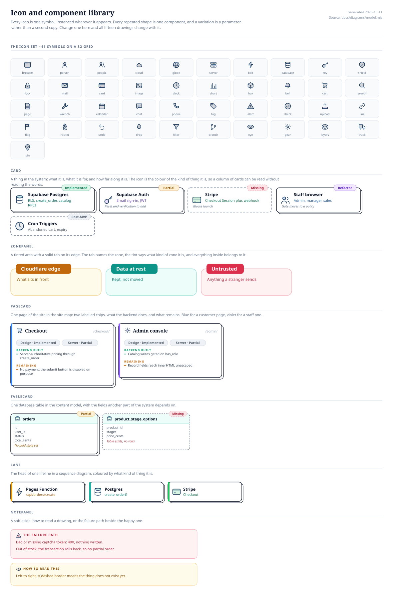

_**Icon and component library.** The vocabulary the other fourteen drawings are assembled from: every symbol, and every component in each state it is used in._

---

## 18. How this document is kept true

- The source is docs/blueprint-content.mjs and docs/diagrams/model.mjs. Three surfaces are generated from them and none is written by hand: the Artifact at https://claude.ai/artifact/SrRGRwrLYrSisyGC53rCLo, which is the one to send anybody; docs/blueprint.html, the same page as a file that opens from the repository; and docs/blueprint.md, for reading in a pull request. Editing any of the three is work that the next regeneration silently destroys.
- npm run blueprint rebuilds all three. npm run diagrams rebuilds every drawing. npm run check runs the tests, the publish allow-list and both drift checks, so a stale picture or a page that has drifted from its source cannot survive a pull request.
- Amend this in the same commit as the change it describes. A decision that changes in code and not here is a decision that will be made again, differently.
- Mark an answered question answered, with the date and the answer. Do not delete it.
- When a section is superseded, say so at the top of the section and point at what replaced it. Never renumber.
- Two assistants commit to main. Read COORDINATION.md before editing, and pull before you start and before each push.

> **Publish from one place**
>
> The Artifact is published from this repository and nowhere else. Anyone republishing it pulls first and republishes to the same URL (https://claude.ai/artifact/SrRGRwrLYrSisyGC53rCLo) rather than creating a second one. A generated document published from two places stops matching its own sources quietly, and the next person to rebuild wipes out work nobody remembers doing.
