# Crystalina blueprint

<!-- Generated by `npm run blueprint`. Do not edit.
     Source: docs/blueprint-content.mjs and docs/diagrams/model.mjs. -->

| | |
| --- | --- |
| Shape | Shop |
| Status | Building |
| Prepared | 2026-10-09 |
| State verified | 2026-11-02 (hosting), 2026-08-31 (database) |
| Target | One Cloudflare Worker serving dist and routing /api/*, with Supabase kept for data and identity |
| Revised | 2026-11-02. The server boundary works for the first time: the Worker is live and all three API routes answer, checked against the live host. The Vercel project is deleted and the domain still points at GitHub Pages. Google sign-in is enabled and there is no password anywhere in the project. Four claims that had been carried forward unchecked were wrong and are corrected below. Every card in every drawing is now clickable. |

What Crystalina is, what actually runs today, and what stands between it and an open shop. Every drawing is generated from one data file, every card in every drawing can be clicked for what it is and what it is waiting on, and every status word is one of five.

A readable version of this document, with every drawing inline, is at
[docs/blueprint.html](blueprint.html). The drawings on their own are in
[docs/diagrams/](diagrams/index.html).

## Contents

1. [Where this stands](#1-where-this-stands)
2. [What runs today](#2-what-runs-today)
3. [How one request travels](#3-how-one-request-travels)
4. [Where it is going](#4-where-it-is-going)
5. [Channels and accounts already held](#5-channels-and-accounts-already-held)
6. [Every page, and the state of the work behind it](#6-every-page-and-the-state-of-the-work-behind-it)
7. [The content model](#7-the-content-model)
8. [The flows that carry money, identity or anything irreversible](#8-the-flows-that-carry-money-identity-or-anything-irreversible)
9. [Security and privacy](#9-security-and-privacy)
10. [Deployment, environments and secrets](#10-deployment-environments-and-secrets)
11. [Performance budget](#11-performance-budget)
12. [Build plan](#12-build-plan)
13. [Risks](#13-risks)
14. [One definition, read everywhere](#14-one-definition-read-everywhere)
15. [Deliberately not built](#15-deliberately-not-built)
16. [Architecture decisions](#16-architecture-decisions)
17. [Questions and unknowns](#17-questions-and-unknowns)
18. [The drawing system](#18-the-drawing-system)
19. [Everything, one card at a time](#19-everything-one-card-at-a-time)
20. [How this document is kept true](#20-how-this-document-is-kept-true)

---

## 1. Where this stands

Crystalina is a premium home water filtration shop for New York City: seventeen products with real compatibility and bundle relationships, a customer account, and five private pages for admin, managers, sales and field technicians. The design is built. The database is built and protected. As of today the server boundary runs as well. What is missing is a way to take money, a shelf that is not sold out, and a domain pointed at the half that works.

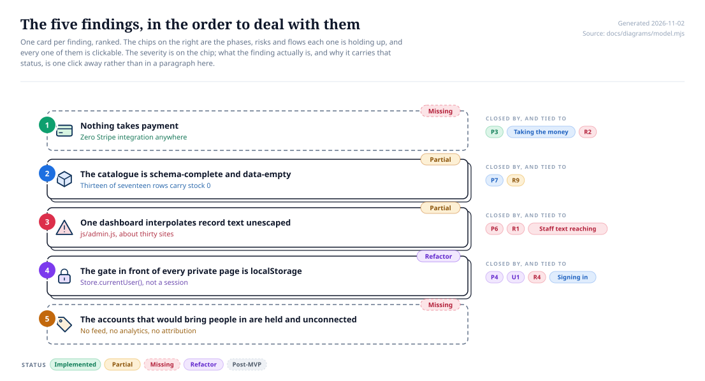

_**The five findings, in the order to deal with them.** Ranked by what to do first, not by severity alone: F2 is half a day of data entry and is blocked on nothing, while F1 is the largest remaining piece of work._

> **How to read this document**
>
> Every card in every drawing opens a panel: what the thing is, why it carries the status it carries, what it is waiting on, and what is waiting on it. Both lists are derived from one data file rather than written out, so they cannot drift. Click through a chain and the trail at the top of the panel remembers where you started. Nothing here is fetched: with scripting off, the same detail is an index at the foot of the page.

### The path, in four lines

1. Build the payment path once, carefully, with the money recomputed on the server and the webhook keyed so a retry cannot charge twice. This is now the largest remaining piece of work.
2. Seed the catalogue. It is half a day, it is blocked on nothing, and it is the difference between a shop and a page of sold-out items.
3. Close the three findings that are each under a day: escape one file, put the captcha widget on three forms, move the rate limit to the edge.
4. Then move the nameservers, which is what makes everything already built visible to a visitor.

### What was checked, when, and how

| What was checked | When | How |
| --- | --- | --- |
| Hosting | 2026-11-02 | Requested all three hosts. crystalina.crystalina.workers.dev answers 200 with Server: cloudflare. crystalina.org answers 200 with Server: GitHub.com, so the domain has not moved. crystalina.vercel.app answers 404 DEPLOYMENT_NOT_FOUND, so the Vercel project is gone. |
| Boundary | 2026-11-02 | Probed each route on the Worker. GET returns 405 with a JSON method guard; POST with an empty body returns 400 from the validator on /api/contact and /api/newsletter and 401 on /api/orders/create; an unknown /api path returns 404 rather than a static file. The owner reports a real submission returning 200 on both forms the same day. The probe proves routing, guards and validation, and stops before Supabase, so it does not by itself prove the keys are set. |
| Tests | 2026-11-02 | npm test: 35 tests over 6 files, 35 pass, under a second. |
| Catalogue | 2026-11-02 | Read the seed migration. 17 published rows: four systems carrying stock 1, nine replacement filters and four filter bundles carrying stock 0. No faucet rows, and product_stage_options is created and never inserted into. |
| Repository | 2026-11-02 | GitHub API: arch-erickson/crystalina is public. dist/ holds 128 files and the allow-list check finds no .sql, test or internal .md file in it. |
| Database | 2026-08-31 | 12 migrations, 23 tables, row level security on every table, nine distinct security definer functions. Checked against the live project then and not since, so the live rows may have moved away from the migrations. |

> **Four things this document used to say that were not true**
>
> - That all four staff dashboards interpolated record text unescaped. One does, about thirty times: js/admin.js. The other five files escape theirs.
> - That the free shipping threshold was written in three places. It was written on ten lines across six files, six of them arithmetic; since 2026-11-03 the arithmetic reads one database row.
> - That stock was 0 on all thirteen products. There are seventeen published rows; four systems carry stock 1 and the other thirteen carry 0.
> - That the environment variables were unset and every server call returned 500. The Worker answers, and the method guards and validators on all three routes were exercised against the live host today.

---

## 2. What runs today

One working host nobody visits, and one stale host everybody visits. That is the whole of the remaining hosting problem, and it is one nameserver change rather than the two half-deployments it was a month ago.

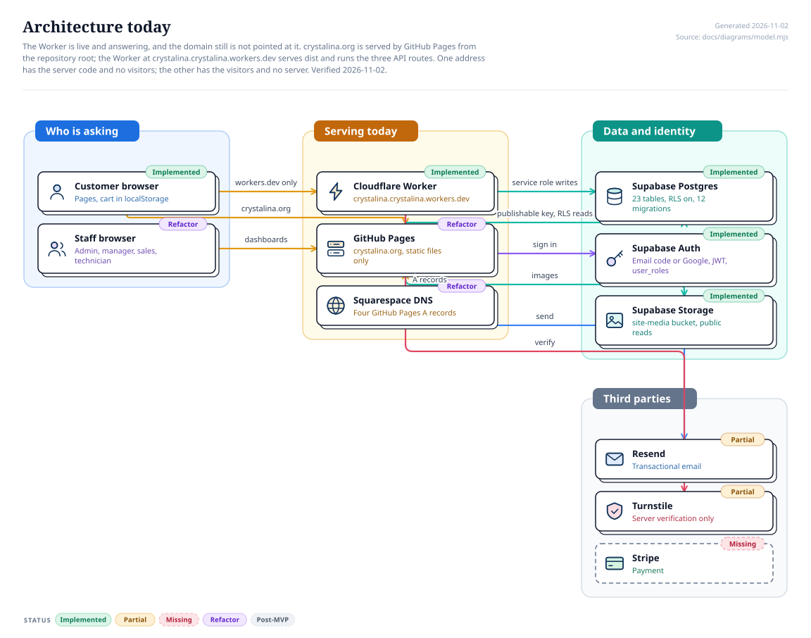

_**Architecture today.** The Worker is live and answering, and the domain still is not pointed at it. crystalina.org is served by GitHub Pages from the repository root; the Worker at crystalina.crystalina.workers.dev serves dist and runs the three API routes. One address has the server code and no visitors; the other has the visitors and no server. Verified 2026-11-02._

> **The shape of the problem**
>
> The repository is correct. Both deployments are correct in isolation. What is wrong is that the domain points at the half that cannot run code. No amount of further building fixes that; one nameserver change does, and it is held up by a question about mail rather than by anything technical.

---

## 3. How one request travels

The Worker makes one branch and then a short series of decisions in a fixed order. This is the drawing to read before changing anything in the server boundary, because it is the only place where the route table, the shim and the handler guards are visible together.

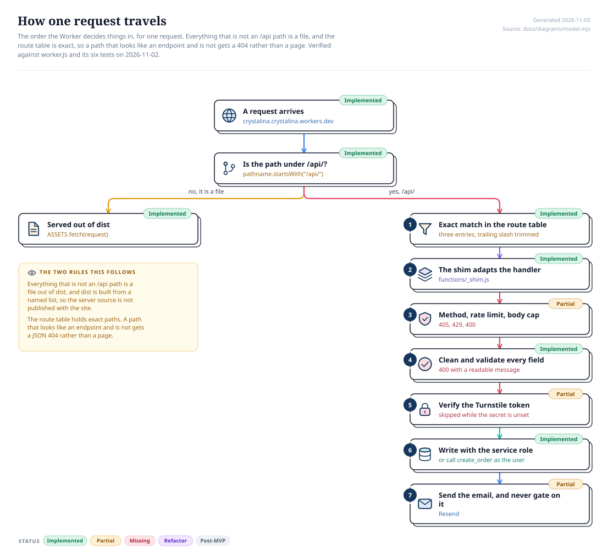

_**How one request travels.** The order the Worker decides things in. Verified against worker.js and its six tests, and against the live Worker, on 2026-11-02._

---

## 4. Where it is going

The same picture with the domain in front of it, and with the four things that only exist once the zone is on Cloudflare: Access on the previews, WAF rate limiting on the API, Web Analytics with no cookie, and a captcha that has a widget as well as a verifier.

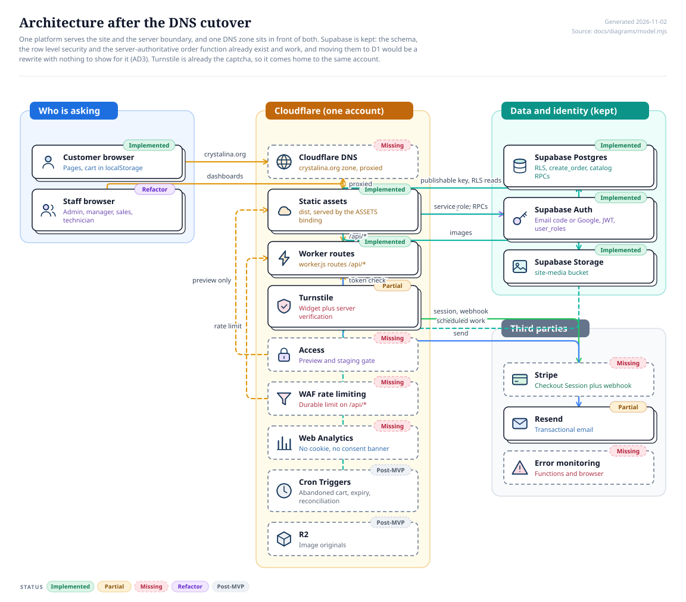

_**Architecture after the DNS cutover.** One platform serves the site and the server boundary, and one DNS zone sits in front of both. Supabase is kept: the schema, the row level security and the server-authoritative order function already exist and work, and moving them to D1 would be a rewrite with nothing to show for it (AD3). Turnstile is already the captcha, so it comes home to the same account._

> **The rule that survives the choice**
>
> Two environments, secrets per environment, a deploy that is one command and a rollback that is one more. If a platform ever makes one of those four hard, that is the signal to look again rather than to work around it.

### What only the owner can do

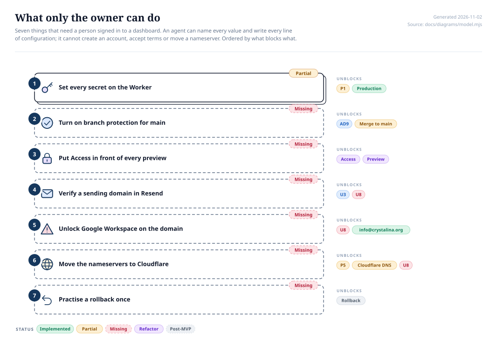

_**What only the owner can do.** Seven dashboard tasks, in dependency order. An agent can name every value and write every line of configuration; it cannot create an account, accept terms or move a nameserver._

---

## 5. Channels and accounts already held

Crystalina is not a new project, so most of the "go and open an account" work is already done. The question on each card is not whether the account exists; it is whether the site uses it, and whether the move breaks it.

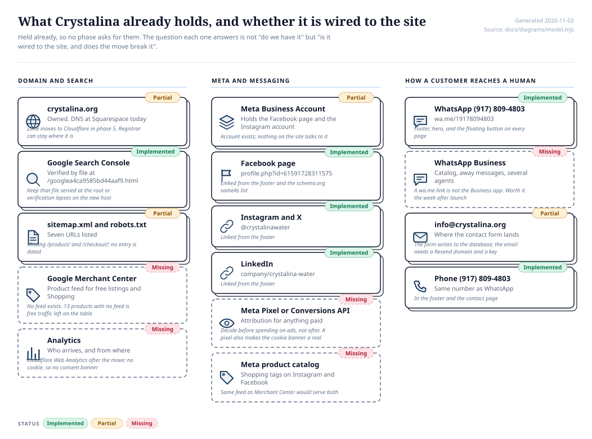

_**Channels and accounts already held.** The domain, Search Console, the Meta Business account and the WhatsApp number exist. The status on each card is whether the site actually uses it._

> **One of these changed, and not for the better**
>
> Google Workspace on the domain is suspended behind a Squarespace reseller lock, so info@crystalina.org is not receiving mail. The contact form still writes its row, so no enquiry is lost, but nobody is told one arrived. It also sits on the same DNS zone as the nameserver move, which is why it is recorded as U8 rather than as a nuisance.

---

## 6. Every page, and the state of the work behind it

The one picture that answers "how far along are we". Click any page for what it looks like today beside what is left to do on it. Menu, search and footer links are left out on purpose: drawn, they turn the arrows into a web. Dashed arrows are staff actions that reach a customer page.

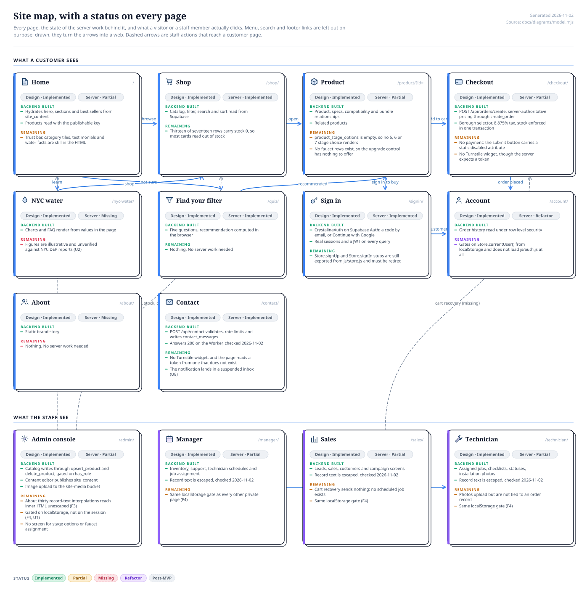

_**Site map, with a status on every page.** The one picture that answers "how far along are we". Plus signs are backend work that is built; minus signs are what remains._

### The same thing as a table

| Page | Route | Design | Server | What remains |
| --- | --- | --- | --- | --- |
| Home | / | Implemented | Partial | Trust list, testimonials, water facts and process steps are still in the HTML; the category tiles read CATEGORIES in main.js |
| Shop | /shop/ | Implemented | Implemented | Thirteen of seventeen rows carry stock 0, so most cards read out of stock |
| Product | /product/?id= | Implemented | Partial | product_stage_options is empty, so no 5, 6 or 7 stage choice renders No faucet rows exist, so the upgrade control has nothing to offer Low stock reads as a count, never a warning; a rating shows only with its review count, and no product has one yet |
| Checkout | /checkout/ | Implemented | Partial | No payment: the submit button carries a static disabled attribute No Turnstile widget, though the server expects a token |
| Find your filter | /quiz/ | Implemented | Implemented | Nothing. No server work needed |
| NYC water | /nyc-water/ | Implemented | Missing | The microplastics card makes no numeric claim, by design, because none we found had a source we could stand behind |
| About | /about/ | Implemented | Missing | Nothing. No server work needed |
| Contact | /contact/ | Implemented | Implemented | No Turnstile widget, and the page reads a token from one that does not exist The notification lands in a suspended inbox (U8) |
| Privacy policy | /privacy/ | Implemented | Missing | Not in the publish allow-list and linked from the footer as # until the owner has approved the wording Nothing on the server. No server work needed |
| Terms of service | /terms/ | Implemented | Missing | Not in the publish allow-list and linked from the footer as # until the owner has approved the wording Nothing on the server. No server work needed |
| Shipping and returns | /shipping-returns/ | Implemented | Missing | Not in the publish allow-list and linked from the footer as # until the owner has approved the wording Nothing on the server. No server work needed |
| Manuals and guides | /manuals/ | Implemented | Missing | No manual file exists yet. A manual belongs in the site-media bucket, named on the product row as manualUrl, which the page trusts; only the guessed /manuals/files/<slug>.pdf address is checked when the page loads Nothing on the server. No server work needed |
| Order receipt | /order/?id= | Implemented | Implemented | No order can be placed until payment exists, so the page has only its signed-out, missing and not-found states to show today Checkout should land here once an order is created |
| Not found | /404.html | Implemented | Implemented | Nothing. No server work needed |
| Sign in | /signin/ | Implemented | Implemented | Store.signUp and Store.signIn stubs are still exported from js/store.js and must be retired |
| Account | /account/ | Implemented | Refactor | Gates on Store.currentUser() from localStorage and does not load js/auth.js at all |
| Admin console | /admin/ | Implemented | Partial | About thirty record-text interpolations reach innerHTML unescaped (F3) Gated on localStorage, not on the session (F4, U1) No screen for stage options or faucet assignment |
| Manager | /manager/ | Implemented | Partial | Same localStorage gate as every other private page (F4) |
| Sales | /sales/ | Implemented | Partial | Cart recovery sends nothing: no scheduled job exists Same localStorage gate (F4) |
| Technician | /technician/ | Implemented | Partial | Photos upload but are not tied to an order record Same localStorage gate (F4) |

### And the same thing as photographs

Captured from the served site at three widths, so a redesign has a before to be judged against and a reader who has never opened the shop can see it without a server. Every page is here, and the home page is here twice: whole, and then section by section, in the order a visitor meets them. Each of these also appears inside its own page bubble above.

Captured 2026-11-03 at 1366, 834, 390 pixels wide.

### What a customer sees
- **Home /**: [desktop](screens/page-home-desktop.webp), [tablet](screens/page-home-tablet.webp), [mobile](screens/page-home-mobile.webp)
- **Shop /shop/**: [desktop](screens/page-shop-desktop.webp), [tablet](screens/page-shop-tablet.webp), [mobile](screens/page-shop-mobile.webp)
- **Product /product/**: [desktop](screens/page-product-desktop.webp), [tablet](screens/page-product-tablet.webp), [mobile](screens/page-product-mobile.webp)
- **Checkout /checkout/**: [desktop](screens/page-checkout-desktop.webp), [tablet](screens/page-checkout-tablet.webp), [mobile](screens/page-checkout-mobile.webp)
- **NYC water /nyc-water/**: [desktop](screens/page-nyc-water-desktop.webp), [tablet](screens/page-nyc-water-tablet.webp), [mobile](screens/page-nyc-water-mobile.webp)
- **Find your filter /quiz/**: [desktop](screens/page-quiz-desktop.webp), [tablet](screens/page-quiz-tablet.webp), [mobile](screens/page-quiz-mobile.webp)
- **Sign in /signin/**: [desktop](screens/page-signin-desktop.webp), [tablet](screens/page-signin-tablet.webp), [mobile](screens/page-signin-mobile.webp)
- **Account /account/**: [desktop](screens/page-account-desktop.webp), [tablet](screens/page-account-tablet.webp), [mobile](screens/page-account-mobile.webp)
- **About /about/**: [desktop](screens/page-about-desktop.webp), [tablet](screens/page-about-tablet.webp), [mobile](screens/page-about-mobile.webp)
- **Contact /contact/**: [desktop](screens/page-contact-desktop.webp), [tablet](screens/page-contact-tablet.webp), [mobile](screens/page-contact-mobile.webp)
- **Manuals and guides /manuals/**: [desktop](screens/page-manuals-desktop.webp), [tablet](screens/page-manuals-tablet.webp), [mobile](screens/page-manuals-mobile.webp)
- **Order receipt /order/**: [desktop](screens/page-order-desktop.webp), [tablet](screens/page-order-tablet.webp), [mobile](screens/page-order-mobile.webp)
- **Not found /404.html**: [desktop](screens/page-not-found-desktop.webp), [tablet](screens/page-not-found-tablet.webp), [mobile](screens/page-not-found-mobile.webp)
- **Privacy policy /privacy/**: [desktop](screens/page-privacy-desktop.webp), [tablet](screens/page-privacy-tablet.webp), [mobile](screens/page-privacy-mobile.webp)
- **Terms of service /terms/**: [desktop](screens/page-terms-desktop.webp), [tablet](screens/page-terms-tablet.webp), [mobile](screens/page-terms-mobile.webp)
- **Shipping and returns /shipping-returns/**: [desktop](screens/page-shipping-desktop.webp), [tablet](screens/page-shipping-tablet.webp), [mobile](screens/page-shipping-mobile.webp)

### What the staff see
- **Admin console /admin/**: [desktop](screens/page-admin-desktop.webp), [tablet](screens/page-admin-tablet.webp), [mobile](screens/page-admin-mobile.webp)
- **Manager /manager/**: [desktop](screens/page-manager-desktop.webp), [tablet](screens/page-manager-tablet.webp), [mobile](screens/page-manager-mobile.webp)
- **Sales /sales/**: [desktop](screens/page-sales-desktop.webp), [tablet](screens/page-sales-tablet.webp), [mobile](screens/page-sales-mobile.webp)
- **Technician /technician/**: [desktop](screens/page-technician-desktop.webp), [tablet](screens/page-technician-tablet.webp), [mobile](screens/page-technician-mobile.webp)

### The home page, section by section
- **Most of what your family drinks is water. Make it the purest thing in the house.**: [desktop](screens/section-hero-desktop.webp), [tablet](screens/section-hero-tablet.webp), [mobile](screens/section-hero-mobile.webp)
- **trust**: [desktop](screens/section-trust-desktop.webp), [tablet](screens/section-trust-tablet.webp), [mobile](screens/section-trust-mobile.webp)
- **A system for every home, and every household.**: [desktop](screens/section-categories-desktop.webp), [tablet](screens/section-categories-tablet.webp), [mobile](screens/section-categories-mobile.webp)
- **Component by Component**: [desktop](screens/section-anatomy-desktop.webp), [tablet](screens/section-anatomy-tablet.webp), [mobile](screens/section-anatomy-mobile.webp)
- **Start here**: [desktop](screens/section-best-sellers-desktop.webp), [tablet](screens/section-best-sellers-tablet.webp), [mobile](screens/section-best-sellers-mobile.webp)
- **Good water is treated at the source. The last mile is yours.**: [desktop](screens/section-water-facts-desktop.webp), [tablet](screens/section-water-facts-tablet.webp), [mobile](screens/section-water-facts-mobile.webp)
- **Four steps, under an hour**: [desktop](screens/section-process-desktop.webp), [tablet](screens/section-process-tablet.webp), [mobile](screens/section-process-mobile.webp)
- **Made for New York, by people who drink it too.**: [desktop](screens/section-why-crystalina-desktop.webp), [tablet](screens/section-why-crystalina-tablet.webp), [mobile](screens/section-why-crystalina-mobile.webp)
- **What our neighbors say**: [desktop](screens/section-testimonials-desktop.webp), [tablet](screens/section-testimonials-tablet.webp), [mobile](screens/section-testimonials-mobile.webp)
- **Not sure where to begin?**: [desktop](screens/section-cta-desktop.webp), [tablet](screens/section-cta-tablet.webp), [mobile](screens/section-cta-mobile.webp)

> **Refreshing the captures**
>
> Serve the site, then run npm run screens. The script captures every page and every data-home-section element at 1366, 834 and 390 pixels wide, writes them to docs/screens as webp and rewrites docs/screens/index.json, which this section and the page bubbles are both generated from. Run npm run blueprint afterwards, as for any other change. Staff pages are captured signed out, so they show what a visitor who guesses the address sees, which is the honest version.

---

## 7. The content model

Twenty three tables in one Supabase project, grouped by what they are for. The fields shown are the ones another part of the system depends on, not every column. The panel at the foot of the drawing is the sentence the whole data design turns on.

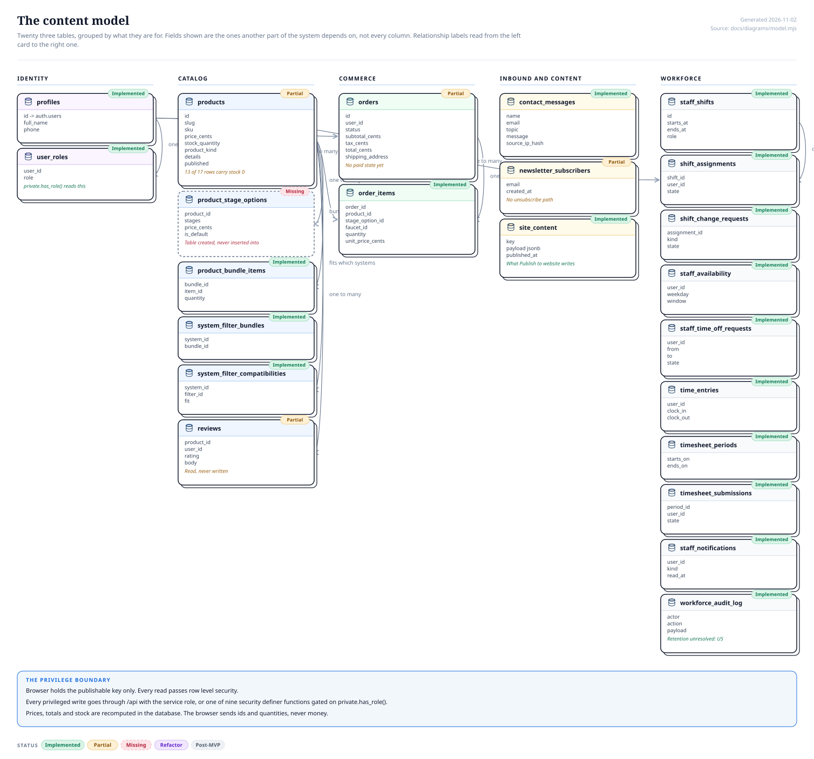

_**The content model.** What exists in Supabase, which tables are still empty, and where the privilege boundary sits._

> **Migrations**
>
> Additive and re-runnable: create or replace, if not exists, drop-then-create for policies. Forward only, numbered, applied as a job rather than by hand. Keep it that way: a migration that cannot be run twice will eventually be run twice.

---

## 8. The flows that carry money, identity or anything irreversible

Five flows, each with the happy path numbered and the failure path drawn beside it rather than left in a footnote. These are the only flows drawn, because these are the only ones where being wrong costs something a reload cannot undo.

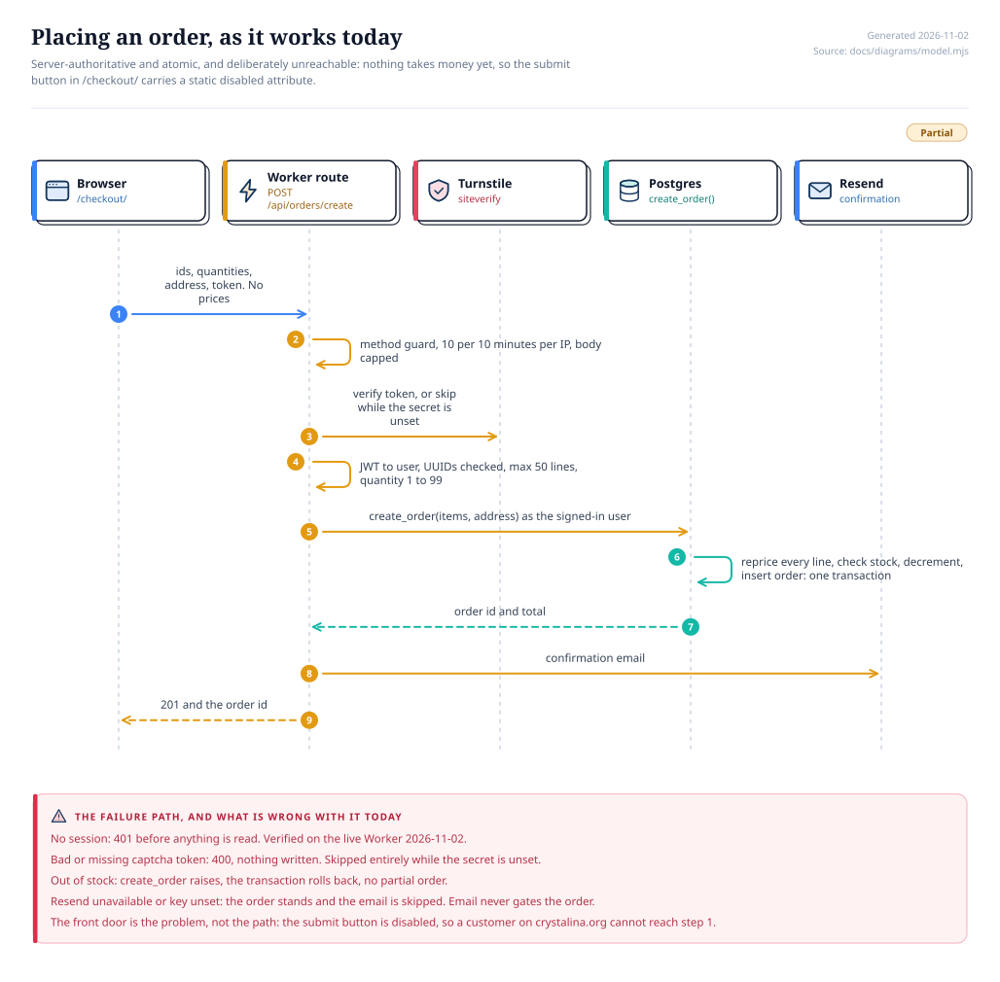

_**Placing an order, as it works today.** Server-authoritative and atomic, and deliberately unreachable: nothing takes money yet, so the submit button in /checkout/ carries a static disabled attribute._

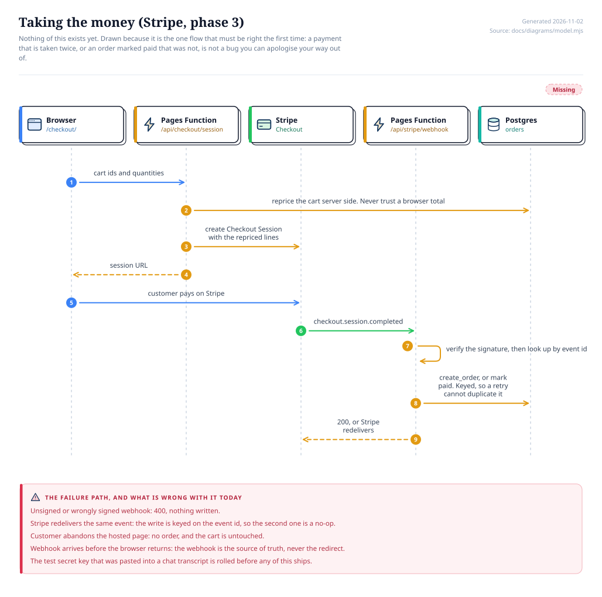

_**Taking the money (Stripe, phase 3).** Nothing of this exists yet. Drawn because it is the one flow that must be right the first time: a payment taken twice, or an order marked paid that was not, is not a bug you can apologise your way out of._

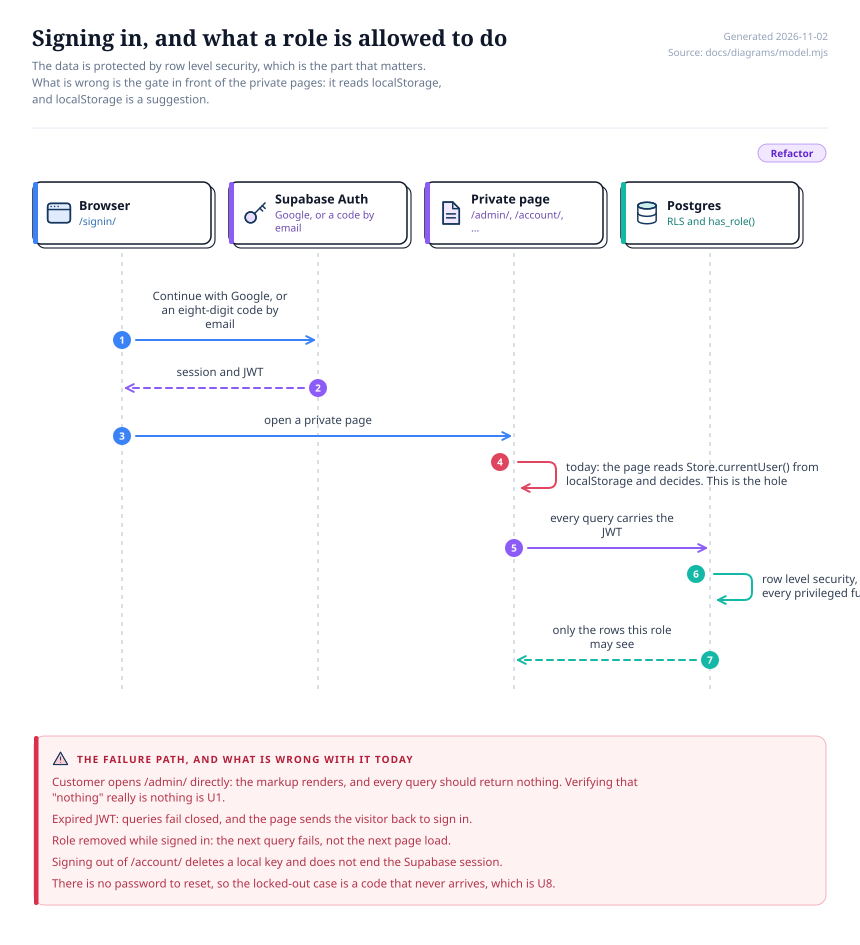

_**Signing in, and what a role is allowed to do.** The data is protected by row level security, which is the part that matters. What is wrong is the gate in front of the private pages: it reads localStorage, and localStorage is a suggestion._

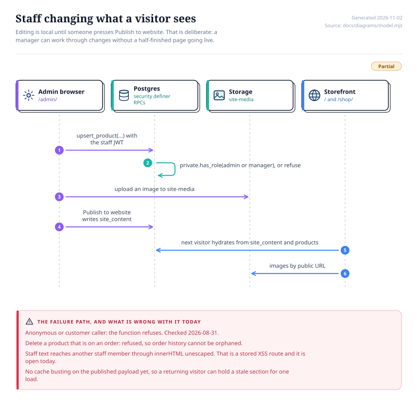

_**Staff changing what a visitor sees.** Editing is local until someone presses Publish to website. That is deliberate: a manager can work through changes without a half-finished page going live._

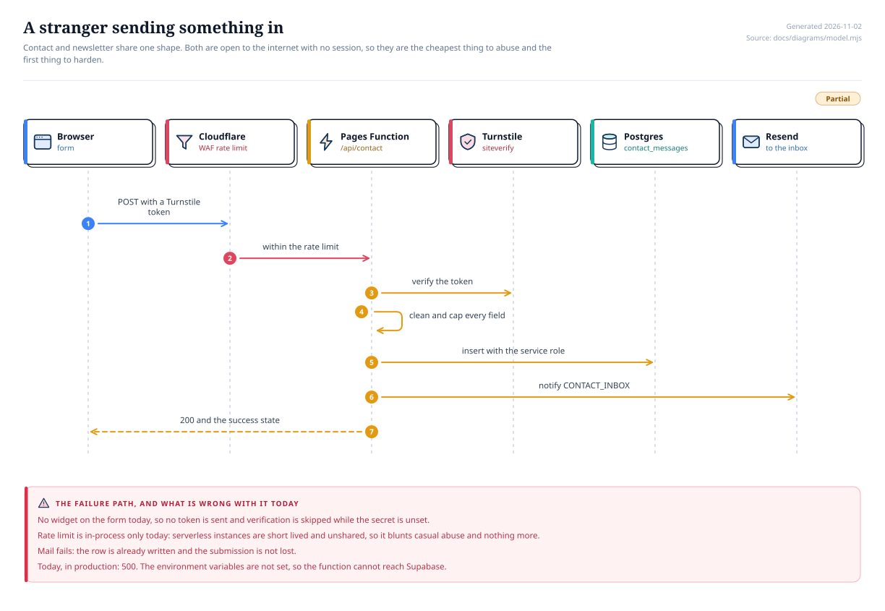

_**A stranger sending something in.** Contact and newsletter share one shape. Both are open to the internet with no session, so they are the cheapest thing to abuse and the first thing to harden. Both answer on the Worker as of 2026-11-02._

---

## 9. Security and privacy

Every threat that actually applies, in the column that says whether anything stands in front of it. The right-hand column is the work, and two of the three cards in the middle column are the same single file.

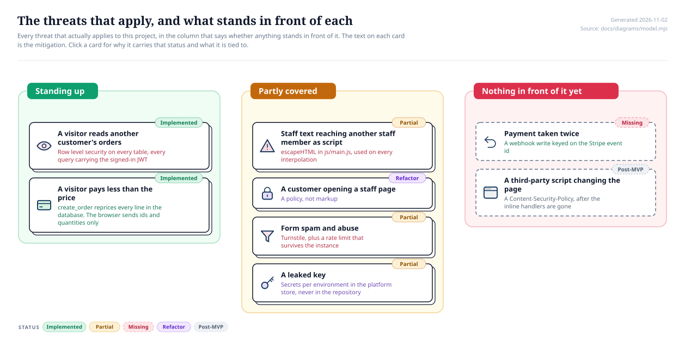

_**The threats that apply, and what stands in front of each.** The right-hand column is the work. Two of the three cards in the middle column are the same one file._

### Personal data held

| What is held | Where | For how long |
| --- | --- | --- |
| Name, email, phone, delivery address | Supabase: profiles and orders.shipping_address | For the life of the account. No deletion flow exists |
| Contact form messages | Supabase: contact_messages, with the sender IP as a truncated hash | Indefinite. Worth a rule before volume makes one urgent |
| Newsletter addresses | Supabase: newsletter_subscribers | Until unsubscribed, and no unsubscribe path is built |
| Card details | Never touched. Stripe would hold them on its own hosted page | Not applicable, and it must stay that way |
| Staff hours, shifts, time off | Supabase: ten workforce tables and an audit log | For the life of employment, plus whatever payroll law requires. Unresolved: U5 |

> **Deliberately accepted**
>
> The five security headers in _headers, carried over from the Vercel configuration unchanged, are nosniff, a strict referrer policy, DENY framing, a closed permissions policy and HSTS with preload. There is no Content-Security-Policy: the pages still use inline handlers, so a policy written today would either break them or be weak enough to be theatre. It belongs after the escaping sweep, not before it.

---

## 10. Deployment, environments and secrets

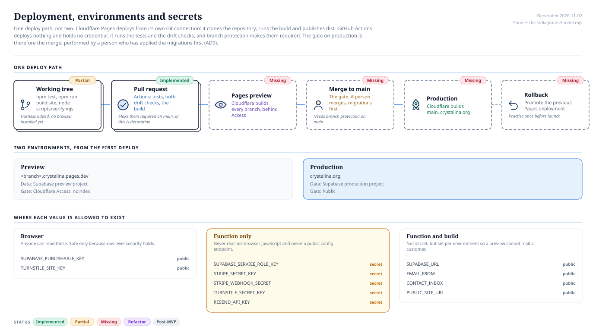

_**Deployment, environments and secrets.** One deploy path, two environments, and the three places a value is allowed to live. The middle column is the one that ends a project if it leaks._

### Every value, and where it is allowed to exist

| Name | Secret | Where it is allowed to exist |
| --- | --- | --- |
| SUPABASE_URL | No | Function and build |
| SUPABASE_PUBLISHABLE_KEY | No | Browser, safe only because RLS holds |
| SUPABASE_SERVICE_ROLE_KEY | Yes | Function only |
| STRIPE_SECRET_KEY | Yes | Function only |
| STRIPE_WEBHOOK_SECRET | Yes | Function only |
| TURNSTILE_SITE_KEY | No | Browser widget |
| TURNSTILE_SECRET_KEY | Yes | Function only |
| RESEND_API_KEY | Yes | Function only |
| EMAIL_FROM | No | Function |
| CONTACT_INBOX | No | Function |
| PUBLIC_SITE_URL | No | Function and build |

> **One deploy path, not two**
>
> Cloudflare can deploy from its own Git connection or from a workflow in the repository. Pick one. With both connected, every push deploys twice, the two race, and the one that wins is whichever finished last. The Git connection is the choice here, and GitHub Actions only gates it. See AD9, which is Partial rather than done: the branch protection the whole decision rests on is not switched on yet.

---

## 11. Performance budget

The targets are set and the bars are empty, because nothing has been measured on a served copy yet. A guessed number in a budget is worse than an empty one: it gets believed. npm run verify reports transferred weight per page and fills these in.

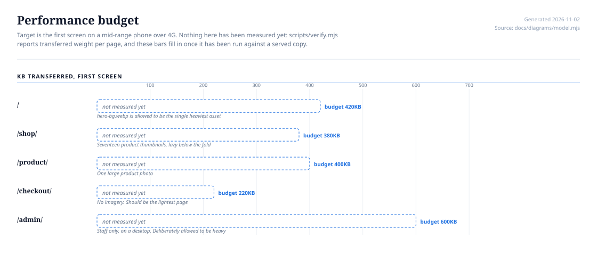

_**Performance budget.** The targets are set. The bars stay empty until the harness has rendered a served copy, because a guessed number in a budget gets believed._

- The site is static HTML, CSS and JavaScript with no build step, so there is no bundler cost to argue about and no framework runtime to pay for.
- Imagery is the whole budget. The hero is allowed to be the single heaviest asset on the site; everything below the fold is lazy.
- Cache busting is not in place. Styles and scripts are referenced with no version or hash, so a returning visitor can hold a stale stylesheet after a deploy. This is almost always the cause when a site looks broken for some people and not others.

---

## 12. Build plan

Phases, not dates. An arrow means the phase it points at cannot honestly start before the one behind it has finished. P2 is the first to finish, and it finished by changing a deploy target rather than a handler.

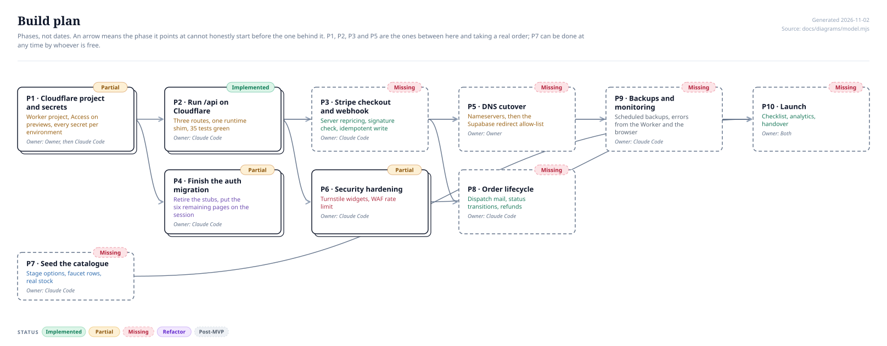

_**Build plan.** What each phase needs before it can start, and who owns it. Arrows are dependencies, not a schedule._

---

## 13. Risks

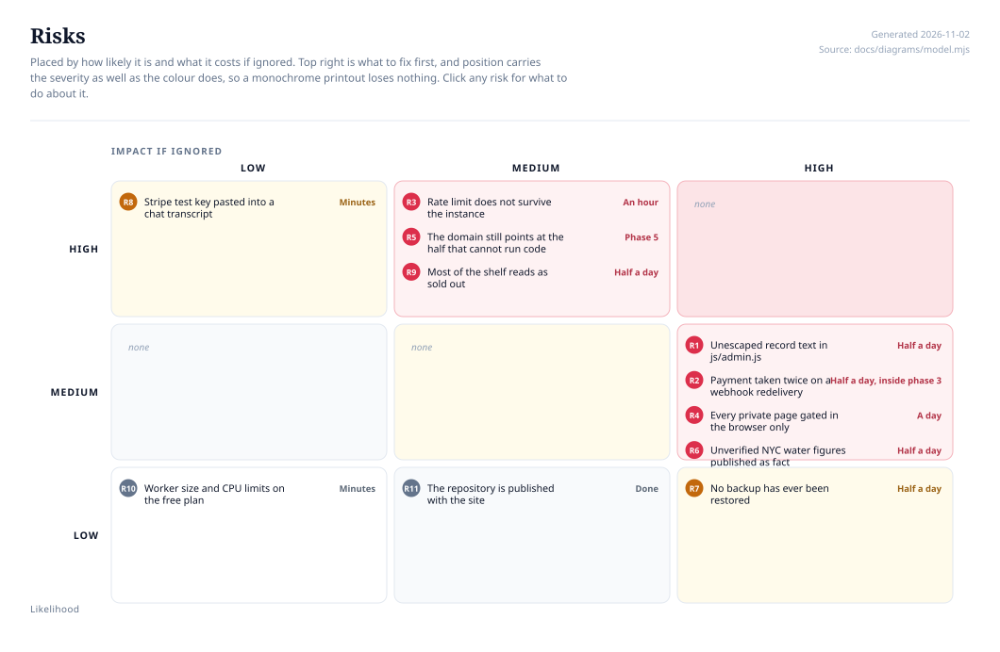

_**Risks.** Eleven risks by likelihood and impact, with the effort on each one. R3 is an hour of work and sits in the top row; R11 moved to the bottom left on 2026-11-02 when the Vercel host was deleted._

> **What moved on 2026-11-02**
>
> R1 dropped from high likelihood to medium when the other five dashboard files were checked and found to escape their record text. R10 and R11 both dropped: the Worker deploys inside the free plan, and the Vercel host that was publishing the repository has been deleted. Nothing got worse. R3 is still an hour of work and still in the top row.

---

## 14. One definition, read everywhere

Anything that appears twice is built once, and a variation is a parameter rather than a second copy. This is the rule the whole project runs on, and it is the rule that quietly breaks first.

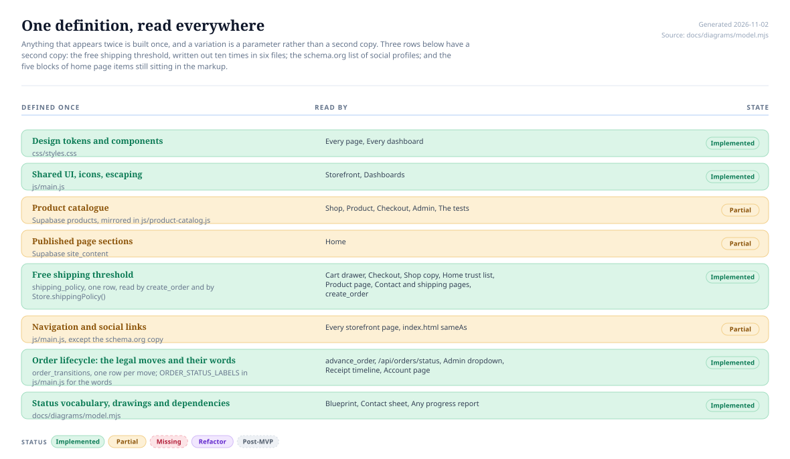

_**One definition, read everywhere.** Where each shared fact lives and who reads it. The three marked Refactor or Partial are the ones with a second copy; click one for where the copies are._

The library can be looked at as well as read. docs/components.html is a page in the repository that loads the real stylesheet and the real script and renders every token, button, heading, band, card, wash and icon the storefront is built from, with the real header above it. Serve the site and open /docs/components.html. It is outside the publish allow-list, so it never reaches a customer, and because it uses the live components rather than copies of them, it cannot drift from the site.

> **The one that is worse than it looked**
>
> The free shipping threshold was recorded as living in three places. Checked on 2026-11-02 it was on ten lines across six files: six of them arithmetic, including both versions of create_order, and four of them sentences of customer-facing copy. On 2026-11-03 it moved to shipping_policy, one enforced row that create_order reads on the server and Store.shippingPolicy() reads in the browser, so the cart drawer and the checkout quote the figure the order is charged. The seven sentences of prose wrap the figure in a span that main.js fills from the same row, so the words and the arithmetic cannot disagree. The announcement bar is the one copy left, because staff edit it as a sentence.

---

## 15. Deliberately not built

This section exists to prevent an argument later. Every card is a decision not to build something, and the text on it is the condition that reverses that decision.

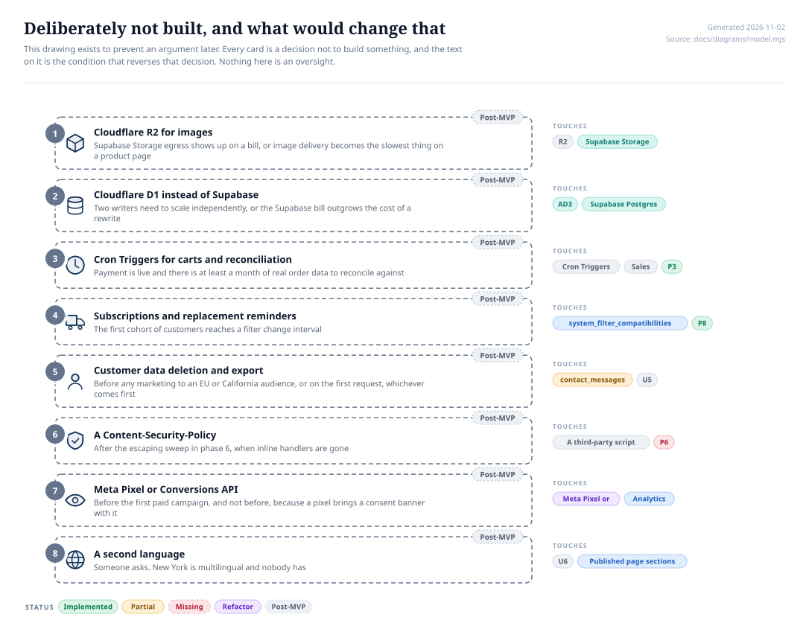

_**Deliberately not built, and what would change that.** Eight things that are not being built, each with the trigger that would start it. The chips name what each one touches._

---

## 16. Architecture decisions

Ten decisions, numbered, dated and never renumbered, grouped by what they decide rather than by when they were taken. Click a card for what it does, why it belongs here, what it costs and when it should be replaced. The last of those is the field people skip and the one that matters in a year.

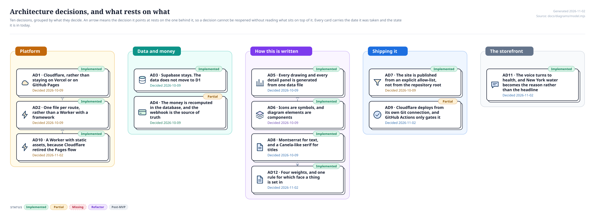

_**Architecture decisions, and what rests on what.** AD1 to AD10, never renumbered. AD10 replaced the platform half of AD1 without changing anything else, which is the test of whether a decision was recorded at the right size._

---

## 17. Questions and unknowns

Numbered, owned, and drawn beside what each one is holding up. An unknown with no owner is a decision nobody is making. Answered ones stay here, marked answered with the date, rather than being deleted; the trail is the value.

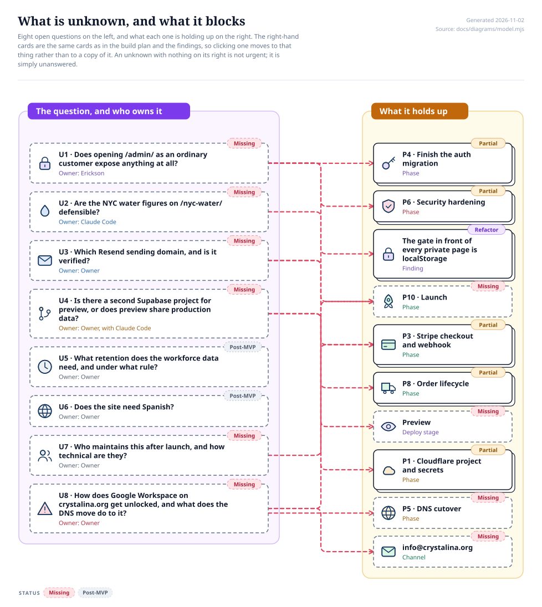

_**What is unknown, and what it blocks.** U8 is new on 2026-11-02 and is the most entangled: a suspended mailbox that also sits on the DNS move. U5 and U6 block nothing and are still worth answering._

---

## 18. The drawing system

Every drawing is assembled from one icon library and nine components, and coloured by a palette where the colour carries meaning rather than decoration. Learn the seven families once and no drawing needs a legend.

| Family | Stands for |
| --- | --- |
| Blue | The visitor, and anything a customer touches |
| Amber | The edge: hosting, DNS, caching, the things in front |
| Violet | Identity, secrets, anything that proves who someone is |
| Teal | Data at rest |
| Green | Money, and the things that must be exactly right |
| Rose | Danger, failure paths, and anything untrusted |
| Slate | Neutral, and anything deliberately postponed |

A status word is a family too, so Partial is the same amber on a card, in a table and in a progress report. The word is printed on every chip as well as the colour, and anything that does not exist yet also carries a dashed outline, so a monochrome printout and a colour-blind reader both lose nothing. An arrow takes the colour of what it points at, which means a path through a drawing can be followed by colour alone.

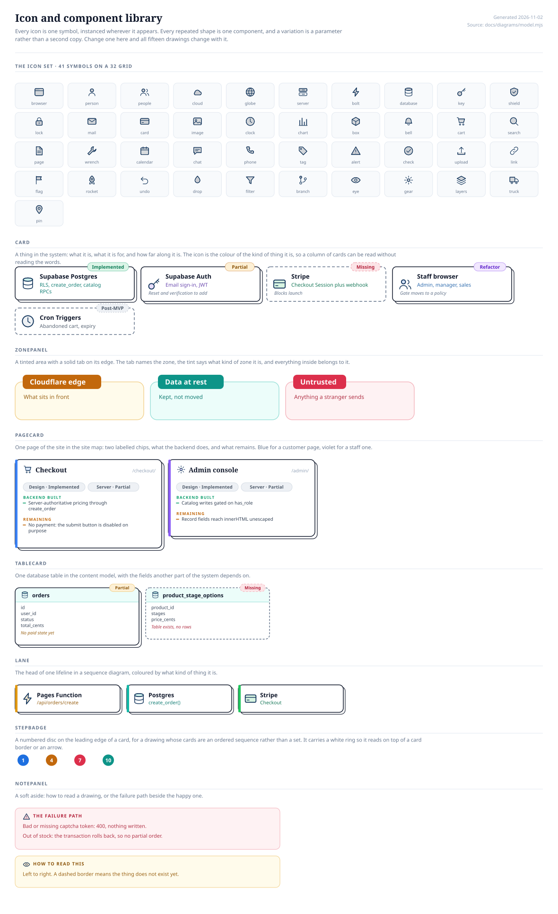

_**Icon and component library.** The vocabulary the other fourteen drawings are assembled from: every symbol, and every component in each state it is used in._

---

## 19. Everything, one card at a time

Every card in every drawing, as a panel. This is where the detail lives, and it is the same content the drawings open: clicking a card above and finding its entry here reach the same place. With scripting switched off this section is the document, and every dependency is an ordinary link.

### Findings

#### Nothing takes payment · Missing

_Finding · Zero Stripe integration anywhere._

There is no payment provider in the project. A repository-wide search finds the two secret names in .env.example, one unused stripe_payment_intent_id column and a handful of mentions in prose. There is no API route, no webhook and no client library. The checkout submit button is a static disabled attribute reading "Checkout unavailable", and the handler behind it calls a stub that returns null.

Missing, and deliberately unreachable. The shop cannot open until this exists, which makes it the single largest remaining piece of work and the reason the launch phase sits where it does.

- **Closed by.** P3 · Stripe checkout and webhook
- **See also.** Taking the money (Stripe, phase 3); Payment taken twice on a webhook redelivery; AD4 · The money is recomputed in the database, and the webhook is the source of truth; Customer browser; Stripe; Stripe; Checkout; orders; Placing an order, as it works today; A visitor pays less than the price
- **Severity.** High

#### The catalogue is schema-complete and data-empty · Partial

_Finding · Thirteen of seventeen rows carry stock 0._

The seed migration publishes seventeen products: four systems at stock 1, and nine replacement filters plus four filter bundles at stock 0. product_stage_options is created and never filled, so the five, six and seven stage choice never renders. No product has product_kind faucet, so the faucet upgrade control has nothing to offer and never appears.

Partial. Every shape exists in the database and most of the shelf reads as sold out. Two of the three controls on a product page are built, wired and invisible for want of rows.

- **Closed by.** P7 · Seed the catalogue
- **See also.** products; product_stage_options; Most of the shelf reads as sold out; Shop; Product; Product catalogue
- **Severity.** High

#### One dashboard interpolated record text unescaped · Implemented

_Finding · js/admin.js, swept 2026-11-03, pinned by a test._

escapeHTML is defined once in js/main.js and used 37 times in js/admin.js, and about thirty other interpolations in the same file put record text straight into innerHTML: product names, order statuses, job addresses, campaign names, role names. Checked 2026-11-02: js/manager.js, js/sales.js, js/technician.js, js/technician-route.js, js/admin-schedule.js and js/staff-schedule.js all escape their record text, so the earlier claim that all four dashboards were unescaped was wrong.

Partial, and narrower than it was described as. One file is the whole finding. Row level security still decides who can read a row; this decides what happens to a row once it is on a staff screen.

- **Closed by.** P6 · Security hardening
- **See also.** Unescaped record text in js/admin.js; Staff text reaching another staff member as script; Admin console; Staff changing what a visitor sees; Shared UI, icons, escaping
- **Severity.** High

#### The gate in front of every private page is localStorage · Refactor

_Finding · Store.currentUser(), not a session._

The five staff pages and /account/ decide what to show by reading Store.currentUser() out of localStorage and checking a roles array on it. js/auth.js, which holds the real Supabase session, is loaded on the staff pages for sign-out, the role switcher and the staff directory only, and /account/ does not load it at all. Row level security still refuses the data, so the exposure is what the page draws before any query returns, not the rows themselves.

Refactor. The protection that matters is in the database and is in place. The gate in front of it is markup, and markup is a suggestion. Nobody has yet signed in as an ordinary customer and looked, which is U1.

- **Waiting on the answer to.** U1 · Does opening /admin/ as an ordinary customer expose anything at all?
- **Closed by.** P4 · Finish the auth migration
- **See also.** Every private page gated in the browser only; Signing in, and what a role is allowed to do; Staff browser; Supabase Auth; Sign in; Account; Admin console; Manager; Sales; Technician; user_roles; A customer opening a staff page
- **Severity.** High

#### The accounts that would bring people in are held and unconnected · Missing

_Finding · No feed, no analytics, no attribution._

The domain, Google Search Console, the Meta Business account and the WhatsApp number all exist and have history. There is no product feed for Google Merchant Center or the Meta catalogue, no analytics of any kind, and no pixel or Conversions API. Seventeen products with no feed is free traffic left on the table, and a pixel added after a campaign starts cannot report on the days before it.

Missing. None of it blocks launch and all of it is cheaper to decide now than to retrofit. A pixel also turns the cookie banner into a real question, which Cloudflare Web Analytics on its own does not.

- **See also.** Google Merchant Center; Meta Pixel or Conversions API; Analytics
- **Severity.** Medium

### Pages

#### Home · Partial

_Page · /._

The front page. The hero, the section copy and the best-seller row are published from site_content, so a manager can change them without a developer. Five blocks of repeatable items are not.

Partial. What a manager can edit is the part that was finished; what is still in the markup is the part that looks editable and is not. See U7.

- **Reached from.** Admin console (publish to website)
- **Links to.** Shop (browse); NYC water (learn); Find your filter (not sure)
- **See also.** Published page sections; U7 · Who maintains this after launch, and how technical are they?; Staff changing what a visitor sees; Privacy policy; Terms of service; Shipping and returns; Not found; AD11 · The voice turns to health, and New York water becomes the reason rather than the headline; AD12 · Four weights, and one rule for which face a thing is set in
- **Design.** Implemented
- **Server.** Partial
- **Backend built.** Hydrates hero, sections and best sellers from site_content Products read with the publishable key
- **Remaining.** Trust list, testimonials, water facts and process steps are still in the HTML; the category tiles read CATEGORIES in main.js

#### Shop · Implemented

_Page · /shop/._

The shelf. Filtering, search and sort all run against the live catalogue rather than a copy.

Implemented on the server side, and reading as mostly sold out because of the data behind it. See F2.

- **Reached from.** Home (browse); NYC water (shop); Admin console (price, stock, copy)
- **Links to.** Product (open)
- **See also.** The catalogue is schema-complete and data-empty; products; P7 · Seed the catalogue; Customer browser; Manuals and guides; Not found; AD11 · The voice turns to health, and New York water becomes the reason rather than the headline
- **Design.** Implemented
- **Server.** Implemented
- **Backend built.** Catalog, filter, search and sort read from Supabase
- **Remaining.** Thirteen of seventeen rows carry stock 0, so most cards read out of stock

#### Product · Partial

_Page · /product/?id=._

One product, its specifications, which systems a filter fits, what a bundle contains, and two configuration controls: how many stages, and whether to add a faucet.

Partial. The page is in the frame of a fashion house with the system explained, and both configuration controls are built, priced server-side in create_order, and invisible, because neither has any rows behind it.

- **Reached from.** Shop (open); Find your filter (recommended)
- **Links to.** Checkout (add to cart); Sign in (sign in to buy)
- **See also.** The catalogue is schema-complete and data-empty; product_stage_options; P7 · Seed the catalogue; Manuals and guides
- **Design.** Implemented
- **Server.** Partial
- **Backend built.** Product, specs, compatibility and bundle relationships Related products, four across, headed "Also in <category>" Redesigned 2026-11-03: the photograph large and bare on the left, sticky while the buying column scrolls; Playfair on the name and price with one cyan rule, the only cyan on the page; the choices as hairline rows; one button; three facts; then the product explained in accordions built only from catalogue fields: what it removes (the home chart, same figures, one register line), what it fits, specifications, replacement filters with their interval, delivery and returns
- **Remaining.** product_stage_options is empty, so no 5, 6 or 7 stage choice renders No faucet rows exist, so the upgrade control has nothing to offer Low stock reads as a count, never a warning; a rating shows only with its review count, and no product has one yet

#### Checkout · Partial

_Page · /checkout/._

The last page before money. The browser sends ids, quantities, a stage option, a faucet choice and an address; the database decides every price.

Partial, and deliberately unreachable. Everything except taking the money works and is tested. The button reads "Checkout unavailable" so the gap cannot be reached by accident.

- **Reached from.** Product (add to cart); Sales (cart recovery (missing))
- **Links to.** Account (order placed)
- **See also.** Nothing takes payment; Placing an order, as it works today; Taking the money (Stripe, phase 3); P3 · Stripe checkout and webhook; Order receipt
- **Design.** Implemented
- **Server.** Partial
- **Backend built.** POST /api/orders/create, server-authoritative pricing through create_order Borough selector, 8.875% tax, stock enforced in one transaction In the frame since 2026-11-03: three hairline form sections (Delivery, Fitting, Payment) with the order on the silver panel at the right, sticky while the form scrolls; the delivery quote reads shipping_policy; the payment section says plainly that we do not take payment online yet and offers WhatsApp and the phone
- **Remaining.** No payment: the submit button carries a static disabled attribute No Turnstile widget, though the server expects a token

#### Find your filter · Implemented

_Page · /quiz/._

Five questions that end in a recommended system. Entirely client-side, by design: there is nothing here worth a round trip. When the closest fit is above the figure the person gave, the page says so.

Implemented, and finished.

- **Reached from.** Home (not sure)
- **Links to.** Product (recommended)
- **Design.** Implemented
- **Server.** Implemented
- **Backend built.** Five questions, recommendation computed in the browser In the frame since 2026-11-03: the quiet page head, a two-pixel navy progress line, options as hairline rows with a line icon, and the answer said as the product with its photograph and price, never graded
- **Remaining.** Nothing. No server work needed

#### NYC water · Missing

_Page · /nyc-water/._

What arrives at a New York tap, where it picks up what it carries, and what a system at home does about it. Every figure carries a source mark.

Missing on the server side because it needs none. The figures were first drafted as illustrative and presented as fact; since 2026-11-03 each one is checked against the source it cites, which answers U2.

- **Reached from.** Home (learn)
- **Links to.** Shop (shop)
- **See also.** U2 · Are the NYC water figures on /nyc-water/ defensible?; Unverified NYC water figures published as fact
- **Design.** Implemented
- **Server.** Missing
- **Backend built.** Rewritten 2026-11-03 in the frame and the voice: the journey as four editorial steps, five things a tap can carry on the navy band, the arithmetic shown in full with its assumption named in place of the unsourced bottled water chart, the questions as the shared accordion, and seven numbered sources at the foot (NYC DEP, NYS DOH, EPA) that every figure on the page points to
- **Remaining.** The microplastics card makes no numeric claim, by design, because none we found had a source we could stand behind

#### About · Missing

_Page · /about/._

The brand page, static on purpose. The emotional half of the site (Binet and Field): one feeling, care for what a household drinks, with the facts beneath it.

Missing on the server side because it needs none.

- **Design.** Implemented
- **Server.** Missing
- **Backend built.** Static brand story Rewritten 2026-11-03 in the voice: a tall washed photograph with the one sentence (clean water at home, from people who know New York water), the founding told in half the words, four things a customer can hold us to on the silver band, and the contact band
- **Remaining.** Nothing. No server work needed

#### Contact · Implemented

_Page · /contact/._

A form that writes contact_messages and emails the team. The first server route to work anywhere.

Implemented as of 2026-11-02: the route answers on the Worker, the method guard and validator both fire. What is not implemented is the captcha widget and a mailbox that receives.

- **See also.** A stranger sending something in; U8 · How does Google Workspace on crystalina.org get unlocked, and what does the DNS move do to it?; Turnstile
- **Design.** Implemented
- **Server.** Implemented
- **Backend built.** POST /api/contact validates, rate limits and writes contact_messages Answers 200 on the Worker, checked 2026-11-02 In the frame since 2026-11-03: the ways to reach us as a hairline definition list, the form in the same form section component the checkout uses, the questions beneath as the shared accordion
- **Remaining.** No Turnstile widget, and the page reads a token from one that does not exist The notification lands in a suspended inbox (U8)

#### Privacy policy · Missing

_Page · /privacy/._

The privacy policy, in plain language: what the shop collects, which services see it, and how to have it removed.

Drafted and styled, not published. The wording is under review and is partly a legal question, so the page exists in the repository and nowhere else until the owner says otherwise.

- **See also.** Home
- **Design.** Implemented
- **Server.** Missing
- **Backend built.** What is collected, who handles it, how to have it removed Set in the long-form text component shared by every legal page
- **Remaining.** Not in the publish allow-list and linked from the footer as # until the owner has approved the wording Nothing on the server. No server work needed

#### Terms of service · Missing

_Page · /terms/._

The terms of service: orders, pricing, warranty, returns and disputes.

Drafted and styled, not published. The wording is under review and is partly a legal question, so the page exists in the repository and nowhere else until the owner says otherwise.

- **See also.** Home
- **Design.** Implemented
- **Server.** Missing
- **Backend built.** Orders, pricing, warranty, returns and disputes in plain language Set in the long-form text component shared by every legal page
- **Remaining.** Not in the publish allow-list and linked from the footer as # until the owner has approved the wording Nothing on the server. No server work needed

#### Shipping and returns · Missing

_Page · /shipping-returns/._

Shipping and returns: where we deliver, how fast, the free shipping threshold and the return window.

Drafted and styled, not published. The wording is under review and is partly a legal question, so the page exists in the repository and nowhere else until the owner says otherwise.

- **See also.** Home
- **Design.** Implemented
- **Server.** Missing
- **Backend built.** Delivery areas, timing, the free shipping threshold and the return window Set in the long-form text component shared by every legal page
- **Remaining.** Not in the publish allow-list and linked from the footer as # until the owner has approved the wording Nothing on the server. No server work needed

#### Manuals and guides · Missing

_Page · /manuals/._

The manual for every system, found by product, model or category, read in the page or kept as a file.

Implemented as a page; empty as a library. The files are the owner's to add, one per product slug, and the page needs no change when they arrive.

- **See also.** Product; Shop
- **Design.** Implemented
- **Server.** Missing
- **Backend built.** Every product listed with its picture, model code and category, searchable by any of them A manual is read in a dialog or downloaded; one that is not on the server yet can be requested by email
- **Remaining.** No manual file exists yet. A manual belongs in the site-media bucket, named on the product row as manualUrl, which the page trusts; only the guessed /manuals/files/<slug>.pdf address is checked when the page loads Nothing on the server. No server work needed

#### Order receipt · Implemented

_Page · /order/?id=._

The receipt for one order: what was bought, what it cost, where it is going, and its status.

Implemented ahead of payment so the first real order has somewhere to be shown. It reads the rows create_order writes and computes nothing.

- **See also.** Account; Checkout; orders
- **Design.** Implemented
- **Server.** Implemented
- **Backend built.** Reads one order of the signed-in customer, with its items, totals and delivery address, under RLS Print or save, and every figure is the one the database wrote Since 2026-11-03, "Where it is": the order_events trail as the timeline component, the placing of the order first, a note where from and to agree
- **Remaining.** No order can be placed until payment exists, so the page has only its signed-out, missing and not-found states to show today Checkout should land here once an order is created

#### Not found · Implemented

_Page · /404.html._

What a visitor sees at a dead link: the fact of it, said plainly, and the way back.

Implemented. Until it existed the Worker returned an empty 404, and the alternative of serving the home page would have hidden every broken link.

- **See also.** Home; Shop
- **Design.** Implemented
- **Server.** Implemented
- **Backend built.** The Worker serves it with a 404 status for any address that does not exist Three ways on: the shop, the manuals, and asking
- **Remaining.** Nothing. No server work needed

#### Sign in · Implemented

_Page · /signin/._

The only page that holds a real session. Passwordless: an eight-digit code by email, or Google. There is no password in the project.

Implemented as of 2026-11-02, Google included. The unfinished part is the six other pages that still read localStorage rather than this session.

- **Reached from.** Product (sign in to buy)
- **Links to.** Account (customer)
- **See also.** Supabase Auth; The gate in front of every private page is localStorage; Signing in, and what a role is allowed to do
- **Design.** Implemented
- **Server.** Implemented
- **Backend built.** CrystalinaAuth on Supabase Auth: a code by email, or Continue with Google Real sessions and a JWT on every query Since 2026-11-03 a bare centred form with no card, the two modes as hairline tabs, the copy said plainly
- **Remaining.** Store.signUp and Store.signIn stubs are still exported from js/store.js and must be retired

#### Account · Refactor

_Page · /account/._

A customer's own orders. The rows come back under row level security, so the data is right even though the gate is not.

Refactor. It is the clearest example of F4: the page decides whether to render from localStorage, and signs out by deleting a local key rather than ending the Supabase session.

- **Reached from.** Checkout (order placed); Sign in (customer)
- **See also.** The gate in front of every private page is localStorage; P4 · Finish the auth migration; Order receipt
- **Design.** Implemented
- **Server.** Refactor
- **Backend built.** Order history read under row level security Since 2026-11-03: who you are on the left with text links, orders as hairline rows with the shared status pill and a link to the receipt and where it is; the status words come from ORDER_STATUS_LABELS
- **Remaining.** Gates on Store.currentUser() from localStorage and does not load js/auth.js at all

#### Admin console · Partial

_Page · /admin/._

Where the catalogue and the published page content are edited, and where images are uploaded. Every write goes through a security definer function that refuses a caller without the role.

Partial. The writes are correct and gated in the database. The page around them is the one file in the project with an open escaping gap, and it has no screen for the two empty tables that F2 is about.

- **Links to.** Home (publish to website); Shop (price, stock, copy)
- **See also.** One dashboard interpolated record text unescaped; The gate in front of every private page is localStorage; Staff changing what a visitor sees; P7 · Seed the catalogue; Staff browser; Staff text reaching another staff member as script
- **Design.** Implemented
- **Server.** Partial
- **Backend built.** Catalog writes through upsert_product and delete_product, gated on has_role Content editor publishes site_content Image upload to the site-media bucket
- **Remaining.** About thirty record-text interpolations reach innerHTML unescaped (F3) Gated on localStorage, not on the session (F4, U1) No screen for stage options or faucet assignment

#### Manager · Partial

_Page · /manager/._

Inventory, support tickets, technician schedules and job assignment.

Partial. The escaping claim against this file was wrong and has been corrected: it escapes its record text. The gate is the remaining problem.

- **Links to.** Technician (assign job)
- **See also.** The gate in front of every private page is localStorage; staff_shifts
- **Design.** Implemented
- **Server.** Partial
- **Backend built.** Inventory, support, technician schedules and job assignment Record text is escaped, checked 2026-11-02
- **Remaining.** Same localStorage gate as every other private page (F4)

#### Sales · Partial

_Page · /sales/._

Leads, sales, customers and campaigns.

Partial. The screen for cart recovery exists and nothing sends anything, because scheduled work is postponed until payment is live.

- **Links to.** Checkout (cart recovery (missing))
- **See also.** Cron Triggers; The gate in front of every private page is localStorage; Cron Triggers for carts and reconciliation
- **Design.** Implemented
- **Server.** Partial
- **Backend built.** Leads, sales, customers and campaign screens Record text is escaped, checked 2026-11-02
- **Remaining.** Cart recovery sends nothing: no scheduled job exists Same localStorage gate (F4)

#### Technician · Partial

_Page · /technician/._

What a technician sees in the field: assigned jobs, a checklist per job, a status to set and photos to upload.

Partial. The photos land in the bucket and nothing joins them to the order they belong to, so they cannot be found again from an order.

- **Reached from.** Manager (assign job)
- **See also.** The gate in front of every private page is localStorage; Supabase Storage
- **Design.** Implemented
- **Server.** Partial
- **Backend built.** Assigned jobs, checklists, statuses, installation photos Record text is escaped, checked 2026-11-02
- **Remaining.** Photos upload but are not tied to an order record Same localStorage gate (F4)

### Architecture today

#### Customer browser · Implemented

_Architecture today · Pages, cart in localStorage._

An ordinary visitor on a phone or a laptop. The cart lives in localStorage, products are read straight from Supabase with the publishable key, and nothing about a price is decided here.

Implemented. Every storefront page renders and hydrates. What a visitor cannot do is pay.

- **Talks to.** GitHub Pages (crystalina.org); Cloudflare Worker (workers.dev only)
- **See also.** Nothing takes payment; Shop; Customer browser
- **Zone.** Who is asking

#### Staff browser · Refactor

_Architecture today · Admin, manager, sales, technician._

One of five private pages opened by a member of staff. Which page a person may open is decided by a roles array read out of localStorage, not by a session.

Refactor. The data is protected by row level security; the gate in front of it is markup. See F4 and U1.

- **Talks to.** GitHub Pages (dashboards)
- **See also.** The gate in front of every private page is localStorage; U1 · Does opening /admin/ as an ordinary customer expose anything at all?; Admin console; Staff browser
- **Zone.** Who is asking

#### Cloudflare Worker · Implemented

_Architecture today · crystalina.crystalina.workers.dev._

worker.js routes the three /api paths to their handlers and hands everything else to the ASSETS binding, which serves dist. Six tests pin the route table down.

Implemented, and verified on 2026-11-02: method guards answer 405, validators answer 400, an unknown /api path answers 404 rather than a static file. This is the first time the server boundary has run anywhere.

- **Talked to by.** Customer browser (workers.dev only)
- **Talks to.** Supabase Postgres (service role writes); Resend (send); Turnstile (verify)
- **See also.** AD10 · A Worker with static assets, because Cloudflare retired the Pages flow; GitHub Pages; P5 · DNS cutover; Static assets; Worker routes; A request arrives; Production; P2 · Run /api on Cloudflare; Worker size and CPU limits on the free plan; The repository is published with the site; AD1 · Cloudflare, rather than staying on Vercel or on GitHub Pages
- **Zone.** Serving today

#### GitHub Pages · Refactor

_Architecture today · crystalina.org, static files only._

The live domain, still served by GitHub Pages out of the repository root. A static host has no server, so the three API routes do not exist at this address at all.

Refactor. It is what a visitor reaches today, and it is the half that cannot run code. It is retired by the DNS cutover, not before.

- **Talked to by.** Customer browser (crystalina.org); Staff browser (dashboards); Squarespace DNS (A records)
- **Talks to.** Supabase Postgres (publishable key, RLS reads); Supabase Auth (sign in); Supabase Storage (images)
- **See also.** P5 · DNS cutover; The domain still points at the half that cannot run code; Cloudflare Worker
- **Zone.** Serving today

#### Squarespace DNS · Refactor

_Architecture today · Four GitHub Pages A records._

The crystalina.org zone, hosted at the registrar, with four A records pointing at GitHub Pages. The same reseller account holds the Google Workspace subscription.

Refactor. The zone has to be on Cloudflare before Access, WAF rate limiting or Web Analytics can apply to the site. Nothing has moved yet.

- **Talks to.** GitHub Pages (A records)
- **See also.** P5 · DNS cutover; U8 · How does Google Workspace on crystalina.org get unlocked, and what does the DNS move do to it?; Cloudflare DNS; crystalina.org
- **Zone.** Serving today

#### Supabase Postgres · Implemented

_Architecture today · 23 tables, RLS on, 12 migrations._

One Postgres database holding the catalogue, orders, inbound forms, published page content and ten workforce tables, with row level security on every one of them and nine security definer functions in front of the privileged writes.

Implemented, and the most finished thing in the project. Last checked against the live project on 2026-08-31, which makes it the oldest row in the verified table.

- **Talked to by.** GitHub Pages (publishable key, RLS reads); Cloudflare Worker (service role writes)
- **See also.** AD3 · Supabase stays. The data does not move to D1; products; orders; Supabase Postgres; Cloudflare D1 instead of Supabase
- **Zone.** Data and identity

#### Supabase Auth · Implemented

_Architecture today · Email code or Google, JWT, user_roles._

Passwordless sign-in. A visitor either receives a code by email or continues with Google; both return a real Supabase session and a JWT that every query carries. There is no password anywhere in the project, and no password column.

Implemented as of 2026-11-02: the Google provider is enabled and the button works. What is unfinished is not the sign-in, it is the six pages that still read localStorage instead of the session.

- **Talked to by.** GitHub Pages (sign in)
- **See also.** The gate in front of every private page is localStorage; Signing in, and what a role is allowed to do; Sign in; Supabase Auth
- **Zone.** Data and identity

#### Supabase Storage · Implemented

_Architecture today · site-media bucket, public reads._

One bucket holding the images staff upload from the admin console. Reads are public by URL; writes require a staff session.

Implemented. Moving the originals to R2 is deliberately postponed until Storage egress shows up on a bill.

- **Talked to by.** GitHub Pages (images)
- **See also.** R2; Staff changing what a visitor sees; Supabase Storage; Technician; Cloudflare R2 for images
- **Zone.** Data and identity

#### Resend · Partial

_Architecture today · Transactional email._

The sender for contact notifications and, later, order confirmations. The code is written and never blocks: if the key is unset or the send fails, the row is already written and the submission is not lost.

Partial. The sending domain has not been verified and info@crystalina.org is not currently receiving mail, so the half of this that matters is unproven. See U3 and U8.

- **Talked to by.** Cloudflare Worker (send)
- **See also.** U3 · Which Resend sending domain, and is it verified?; U8 · How does Google Workspace on crystalina.org get unlocked, and what does the DNS move do to it?; A stranger sending something in; Resend; Send the email, and never gate on it; info@crystalina.org
- **Zone.** Third parties

#### Turnstile · Partial

_Architecture today · Server verification only._

Cloudflare's captcha. The server half is written: with a secret set, a request without a valid token is refused. With no secret set, verification is skipped so the endpoints stay usable.

Partial, and the wrong half is done. No page renders a widget, and contact/index.html reads a token from a widget that does not exist. Setting the secret today would therefore break the contact form rather than protect it.

- **Talked to by.** Cloudflare Worker (verify)
- **See also.** Form spam and abuse; P6 · Security hardening; A stranger sending something in; Turnstile; Verify the Turnstile token; Contact
- **Zone.** Third parties

#### Stripe · Missing

_Architecture today · Payment._

The payment provider, chosen and not built. Nothing of it exists in the codebase.

Missing. It is the one piece between a working order path and an open shop.

- **See also.** Nothing takes payment; P3 · Stripe checkout and webhook; Taking the money (Stripe, phase 3)
- **Zone.** Third parties

### Request path

#### A request arrives · Implemented

_Request path · crystalina.crystalina.workers.dev._

One fetch, with a URL, a method and headers. Today it arrives at the workers.dev address, because the domain still points at GitHub Pages.

Implemented

- **Then.** Is the path under /api/?
- **See also.** Cloudflare Worker; P5 · DNS cutover

#### Is the path under /api/? · Implemented

_Request path · pathname.startsWith("/api/")._

The only branch in the Worker. Yes goes to the route table; no goes to the assets binding. There is no third case.

Implemented

- **After.** A request arrives
- **Then.** Served out of dist
- **See also.** AD10 · A Worker with static assets, because Cloudflare retired the Pages flow

#### Served out of dist · Implemented

_Request path · ASSETS.fetch(request)._

The assets binding answers from dist, with auto-trailing-slash handling so /shop and /shop/ both find the folder. dist is built from an explicit allow-list, so the repository is not published with the site.

Implemented

- **After.** Is the path under /api/?
- **Then.** Exact match in the route table
- **See also.** AD7 · The site is published from an explicit allow-list, not from the repository root; Static assets

#### Exact match in the route table · Implemented

_Request path · three entries, trailing slash trimmed._

A Map of three exact paths. A prefix of a real route does not match it, and an unknown /api path returns a JSON 404 instead of falling through to a file.

Implemented

- **After.** Served out of dist
- **Then.** The shim adapts the handler
- **See also.** Worker routes

#### The shim adapts the handler · Implemented

_Request path · functions/_shim.js._

The handlers in api/ are written in the Node request and response style. One adapter turns { request, env } into that shape and the handler's reply back into a Response, which is why a Pages Function and a Worker can run the same file. Nine tests cover it.

Implemented

- **After.** Exact match in the route table
- **Then.** Method, rate limit, body cap
- **See also.** AD2 · One file per route, rather than a Worker with a framework; AD10 · A Worker with static assets, because Cloudflare retired the Pages flow

#### Method, rate limit, body cap · Partial

_Request path · 405, 429, 400._

The method guard answers 405 before the body is read. The in-process rate limit allows five to ten requests per ten minutes per IP. The body is capped before it is parsed.

Partial: the rate limit does not survive the instance that holds it, which is R3.

- **After.** The shim adapts the handler
- **Then.** Clean and validate every field
- **See also.** Rate limit does not survive the instance; WAF rate limiting

#### Clean and validate every field · Implemented

_Request path · 400 with a readable message._

Every field is trimmed and capped to a length, the email is checked, the topic has to be one of seven. Verified on 2026-11-02: an empty body returns "Please include your name and a message."

Implemented

- **After.** Method, rate limit, body cap
- **Then.** Verify the Turnstile token
- **See also.** A stranger sending something in

#### Verify the Turnstile token · Partial

_Request path · skipped while the secret is unset._

With a secret set, a missing or bad token is a 400. With no secret set, verification is skipped so the endpoints stay usable.

Partial, and in the worse-than-absent state: no page renders a widget, so setting the secret would refuse every real submission.

- **After.** Clean and validate every field
- **Then.** Write with the service role
- **See also.** Turnstile; Form spam and abuse

#### Write with the service role · Implemented

_Request path · or call create_order as the user._

An inbound form inserts with the service role. An order calls create_order as the signed-in user, which reprices every line, checks stock and decrements it in one transaction. The browser never sends money.

Implemented

- **After.** Verify the Turnstile token
- **Then.** Send the email, and never gate on it
- **See also.** AD4 · The money is recomputed in the database, and the webhook is the source of truth; orders

#### Send the email, and never gate on it · Partial

_Request path · Resend._

The row is written first. If the send fails or the key is unset, the failure is logged and the caller still gets a 200, because a lost enquiry is worse than a missing notification.

Partial: the sending domain is unverified and the inbox is not receiving mail. See U3 and U8.

- **After.** Write with the service role
- **See also.** Resend; U8 · How does Google Workspace on crystalina.org get unlocked, and what does the DNS move do to it?

### After the cutover

#### Customer browser · Implemented

_Architecture after the cutover · Pages, cart in localStorage._

The same visitor, arriving at crystalina.org instead of a workers.dev address.

Implemented. Nothing about the browser changes in the cutover.

- **Talks to.** Cloudflare DNS (crystalina.org)
- **See also.** Customer browser
- **Zone.** Who is asking

#### Staff browser · Refactor

_Architecture after the cutover · Admin, manager, sales, technician._

The same five private pages, with the gate moved from a roles array in localStorage to the session the database already trusts.

Refactor, and the work is phase 4 and phase 6 rather than the cutover.

- **Talks to.** Cloudflare DNS (dashboards)
- **See also.** Staff browser; P4 · Finish the auth migration
- **Zone.** Who is asking

#### Cloudflare DNS · Missing

_Architecture after the cutover · crystalina.org zone, proxied._

The zone moved from the registrar to Cloudflare, so that everything below it can apply to the real domain rather than to a workers.dev address.

Missing. It is a nameserver change the owner makes, and it is the single step that turns the live Worker into the live site. It also has to not break Google Workspace, which is U8.

- **Talked to by.** Customer browser (crystalina.org); Staff browser (dashboards)
- **Talks to.** Static assets (proxied)
- **See also.** Squarespace DNS; P5 · DNS cutover; U8 · How does Google Workspace on crystalina.org get unlocked, and what does the DNS move do to it?; Move the nameservers to Cloudflare
- **Zone.** Cloudflare (one account)

#### Static assets · Implemented

_Architecture after the cutover · dist, served by the ASSETS binding._

Every page, stylesheet, script and image, copied into dist by an explicit allow-list and served by the Worker's assets binding.

Implemented and live on the workers.dev address. What is missing is the domain in front of it.

- **Talked to by.** Cloudflare DNS (proxied); Access (preview only)
- **Talks to.** Worker routes (/api/*); Supabase Postgres (publishable key, RLS reads); Supabase Auth (sign in); Supabase Storage (images)
- **See also.** AD7 · The site is published from an explicit allow-list, not from the repository root; AD10 · A Worker with static assets, because Cloudflare retired the Pages flow; Cloudflare Worker; Served out of dist
- **Zone.** Cloudflare (one account)

#### Worker routes · Implemented

_Architecture after the cutover · worker.js routes /api/*._

A route table of three: /api/contact, /api/newsletter and /api/orders/create. Exact paths only, so a prefix cannot be captured by accident, and an unknown /api path is a 404 rather than a static file.

Implemented and verified on 2026-11-02. Payment adds two more lines to the same table.

- **Talked to by.** Static assets (/api/*); WAF rate limiting (rate limit); Turnstile (token check)
- **Talks to.** Supabase Postgres (service role, RPCs); Stripe (session, webhook); Resend (send)
- **See also.** AD10 · A Worker with static assets, because Cloudflare retired the Pages flow; P3 · Stripe checkout and webhook; Cloudflare Worker; Exact match in the route table; P2 · Run /api on Cloudflare
- **Zone.** Cloudflare (one account)

#### Turnstile · Partial

_Architecture after the cutover · Widget plus server verification._

The captcha, with the widget finally rendered on the contact, newsletter and checkout forms so that there is a token for the server half to check.

Partial. The server side is done and the widget is not, which is the wrong way round: the secret cannot be set until the widget exists.

- **Talks to.** Worker routes (token check)
- **See also.** Turnstile; P6 · Security hardening; Form spam and abuse
- **Zone.** Cloudflare (one account)

#### Access · Missing

_Architecture after the cutover · Preview and staging gate._

A sign-in wall in front of any non-production address, so a half-finished copy cannot be indexed or found.

Missing. Free, quick, and worth having before the first preview is shared with anyone.

- **Talks to.** Static assets (preview only)
- **See also.** P1 · Cloudflare project and secrets; Preview; Put Access in front of every preview
- **Zone.** Cloudflare (one account)

#### WAF rate limiting · Missing

_Architecture after the cutover · Durable limit on /api/*._

A rate limit applied at the edge, where the count survives, replacing the in-process Map that each Worker instance holds on its own.

Missing, and an hour of work. It cannot be fixed in application code: a counter inside an instance does not outlive the instance.

- **Talks to.** Worker routes (rate limit)
- **See also.** Rate limit does not survive the instance; P6 · Security hardening; Form spam and abuse; Method, rate limit, body cap
- **Zone.** Cloudflare (one account)

#### Web Analytics · Missing

_Architecture after the cutover · No cookie, no consent banner._

Who arrives and from where, measured at the edge with no cookie and therefore no consent banner.

Missing. It needs the zone on Cloudflare first, so it follows the cutover.

- **See also.** Analytics; P5 · DNS cutover
- **Zone.** Cloudflare (one account)

#### Cron Triggers · Post-MVP

_Architecture after the cutover · Abandoned cart, expiry, reconciliation._

Scheduled work: chasing an abandoned cart, expiring a stale reservation, reconciling a day of payments against orders.

Post-MVP by decision. There is nothing to reconcile until payment is live and a month of real orders exists.

- **Talks to.** Supabase Postgres (scheduled work)
- **See also.** Cron Triggers for carts and reconciliation; Sales
- **Zone.** Cloudflare (one account)

#### R2 · Post-MVP

_Architecture after the cutover · Image originals._

Object storage for image originals, in front of or instead of the Supabase bucket.

Post-MVP by decision. Only worth it when Storage egress shows up on a bill or image delivery becomes the slowest thing on a product page.

- **See also.** Supabase Storage; Cloudflare R2 for images
- **Zone.** Cloudflare (one account)

#### Supabase Postgres · Implemented

_Architecture after the cutover · RLS, create_order, catalog RPCs._

Unchanged by the move. The serving layer is what is moving.

Implemented. See AD3 for why it is not moving to D1.

- **Talked to by.** Static assets (publishable key, RLS reads); Worker routes (service role, RPCs); Cron Triggers (scheduled work)
- **See also.** AD3 · Supabase stays. The data does not move to D1; Supabase Postgres
- **Zone.** Data and identity (kept)

#### Supabase Auth · Implemented

_Architecture after the cutover · Email code or Google, JWT, user_roles._

Unchanged, except that the redirect allow-list has to learn the new domain on the day the DNS moves.

Implemented. The redirect list is a line on the cutover checklist, and forgetting it breaks sign-in on the new domain only.

- **Talked to by.** Static assets (sign in)
- **See also.** Supabase Auth; P5 · DNS cutover
- **Zone.** Data and identity (kept)

#### Supabase Storage · Implemented

_Architecture after the cutover · site-media bucket._

Unchanged.

Implemented.

- **Talked to by.** Static assets (images)
- **See also.** Supabase Storage
- **Zone.** Data and identity (kept)

#### Stripe · Missing

_Architecture after the cutover · Checkout Session plus webhook._

Two more routes on the same table: one that creates a Checkout Session from server-repriced lines, and one that receives the webhook and is the only thing allowed to mark an order paid.

Missing, and it blocks launch. See AD4 for the shape it has to take.

- **Talked to by.** Worker routes (session, webhook)
- **See also.** Nothing takes payment; P3 · Stripe checkout and webhook; Taking the money (Stripe, phase 3)
- **Zone.** Third parties

#### Resend · Partial

_Architecture after the cutover · Transactional email._

Unchanged, and needing a verified sending domain before any of it is believable.

Partial. See U3 and U8.

- **Talked to by.** Worker routes (send)
- **See also.** Resend; U3 · Which Resend sending domain, and is it verified?
- **Zone.** Third parties

#### Error monitoring · Missing

_Architecture after the cutover · Functions and browser._

Somewhere for an exception to go other than a console nobody is reading.

Missing. It belongs with backups in phase 9, before launch rather than after the first incident.

- **See also.** P9 · Backups and monitoring; No backup has ever been restored
- **Zone.** Third parties

### Channels

#### crystalina.org · Partial

_Channel · Owned. DNS at Squarespace today._

The domain, with its zone at the registrar and four A records pointing at GitHub Pages.

Partial. It resolves and serves the old copy. The zone moves to Cloudflare in phase 5; the registrar can stay where it is.

- **See also.** Squarespace DNS; P5 · DNS cutover; U8 · How does Google Workspace on crystalina.org get unlocked, and what does the DNS move do to it?
- **Group.** Domain and search

#### Google Search Console · Implemented

_Channel · Verified by a file at the site root._

The property is verified by googlea4ca9585bd44aaf9.html, 53 bytes, served from the root. It is named in the publish allow-list and present in dist, checked 2026-11-02.

Implemented. Keep that file served at the root or verification lapses silently on the new host. Once the zone is on Cloudflare, adding the DNS TXT method as a second, host-independent proof costs nothing.

- **See also.** AD7 · The site is published from an explicit allow-list, not from the repository root; sitemap.xml and robots.txt
- **Group.** Domain and search

#### sitemap.xml and robots.txt · Partial

_Channel · Seven URLs, no dates._

Seven URLs with changefreq and priority and no lastmod on any of them. /product/, /checkout/ and /account/ are absent, so seven of sixteen published directories are listed. robots.txt allows everything and names the sitemap; there is no Disallow, so the staff pages are crawlable as far as it is concerned.

Partial. Worth fixing in the same change as the cutover, when the URLs change anyway.

- **See also.** Google Search Console; P5 · DNS cutover
- **Group.** Domain and search

#### Google Merchant Center · Missing

_Channel · Product feed for free listings._

The feed that puts products into Google Shopping's free listings. One feed would serve the Meta catalogue as well.

Missing. Seventeen products with no feed is free traffic left on the table.

- **See also.** The accounts that would bring people in are held and unconnected; Meta product catalog
- **Group.** Domain and search

#### Analytics · Missing

_Channel · Who arrives, and from where._

Nothing measures traffic today. Cloudflare Web Analytics is the choice: no cookie, so no consent banner.

Missing. It needs the zone on Cloudflare, so it follows the cutover.

- **See also.** The accounts that would bring people in are held and unconnected; Web Analytics; P10 · Launch; Meta Pixel or Conversions API
- **Group.** Domain and search

#### Meta Business Account · Partial

_Channel · Holds the Facebook page and Instagram._

The account that owns the Facebook page and the Instagram account, and would own a catalogue and a pixel.

Partial. The account exists; nothing on the site talks to it.

- **See also.** Meta Pixel or Conversions API; Meta product catalog
- **Group.** Meta and messaging

#### Four social profiles · Implemented

_Channel · Instagram, X, Facebook, LinkedIn._

Instagram and X at @crystalinawater, a Facebook page, and a LinkedIn company page. The footer renders five icons, the fifth being WhatsApp; the schema.org sameAs list on the home page names the four profiles only.

Implemented. The footer is built by renderFooter in js/main.js from one SOCIALS array, so the five icons are one definition. The sameAs list in index.html is the second copy.

- **See also.** Navigation and social links; WhatsApp (917) 809-4803
- **Group.** Meta and messaging

#### Meta Pixel or Conversions API · Missing

_Channel · Attribution for anything paid._

The measurement that tells you whether an ad worked.

Missing. Decide before spending on ads, not after: a pixel cannot report on the days before it existed, and it also makes the cookie banner a real question.

- **See also.** The accounts that would bring people in are held and unconnected; Meta Pixel or Conversions API; Meta Business Account
- **Group.** Meta and messaging

#### Meta product catalog · Missing

_Channel · Shopping tags on Instagram and Facebook._

The catalogue behind a shopping tag on a post.

Missing. The same feed as Merchant Center would serve both.

- **See also.** Google Merchant Center; Meta Business Account
- **Group.** Meta and messaging

#### WhatsApp (917) 809-4803 · Implemented

_Channel · wa.me/19178094803._

A plain wa.me link, in the footer, in the hero and as a floating button on every storefront page.

Implemented, and unaffected by hosting: it is a link to a third party, so the cutover cannot break it.

- **See also.** WhatsApp Business; Phone (917) 809-4803; Four social profiles
- **Group.** How a customer reaches a human

#### WhatsApp Business · Missing

_Channel · Catalog, away messages, several agents._

The business app, which adds a catalogue, away messages and more than one agent on the same number.

Missing. A wa.me link is not the Business app. Worth it the week after launch.

- **See also.** WhatsApp (917) 809-4803
- **Group.** How a customer reaches a human

#### info@crystalina.org · Missing

_Channel · Where the contact form lands._

The inbox the contact form notifies. Google Workspace on the domain is suspended behind a reseller lock, so mail to this address is not being received.

Missing as of 2026-11-02, and it was Partial before. The form still writes its row, so no enquiry is lost, but nobody is told one arrived. See U8.

- **Waiting on the answer to.** U8 · How does Google Workspace on crystalina.org get unlocked, and what does the DNS move do to it?
- **See also.** U3 · Which Resend sending domain, and is it verified?; Resend; Unlock Google Workspace on the domain
- **Group.** How a customer reaches a human

#### Phone (917) 809-4803 · Implemented

_Channel · Same number as WhatsApp._

The same number, in the footer and on the contact page.

Implemented, and the only channel that is currently reaching a human reliably.

- **See also.** WhatsApp (917) 809-4803
- **Group.** How a customer reaches a human

### Tables

#### profiles · Implemented

_Table · id -> auth.users, full_name, phone._

One row per signed-in person, created by a trigger on sign-up. Holds the name and phone an order needs.

Implemented.

- **Relates to.** orders (one to many); user_roles (one to many); shift_assignments (one to many)
- **Group.** Identity
- **Fields.** id -> auth.users, full_name, phone

#### user_roles · Implemented

_Table · user_id, role._

Which roles a person has. private.has_role() reads it, and about thirty row level security policies and every privileged function call it.

Implemented, and the hinge the whole privilege model turns on.

- **Related from.** profiles (one to many)
- **See also.** The gate in front of every private page is localStorage; Signing in, and what a role is allowed to do
- **Group.** Identity
- **Fields.** user_id, role

#### products · Partial

_Table · id, slug, sku, price_cents, stock_quantity, product_kind, details, published._

Seventeen published rows: four systems, nine replacement filters and four filter bundles. product_kind also allows faucet, and no faucet row exists. js/product-catalog.js mirrors the same seventeen for the tests, in dollars where the database holds cents.

Partial. The schema is finished; the shelf reads as mostly sold out. See F2.

- **Relates to.** order_items (one to many); product_stage_options (one to many); product_bundle_items (bundle of products); system_filter_compatibilities (fits which systems); reviews (one to many)
- **See also.** The catalogue is schema-complete and data-empty; Product catalogue; P7 · Seed the catalogue; Supabase Postgres; Shop; Most of the shelf reads as sold out
- **Group.** Catalog
- **Fields.** id, slug, sku, price_cents, stock_quantity, product_kind, details, published

#### product_stage_options · Missing

_Table · product_id, stages, price_cents, is_default._

The five, six or seven stage choice on a system, and what each costs. create_order prices from this table, never from the browser.

Missing. The table, the RPCs and the control on the product page all exist; there are no rows, so the control never renders.

- **Related from.** products (one to many)
- **See also.** The catalogue is schema-complete and data-empty; Product; P7 · Seed the catalogue
- **Group.** Catalog
- **Fields.** product_id, stages, price_cents, is_default

#### product_bundle_items · Implemented

_Table · bundle_id, item_id, quantity._

What a filter bundle contains. One bundle per system, discounted against the sum of its parts, enforced by a test.

Implemented.

- **Related from.** products (bundle of products)
- **Group.** Catalog
- **Fields.** bundle_id, item_id, quantity

#### system_filter_bundles · Implemented

_Table · system_id, bundle_id._

Which bundle belongs to which system, so a product page can offer the right one.

Implemented.

- **Group.** Catalog
- **Fields.** system_id, bundle_id

#### system_filter_compatibilities · Implemented

_Table · system_id, filter_id, fit._

Which filter fits which system, and how confidently. The uncertain connector variants are marked as needing fit confirmation rather than asserted.

Implemented, and the reason filter replacement reminders are a data problem already solved rather than a feature to design.

- **Related from.** products (fits which systems)
- **See also.** Subscriptions and replacement reminders
- **Group.** Catalog
- **Fields.** system_id, filter_id, fit

#### reviews · Partial

_Table · product_id, user_id, rating, body._

Customer reviews of a product.

Partial. The table is read by the product page and nothing writes to it, because there is no submission screen.

- **Related from.** products (one to many)
- **Group.** Catalog
- **Fields.** product_id, user_id, rating, body

#### orders · Partial

_Table · id, user_id, status, subtotal_cents, tax_cents, total_cents, shipping_address._

One row per order, with every money column computed in the database. There is an unused stripe_payment_intent_id column waiting for the payment work.

Partial. Orders can be created and cannot be paid for, so no row ever reaches a paid state.

- **Related from.** profiles (one to many)
- **Relates to.** order_items (one to many)
- **See also.** Nothing takes payment; Placing an order, as it works today; Taking the money (Stripe, phase 3); Supabase Postgres; Write with the service role; Order receipt; P8 · Order lifecycle; A visitor reads another customer's orders; Free shipping threshold; Order lifecycle: the legal moves and their words
- **Group.** Commerce
- **Fields.** id, user_id, status, subtotal_cents, tax_cents, total_cents, shipping_address

#### order_items · Implemented

_Table · order_id, product_id, stage_option_id, faucet_id, quantity, unit_price_cents._

One row per line, carrying the configuration chosen and the unit price the database decided.

Implemented. create_order writes it, prices it and decrements stock in the same transaction.

- **Related from.** orders (one to many); products (one to many)
- **See also.** AD4 · The money is recomputed in the database, and the webhook is the source of truth
- **Group.** Commerce
- **Fields.** order_id, product_id, stage_option_id, faucet_id, quantity, unit_price_cents

#### contact_messages · Implemented

_Table · name, email, topic, message, source_ip_hash._

Enquiries from the contact form, with the sender IP stored as a truncated hash rather than an address.

Implemented, and receiving rows for the first time now that the Worker answers. Retention is unresolved.

- **See also.** A stranger sending something in; Customer data deletion and export
- **Group.** Inbound and content
- **Fields.** name, email, topic, message, source_ip_hash

#### newsletter_subscribers · Partial

_Table · email, created_at._

Addresses from the newsletter form.

Partial. Rows go in and there is no way out: no unsubscribe path is built.

- **See also.** A stranger sending something in; Customer data deletion and export
- **Group.** Inbound and content
- **Fields.** email, created_at

#### site_content · Implemented

_Table · key, payload jsonb, published_at._

The published page copy, one row per key. Editing in the admin console is local until someone presses Publish to website, which writes here.

Implemented. What is not here is the five blocks of repeatable home page items that are still in the markup.

- **See also.** Published page sections; Staff changing what a visitor sees
- **Group.** Inbound and content
- **Fields.** key, payload jsonb, published_at

#### staff_shifts · Implemented

_Table · id, starts_at, ends_at, role._

A published shift, which assignments hang off.

Implemented.

- **Relates to.** shift_assignments (one to many)
- **See also.** Manager
- **Group.** Workforce
- **Fields.** id, starts_at, ends_at, role

#### shift_assignments · Implemented

_Table · shift_id, user_id, state._

One person on one shift, pending until accepted or declined.

Implemented.

- **Related from.** profiles (one to many); staff_shifts (one to many)
- **Group.** Workforce
- **Fields.** shift_id, user_id, state

#### shift_change_requests · Implemented

_Table · assignment_id, kind, state._

A proposed change, which leaves the original assignment authoritative until it is approved.

Implemented.

- **Group.** Workforce
- **Fields.** assignment_id, kind, state

#### staff_availability · Implemented

_Table · user_id, weekday, window._

When a person can work.

Implemented.

- **Group.** Workforce
- **Fields.** user_id, weekday, window

#### staff_time_off_requests · Implemented

_Table · user_id, from, to, state._

Time off, starting pending.

Implemented.

- **Group.** Workforce
- **Fields.** user_id, from, to, state

#### time_entries · Implemented

_Table · user_id, clock_in, clock_out._

Clock in and out, summed across overnight shifts by the timesheet maths.

Implemented.

- **Group.** Workforce
- **Fields.** user_id, clock_in, clock_out

#### timesheet_periods · Implemented

_Table · starts_on, ends_on._

The pay period a submission belongs to.

Implemented.

- **Group.** Workforce
- **Fields.** starts_on, ends_on

#### timesheet_submissions · Implemented

_Table · period_id, user_id, state._

One person's hours for one period, submitted for approval.

Implemented.

- **Group.** Workforce
- **Fields.** period_id, user_id, state

#### staff_notifications · Implemented

_Table · user_id, kind, read_at._

In-app notices for staff.

Implemented.

- **Group.** Workforce
- **Fields.** user_id, kind, read_at

#### workforce_audit_log · Implemented

_Table · actor, action, payload._

Who changed which workforce record, written by a trigger.

Implemented, and holding payroll-adjacent data with no retention rule named. That is U5.

- **See also.** U5 · What retention does the workforce data need, and under what rule?
- **Group.** Workforce
- **Fields.** actor, action, payload

### Flows

#### Placing an order, as it works today · Partial

_Flow · 9 steps, 5 failure paths._

The whole order path except payment. The browser sends ids, quantities, a configuration and an address. The database prices every line, checks stock, decrements it and inserts the order in one transaction.

Partial. Every step works and is tested, and the one missing step is the one that takes money.

- **See also.** Checkout; Nothing takes payment; Taking the money (Stripe, phase 3); AD4 · The money is recomputed in the database, and the webhook is the source of truth; orders; A visitor pays less than the price
- **Participants.** Browser, Worker route, Turnstile, Postgres, Resend

#### Taking the money (Stripe, phase 3) · Missing

_Flow · 9 steps, 5 failure paths._

Two new routes on the Worker's route table. One reprices the cart and creates a Stripe Checkout Session; the other receives the webhook, verifies its signature, and is the only thing permitted to mark an order paid.

Missing. See AD4 for the shape and F1 for what it blocks.

- **See also.** Nothing takes payment; P3 · Stripe checkout and webhook; AD4 · The money is recomputed in the database, and the webhook is the source of truth; Payment taken twice on a webhook redelivery; Stripe; Stripe; Checkout; orders; Placing an order, as it works today; Stripe test key pasted into a chat transcript; Payment taken twice
- **Participants.** Browser, Worker route, Stripe, Worker route, Postgres

#### Signing in, and what a role is allowed to do · Refactor

_Flow · 7 steps, 5 failure paths._

Passwordless sign-in, and what happens afterwards. A code by email or Google returns a real session; every query then carries the JWT and the database decides what comes back.

Refactor. Step 1 and step 5 onwards are right. Step 3 and step 4 are the hole: the page decides what to draw from a roles array in localStorage.

- **See also.** The gate in front of every private page is localStorage; Sign in; U1 · Does opening /admin/ as an ordinary customer expose anything at all?; P4 · Finish the auth migration; Supabase Auth; user_roles; A visitor reads another customer's orders
- **Participants.** Browser, Supabase Auth, Private page, Postgres

#### Staff changing what a visitor sees · Partial

_Flow · 6 steps, 5 failure paths._

How a price, a photo or a paragraph gets from a staff screen to a visitor. Writes go through security definer functions; the published payload lands in site_content; the next visitor hydrates from it.

Partial. The path works. What is wrong is at the two ends: unescaped record text on the way in, and no cache busting on the way out.

- **See also.** Admin console; site_content; One dashboard interpolated record text unescaped; Published page sections; Supabase Storage; Home
- **Participants.** Admin browser, Postgres, Storage, Storefront

#### A stranger sending something in · Partial

_Flow · 7 steps, 5 failure paths._

The only two paths a stranger can write to the database through. Rate limited, validated, captcha-checked when a secret exists, written with the service role, and notified by email afterwards.

Partial. The route works for the first time. The captcha has no widget and the notification lands in a suspended inbox.

- **See also.** Turnstile; Contact; U8 · How does Google Workspace on crystalina.org get unlocked, and what does the DNS move do to it?; Form spam and abuse; Resend; Clean and validate every field; contact_messages; newsletter_subscribers
- **Participants.** Browser, Cloudflare, Worker route, Turnstile, Postgres, Resend

### Threats

#### A visitor reads another customer's orders · Implemented

_Threat · Threat._

The classic multi-tenant leak: one customer seeing another's order history by changing an id.

Implemented. Policies are on all 23 tables and were checked against the live project on 2026-08-31.

- **See also.** orders; Signing in, and what a role is allowed to do
- **What stands in front of it.** Row level security on every table, every query carrying the signed-in JWT

#### A visitor pays less than the price · Implemented

_Threat · Threat._

A browser that can influence a price is a browser that can choose one.

Implemented, and unreachable until payment exists. The repricing covers stage options and faucet upgrades too, so the payment work extends it rather than inventing a second path.

- **See also.** AD4 · The money is recomputed in the database, and the webhook is the source of truth; Placing an order, as it works today; Nothing takes payment
- **What stands in front of it.** create_order reprices every line in the database. The browser sends ids and quantities only

#### Staff text reaching another staff member as script · Partial

_Threat · Threat._

Stored cross-site scripting through a staff screen: an edit that contains markup becomes markup for the next person to open the record.

Partial, and narrower than it was recorded as. js/admin.js has about thirty unescaped record-text sites; the other five dashboard files were checked on 2026-11-02 and escape theirs.

- **Closed by.** P6 · Security hardening
- **See also.** One dashboard interpolated record text unescaped; Unescaped record text in js/admin.js; Admin console
- **What stands in front of it.** escapeHTML in js/main.js, used on every interpolation

#### A customer opening a staff page · Refactor

_Threat · Threat._

Someone signed in as an ordinary customer opening /admin/ and seeing something they should not.

Refactor. The data is protected and the gate is not. Nobody has tested it against a real customer account, which is U1.

- **Closed by.** P4 · Finish the auth migration
- **See also.** The gate in front of every private page is localStorage; U1 · Does opening /admin/ as an ordinary customer expose anything at all?; Every private page gated in the browser only
- **What stands in front of it.** A policy, not markup

#### Form spam and abuse · Partial

_Threat · Threat._

Two endpoints open to the internet with no session: the cheapest thing in the project to abuse.

Partial, and in an awkward state. Server verification is written and skipped while the secret is unset; no page renders a widget, so setting the secret would refuse every real submission. The rate limit does not survive its instance.

- **Closed by.** P6 · Security hardening
- **See also.** Turnstile; A stranger sending something in; Rate limit does not survive the instance; Turnstile; WAF rate limiting; Verify the Turnstile token
- **What stands in front of it.** Turnstile, plus a rate limit that survives the instance

#### A leaked key · Partial

_Threat · Threat._

A service role key or a payment secret in a place that can be read. The repository is public, which raises the stakes.

Partial. .gitignore covers .env*, the build refuses to publish it, and one Stripe test key was pasted into a chat transcript and has not been rolled.

- **See also.** Stripe test key pasted into a chat transcript; AD7 · The site is published from an explicit allow-list, not from the repository root
- **What stands in front of it.** Secrets per environment in the platform store, never in the repository

#### Payment taken twice · Missing

_Threat · Threat._

Stripe redelivers. A webhook that does not check the event id can charge or record twice.

Missing, with the rest of payment. It has to exist before the first real charge, not after.

- **Closed by.** P3 · Stripe checkout and webhook
- **See also.** Payment taken twice on a webhook redelivery; Taking the money (Stripe, phase 3)
- **What stands in front of it.** A webhook write keyed on the Stripe event id

#### A third-party script changing the page · Post-MVP

_Threat · Threat._

Anything that can inject a script into a page can read a form on it.

Post-MVP by decision. The pages still use inline handlers, so a policy written today would either break them or be weak enough to be theatre. It belongs after the escaping sweep.

- **Closed by.** A Content-Security-Policy
- **See also.** P6 · Security hardening
- **What stands in front of it.** A Content-Security-Policy, after the inline handlers are gone

### Deploy stages

#### Working tree · Implemented

_Deploy stage · npm test, npm run build:site, npm run check._

What runs before a commit: 35 tests, the publish allow-list, and both drift checks. npm run verify renders a page in a real browser and needs puppeteer installed.

Implemented. npm run check passes today.

- **Then.** Pull request
- **See also.** AD7 · The site is published from an explicit allow-list, not from the repository root

#### Pull request · Implemented

_Deploy stage · Actions: tests, both drift checks, the build._

One workflow that deploys nothing and holds no credential. It runs the same checks as the working tree, on every pull request.

Implemented, and only half useful until branch protection makes it required.

- **After.** Working tree
- **Then.** Preview
- **See also.** AD9 · Cloudflare deploys from its own Git connection, and GitHub Actions only gates it; Merge to main

#### Preview · Missing

_Deploy stage · A build per branch, behind Access._

A copy of the site per branch, at an address nobody can index, with its own Supabase project.

Missing. It needs Access turned on and U4 answered: two environments with one database is one environment.

- **Waiting on the answer to.** U4 · Is there a second Supabase project for preview, or does preview share production data?
- **After.** Pull request
- **Then.** Merge to main
- **See also.** Access; Put Access in front of every preview

#### Merge to main · Missing

_Deploy stage · The gate. A person merges, migrations first._

The only human gate on production, by decision. Whoever merges has already applied any migration the change needs.

Missing, because branch protection is not on yet. Until it is, nothing gates production at all.

- **After.** Preview
- **Then.** Production
- **See also.** AD9 · Cloudflare deploys from its own Git connection, and GitHub Actions only gates it; Turn on branch protection for main; Pull request

#### Production · Partial

_Deploy stage · Cloudflare builds main._

The Worker that main deploys to. It is live and answering at crystalina.crystalina.workers.dev.

Partial as of 2026-11-02. It deploys and runs; the domain in front of it has not moved.

- **After.** Merge to main
- **Then.** Rollback
- **See also.** Cloudflare Worker; P5 · DNS cutover; Set every secret on the Worker; P1 · Cloudflare project and secrets

#### Rollback · Missing

_Deploy stage · Promote the previous deployment._

Promoting the previous Worker version, which takes seconds.

Missing until someone has actually done it. A rollback nobody has run is a rollback nobody can run at two in the morning, so it has to be practised once, deliberately, by someone who did not build it.

- **After.** Production
- **See also.** P9 · Backups and monitoring; Practise a rollback once; No backup has ever been restored

### Owner tasks

#### Set every secret on the Worker · Partial

_Owner task · Needs a person in a dashboard._

Eleven names, per environment, in the Cloudflare dashboard. The agent names them; it never holds them.

Partial. The routes answer, so enough of them are set for the forms to work. Stripe, Turnstile and Resend are not.

- **See also.** P1 · Cloudflare project and secrets; Production

#### Turn on branch protection for main · Missing

_Owner task · Needs a person in a dashboard._

Require the Checks job on main, so no push reaches production without a green pull request.

Missing. Without it the deploy has no gate at all, which is the one thing AD9 depends on.

- **See also.** AD9 · Cloudflare deploys from its own Git connection, and GitHub Actions only gates it; Merge to main

#### Put Access in front of every preview · Missing

_Owner task · Needs a person in a dashboard._

A sign-in wall on any non-production address, so a half-built copy cannot be indexed or shared by accident.

Missing, free, and a few minutes of work.

- **See also.** Access; Preview

#### Verify a sending domain in Resend · Missing

_Owner task · Needs a person in a dashboard._

Verify crystalina.org, add the DNS records, and send one real test to an address outside the company.

Missing, and now entangled with the suspended Workspace: mail from an unverified domain is filed as spam, and nobody is reading the inbox either way.

- **See also.** U3 · Which Resend sending domain, and is it verified?; U8 · How does Google Workspace on crystalina.org get unlocked, and what does the DNS move do to it?

#### Unlock Google Workspace on the domain · Missing

_Owner task · Needs a person in a dashboard._

The Workspace subscription is suspended behind a reseller lock, so info@crystalina.org is not receiving mail.

Missing, and outside the repository entirely. It is the only item here that a technical decision cannot route around. See U8.

- **See also.** U8 · How does Google Workspace on crystalina.org get unlocked, and what does the DNS move do to it?; info@crystalina.org

#### Move the nameservers to Cloudflare · Missing

_Owner task · Needs a person in a dashboard._

Point crystalina.org at Cloudflare, then add the new origin to the Supabase redirect allow-list.

Missing, and the single step that turns a working Worker into a working site. Do it only when a preview has passed, and check what it does to Workspace mail first.

- **See also.** P5 · DNS cutover; Cloudflare DNS; U8 · How does Google Workspace on crystalina.org get unlocked, and what does the DNS move do to it?

#### Practise a rollback once · Missing

_Owner task · Needs a person in a dashboard._

Promote the previous deployment, deliberately, before launch, with someone who did not build it.

Missing. It is the cheapest insurance in the project and the easiest thing to skip.

- **See also.** Rollback

### Phases

#### P1 · Cloudflare project and secrets · Partial

_Phase · Worker project, Access on previews, every secret per environment._

Get a Cloudflare project that builds and deploys, with every value set per environment and a sign-in wall in front of anything that is not production.

Partial as of 2026-11-02. The project exists, builds and deploys; the Worker answers. Access is not on and three of the eleven values are unset.

- **Waiting on the answer to.** U4 · Is there a second Supabase project for preview, or does preview share production data?
- **Unblocks.** P2 · Run /api on Cloudflare; P4 · Finish the auth migration
- **See also.** Access; Set every secret on the Worker; Production; AD1 · Cloudflare, rather than staying on Vercel or on GitHub Pages
- **Owner.** Owner, then Claude Code

#### P2 · Run /api on Cloudflare · Implemented

_Phase · Three routes, one runtime shim, 35 tests green._

Make the three server routes run on Cloudflare without rewriting the handlers: one adapter, one route table, tests for both.

Implemented as of 2026-11-02 and verified against the live Worker. It is the first phase to finish, and it went from Partial to done by changing a deploy target rather than a handler.

- **Needs first.** P1 · Cloudflare project and secrets
- **Unblocks.** P3 · Stripe checkout and webhook; P5 · DNS cutover; P6 · Security hardening
- **See also.** AD10 · A Worker with static assets, because Cloudflare retired the Pages flow; Cloudflare Worker; Worker routes
- **Owner.** Claude Code

#### P3 · Stripe checkout and webhook · Partial

_Phase · Built and deliberately off: two routes live, webhook is the source of truth, eighteen tests; keys, endpoint and migration are owner work._

Two routes, a signature check and a write keyed on the Stripe event id, reusing create_order rather than recalculating anything in JavaScript.

Partial as of 2026-11-03. /api/checkout/session and /api/stripe/webhook answer on the Worker, create_order prices and holds stock first, Stripe is told only the total the database arrived at, and every write is keyed on the Stripe event id. The checkout button stays disabled until the owner sets the keys, registers the endpoint, applies the migration and rolls the old test key.

- **Needs first.** P2 · Run /api on Cloudflare
- **Waiting on the answer to.** U3 · Which Resend sending domain, and is it verified?; U8 · How does Google Workspace on crystalina.org get unlocked, and what does the DNS move do to it?
- **Closes.** Nothing takes payment; Payment taken twice on a webhook redelivery; Payment taken twice
- **Unblocks.** P5 · DNS cutover; P8 · Order lifecycle
- **See also.** Taking the money (Stripe, phase 3); AD4 · The money is recomputed in the database, and the webhook is the source of truth; Stripe; Worker routes; Stripe; Checkout; Cron Triggers for carts and reconciliation
- **Owner.** Claude Code

#### P4 · Finish the auth migration · Partial

_Phase · Retire the stubs, put the six remaining pages on the session._

Move the six pages that read Store.currentUser() onto the real session, retire the signUp and signIn stubs, and make signing out end the Supabase session rather than delete a local key.

Partial. Sign-in itself is finished, Google included. What remains is everything downstream of it.

- **Needs first.** P1 · Cloudflare project and secrets
- **Waiting on the answer to.** U1 · Does opening /admin/ as an ordinary customer expose anything at all?
- **Closes.** The gate in front of every private page is localStorage; Every private page gated in the browser only; A customer opening a staff page
- **See also.** Account; Staff browser; Signing in, and what a role is allowed to do
- **Owner.** Claude Code

#### P5 · DNS cutover · Missing

_Phase · Nameservers, then the Supabase redirect allow-list._

Point crystalina.org at Cloudflare, retire GitHub Pages, and teach Supabase the new origin.

Missing. It is the step that makes everything already built visible to a visitor, and it has to not break Workspace mail, which is U8.

- **Needs first.** P2 · Run /api on Cloudflare; P3 · Stripe checkout and webhook
- **Waiting on the answer to.** U8 · How does Google Workspace on crystalina.org get unlocked, and what does the DNS move do to it?
- **Closes.** The domain still points at the half that cannot run code
- **Unblocks.** P9 · Backups and monitoring; P10 · Launch
- **See also.** Cloudflare DNS; Cloudflare Worker; GitHub Pages; Squarespace DNS; Web Analytics; Supabase Auth; A request arrives; Move the nameservers to Cloudflare; Production; The repository is published with the site; crystalina.org; sitemap.xml and robots.txt
- **Owner.** Owner

#### P6 · Security hardening · Partial

_Phase · Turnstile widgets, WAF rate limit._

The three findings that are each less than a day: sweep the thirty interpolations in js/admin.js, put the captcha widget on the three forms, and move the rate limit to the edge.

Partial. The scope shrank on 2026-11-02 when the other dashboards were checked and found to be escaping already.

- **Needs first.** P2 · Run /api on Cloudflare
- **Waiting on the answer to.** U1 · Does opening /admin/ as an ordinary customer expose anything at all?
- **Closes.** One dashboard interpolated record text unescaped; Unescaped record text in js/admin.js; Rate limit does not survive the instance; Staff text reaching another staff member as script; Form spam and abuse
- **Unblocks.** P10 · Launch
- **See also.** Turnstile; Turnstile; WAF rate limiting; A third-party script changing the page; A Content-Security-Policy
- **Owner.** Claude Code

#### P7 · Seed the catalogue · Missing

_Phase · Stage options, faucet rows, real stock._

Fill the three gaps behind the shop: stock on the thirteen rows that have none, rows in product_stage_options, and at least one faucet product.

Missing, and blocked on nothing. It can be done by whoever is free, today, and it is what turns a sold-out shelf into a shop.

- **Closes.** The catalogue is schema-complete and data-empty; Most of the shelf reads as sold out
- **Unblocks.** P10 · Launch
- **See also.** Product; product_stage_options; Shop; Admin console; products
- **Owner.** Claude Code

#### P8 · Order lifecycle · Partial

_Phase · Transitions in a table, a trail by trigger, dispatch mail, the dashboard and the receipt reading both._

What happens to an order after it is paid for: statuses, dispatch mail, refunds. Since 2026-11-03: order_transitions holds every legal move, advance_order (gated on has_role admin or manager) makes it, a trigger writes order_events, and /api/orders/status sends the customer mail the row says to send. The dashboard dropdown offers only the moves reachable from the current status and asks for a tracking number before shipped; the receipt shows the trail as a timeline. A refund is never typed: it is issued in Stripe and the webhook writes the record.

Partial. Written and tested end to end, and not live: the migration is not applied, and there is no paid order to move until P3 is on.

- **Needs first.** P3 · Stripe checkout and webhook
- **Waiting on the answer to.** U3 · Which Resend sending domain, and is it verified?
- **See also.** orders; Order lifecycle: the legal moves and their words; Subscriptions and replacement reminders
- **Owner.** Claude Code

#### P9 · Backups and monitoring · Missing

_Phase · Scheduled backups, errors from the Worker and the browser._

Scheduled Supabase backups, one of them restored into a scratch project, and somewhere for an exception to go.

Missing. A backup nobody has restored is a hope, not a backup.

- **Needs first.** P5 · DNS cutover
- **Closes.** No backup has ever been restored
- **Unblocks.** P10 · Launch
- **See also.** Error monitoring; Rollback
- **Owner.** Claude Code

#### P10 · Launch · Missing

_Phase · Checklist, analytics, handover._

The checklist, analytics turned on, and a handover to whoever maintains this.

Missing. Four phases have to finish first, and U2 and U7 have to be answered.

- **Needs first.** P5 · DNS cutover; P6 · Security hardening; P7 · Seed the catalogue; P9 · Backups and monitoring
- **Waiting on the answer to.** U2 · Are the NYC water figures on /nyc-water/ defensible?; U7 · Who maintains this after launch, and how technical are they?
- **See also.** Analytics
- **Owner.** Both

### Risks

#### Unescaped record text in js/admin.js

_Risk · low likelihood, high impact._

A staff edit that contains markup becomes markup on another staff screen. The sites are product names, order statuses, job addresses, campaign names and role names.

Likelihood dropped to low on 2026-11-03 when the sweep landed with a test behind it. What remains is the browser-side gate in front of the dashboards, which is U1, not this.

- **Closed by.** P6 · Security hardening
- **See also.** One dashboard interpolated record text unescaped; Staff text reaching another staff member as script
- **Likelihood.** low
- **Impact.** high
- **What to do.** Done on 2026-11-03: every person-typed value js/admin.js puts in markup goes through escapeHTML, and tests/admin-escaping.test.cjs pins it. The other dashboards were checked on 2026-11-02 and already escaped
- **Effort.** Done

#### Payment taken twice on a webhook redelivery

_Risk · medium likelihood, high impact._

Stripe redelivers events. A webhook that writes without checking whether it has already seen that event id can charge or record the same order twice.

It does not exist yet, which is the only reason it has not happened. It has to be right the first time.

- **Closed by.** P3 · Stripe checkout and webhook
- **See also.** Taking the money (Stripe, phase 3); AD4 · The money is recomputed in the database, and the webhook is the source of truth; Nothing takes payment; Payment taken twice
- **Likelihood.** medium
- **Impact.** high
- **What to do.** Key the write on the Stripe event id before the first real charge
- **Effort.** Half a day, inside phase 3

#### Rate limit does not survive the instance

_Risk · low likelihood, medium impact._

The limit was an in-process Map. Worker instances are short lived and unshared, so each one counted from zero.

Now low likelihood. The durable check survives the isolate; what remains is the edge limit the WAF gives for free once the domain is on Cloudflare (P5).

- **Closed by.** P6 · Security hardening
- **See also.** WAF rate limiting; Form spam and abuse; Method, rate limit, body cap
- **Likelihood.** low
- **Impact.** medium
- **What to do.** Done in application code on 2026-11-03: the limit is checked against a durable store and falls back to the in-process Map only when that store is unreachable. Closed fully by Cloudflare WAF rate limiting on /api/* at P5, which the move makes free
- **Effort.** Done at the application layer; an hour at P5

#### Every private page gated in the browser only

_Risk · medium likelihood, high impact._

Six pages decide what to show from localStorage. The data behind them is protected; what is drawn before any query returns is not.

Nobody has looked yet, which is U1. Until someone does, the claim that it exposes nothing is an assumption.

- **Closed by.** P4 · Finish the auth migration
- **See also.** The gate in front of every private page is localStorage; U1 · Does opening /admin/ as an ordinary customer expose anything at all?; A customer opening a staff page
- **Likelihood.** medium
- **Impact.** high
- **What to do.** Prove with a customer account that /admin/ exposes nothing, then move the gate onto the session
- **Effort.** A day

#### The domain still points at the half that cannot run code

_Risk · high likelihood, medium impact._

crystalina.org is GitHub Pages. Everything built in the last month is at an address nobody visits.

Improved on 2026-11-02: it was two half-deployed hosts and is now one working host and one stale one. The remaining step is a nameserver change.

- **Closed by.** P5 · DNS cutover
- **See also.** GitHub Pages; U8 · How does Google Workspace on crystalina.org get unlocked, and what does the DNS move do to it?
- **Likelihood.** high
- **Impact.** medium
- **What to do.** Move the nameservers. The Worker is already live and answering
- **Effort.** Phase 5

#### Unverified NYC water figures published as fact

_Risk · low likelihood, high impact._

The charts and FAQ on /nyc-water/ presented first-draft illustrative numbers to a New York audience as fact.

Low now. What remains is drift: a source that updates its figure. The rule in U2 is that a figure changes here when it changes there, in one commit.

- **Closed by.** U2 · Are the NYC water figures on /nyc-water/ defensible?
- **See also.** NYC water
- **Likelihood.** low
- **Impact.** high
- **What to do.** Done 2026-11-03: every figure on /nyc-water/ and in the home band cites a numbered source on the page
- **Effort.** Done

#### No backup has ever been restored

_Risk · low likelihood, high impact._

There is no scheduled backup, and nothing has been restored.

Low likelihood of being needed, total cost if it is.

- **Closed by.** P9 · Backups and monitoring
- **See also.** Rollback; Error monitoring
- **Likelihood.** low
- **Impact.** high
- **What to do.** Schedule them, then restore one into a scratch project
- **Effort.** Half a day

#### Stripe test key pasted into a chat transcript

_Risk · high likelihood, low impact._

A test secret key was pasted into a transcript.

Low impact because it is a test key. High likelihood because it has already happened and has not been rolled.

- **See also.** Taking the money (Stripe, phase 3); A leaked key
- **Likelihood.** high
- **Impact.** low
- **What to do.** Roll it. It is a test key, and rolling it costs nothing
- **Effort.** Minutes

#### Most of the shelf reads as sold out

_Risk · high likelihood, medium impact._

Thirteen of seventeen published rows carry stock 0, so a visitor sees a catalogue of unavailable items.

Certain, because it is the current state of the data rather than a hazard. Half a day of work, blocked on nothing.

- **Closed by.** P7 · Seed the catalogue
- **See also.** The catalogue is schema-complete and data-empty; products
- **Likelihood.** high
- **Impact.** medium
- **What to do.** Seed real stock with the stage options in phase 7
- **Effort.** Half a day

#### Worker size and CPU limits on the free plan

_Risk · low likelihood, low impact._

The free plan caps script size and CPU time per request.

Dropped from medium to low on 2026-11-02: the Worker deploys and answers, so the limits are not being hit.

- **See also.** AD1 · Cloudflare, rather than staying on Vercel or on GitHub Pages; Cloudflare Worker
- **Likelihood.** low
- **Impact.** low
- **What to do.** Let a deploy fail on size rather than guessing. Workers Paid is five dollars
- **Effort.** Minutes

#### The repository is published with the site

_Risk · low likelihood, medium impact._

On 2026-10-09 the live Vercel host served the SQL migrations, the test files and the internal task list to anyone who asked.

Likelihood is low at the Worker and low again at the domain since the exclusion list, but the residual risk is real: anything private added to the repository must be named in two lists until Pages is off. The repository being public is why this one mattered.

- **See also.** AD7 · The site is published from an explicit allow-list, not from the repository root; Cloudflare Worker; P5 · DNS cutover
- **Likelihood.** low
- **Impact.** medium
- **What to do.** The Worker publishes from an explicit allow-list into dist/, done. The domain is another matter: on 2026-11-03 crystalina.org was still GitHub Pages, publishing the repository root on every push, with the migrations, the coordination log, the blueprint and the staff captures all answering 200. A _config.yml exclusion list mirrors the FORBIDDEN list and they now 404, verified the same day. That is a stopgap, two lists that must agree; it closes for good at P5, the nameserver move, or when Pages is switched off
- **Effort.** Owner action

### One definition

#### Design tokens and components · Implemented

_One definition · css/styles.css._

The palette, the type scale, the unified button and every component the pages are assembled from.

Implemented. It is the part of the project that most clearly follows the rule.

- **Lives in.** css/styles.css
- **Read by.** Every page, Every dashboard

#### Shared UI, icons, escaping · Implemented

_One definition · js/main.js._

The header, the footer, the cart drawer, the icon set and escapeHTML. The footer and its five social icons are built here from one array, so they are genuinely one definition.

Implemented. escapeHTML living here is why the gap in js/admin.js is a sweep rather than a rewrite.

- **See also.** One dashboard interpolated record text unescaped; Navigation and social links
- **Lives in.** js/main.js
- **Read by.** Storefront, Dashboards

#### Product catalogue · Partial

_One definition · Supabase products, mirrored in js/product-catalog.js._

Seventeen products. The database holds cents and is authoritative; the JavaScript mirror holds dollars and exists so the tests can check SKUs and slugs without a network call.

Partial, because it is a second copy with a test holding it honest rather than a single definition. The test is what makes it defensible.

- **See also.** products; The catalogue is schema-complete and data-empty
- **Lives in.** Supabase products, mirrored in js/product-catalog.js
- **Read by.** Shop, Product, Checkout, Admin, The tests

#### Published page sections · Partial

_One definition · Supabase site_content._

The copy a manager can change without a developer. The hero and the section text are published; five blocks of repeatable items are not.

Partial, and the gap matters most if whoever maintains this is not technical, which is U7.

- **See also.** Home; site_content; U7 · Who maintains this after launch, and how technical are they?; Staff changing what a visitor sees; A second language; U6 · Does the site need Spanish?
- **Lives in.** Supabase site_content
- **Read by.** Home

#### Free shipping threshold · Implemented

_One definition · shipping_policy, one row, read by create_order and by Store.shippingPolicy()._

The $99 free delivery threshold and the $9.99 fee below it. Since 2026-11-03 they live in shipping_policy, a table of one enforced row, public under RLS because the figure is on the front of the site. create_order reads it on the server; the cart drawer and the checkout quote read it in the browser through Store.shippingPolicy(), cached in localStorage with the current figures as the offline fallback.

Implemented on 2026-11-03. The six arithmetic sites are one row, so the figure the customer is quoted is the figure the order is charged, and the seven sentences of prose wrap the figure in [data-ship-threshold], which main.js fills from the same row on every page. The one copy left is the announcement bar, which staff edit as a sentence and own as content.

- **See also.** U7 · Who maintains this after launch, and how technical are they?; orders
- **Lives in.** shipping_policy, one row, read by create_order and by Store.shippingPolicy()
- **Read by.** Cart drawer, Checkout, Shop copy, Home trust list, Product page, Contact and shipping pages, create_order

#### Navigation and social links · Partial

_One definition · js/main.js, except the schema.org copy._

NAV_LINKS and SOCIALS are arrays in js/main.js, rendered into every storefront page by one function. The schema.org sameAs list in index.html names four of the same profiles again.

Partial, and better than it was recorded as: the footer is one definition, and only the sameAs list is a second copy. Two things to fix alongside it, both checked 2026-11-02: the five staff pages have no footer at all, and the three footer legal links still point at "#" although privacy/ and terms/ now exist in the repository. Neither of those two pages is named in the publish allow-list, so neither reaches dist and neither would answer on the live site even once the links are pointed at them.

- **See also.** Four social profiles; Shared UI, icons, escaping
- **Lives in.** js/main.js, except the schema.org copy
- **Read by.** Every storefront page, index.html sameAs

#### Order lifecycle: the legal moves and their words · Implemented

_One definition · order_transitions, one row per move; ORDER_STATUS_LABELS in js/main.js for the words._

Which status may follow which, whether the move returns stock and whether the customer hears about it, as rows the database enforces and the dashboard reads through CrystalinaData.orderTransitions(). The seven statuses as a person reads them are one object in js/main.js.

Implemented on 2026-11-03. The dropdown and the refusal come from the same rows, so they cannot drift; the migration is still to be applied.

- **See also.** P8 · Order lifecycle; orders
- **Lives in.** order_transitions, one row per move; ORDER_STATUS_LABELS in js/main.js for the words
- **Read by.** advance_order, /api/orders/status, Admin dropdown, Receipt timeline, Account page

#### Status vocabulary, drawings and dependencies · Implemented

_One definition · docs/diagrams/model.mjs._

The five status words, every drawing, and every dependency list in this document. The lists are derived from the edges in this file, never written out.

Implemented, with two drift checks that fail a pull request where a drawing or a page no longer matches its source.

- **See also.** AD5 · Every drawing and every detail panel is generated from one data file; AD6 · Icons are symbols, and diagram elements are components; AD8 · Montserrat for text, and a Canela-like serif for titles
- **Lives in.** docs/diagrams/model.mjs
- **Read by.** Blueprint, Contact sheet, Any progress report

### Postponed

#### Cloudflare R2 for images · Post-MVP

_Postponed · Deliberately not built._

Object storage for image originals, in front of or instead of the Supabase bucket.

Post-MVP. Nothing is slow and nothing is expensive yet.

- **See also.** R2; Supabase Storage
- **Build it when.** Supabase Storage egress shows up on a bill, or image delivery becomes the slowest thing on a product page

#### Cloudflare D1 instead of Supabase · Post-MVP

_Postponed · Deliberately not built._

Moving the data to Cloudflare's own database.

Post-MVP, and the most expensive idea in this list. D1 has no row level security, so moving would mean reimplementing every policy as application code. See AD3.

- **See also.** AD3 · Supabase stays. The data does not move to D1; Supabase Postgres
- **Build it when.** Two writers need to scale independently, or the Supabase bill outgrows the cost of a rewrite

#### Cron Triggers for carts and reconciliation · Post-MVP

_Postponed · Deliberately not built._

Scheduled work: chasing an abandoned cart, reconciling payments against orders.

Post-MVP. The sales page already has a cart recovery screen that sends nothing, which is the honest version of this.

- **See also.** Cron Triggers; Sales; P3 · Stripe checkout and webhook
- **Build it when.** Payment is live and there is at least a month of real order data to reconcile against

#### Subscriptions and replacement reminders · Post-MVP

_Postponed · Deliberately not built._

Telling a customer their filter is due, and selling them the right one.

Post-MVP, and cheaper than it looks: system_filter_compatibilities already knows which filter fits which system, so the data is ready before the feature is.

- **See also.** system_filter_compatibilities; P8 · Order lifecycle
- **Build it when.** The first cohort of customers reaches a filter change interval

#### Customer data deletion and export · Post-MVP

_Postponed · Deliberately not built._

A way for a customer to get their data out, and to have it removed.

Post-MVP by date, not by importance. The first request makes it urgent with no notice.

- **See also.** contact_messages; U5 · What retention does the workforce data need, and under what rule?; newsletter_subscribers
- **Build it when.** Before any marketing to an EU or California audience, or on the first request, whichever comes first

#### A Content-Security-Policy · Post-MVP

_Postponed · Deliberately not built._

A header that says which scripts may run.

Post-MVP, and deliberately so. _headers says the same thing in a comment: a policy written while inline handlers remain is either broken or theatre.

- **Closes.** A third-party script changing the page
- **See also.** P6 · Security hardening
- **Build it when.** After the escaping sweep in phase 6, when inline handlers are gone

#### Meta Pixel or Conversions API · Post-MVP

_Postponed · Deliberately not built._

Attribution for advertising.

Post-MVP. A pixel cannot report on the days before it existed, so the timing matters more than the work.

- **See also.** Meta Pixel or Conversions API; Analytics
- **Build it when.** Before the first paid campaign, and not before, because a pixel brings a consent banner with it

#### A second language · Post-MVP

_Postponed · Deliberately not built._

Spanish, most likely.

Post-MVP with no evidence either way, which is U6. It doubles the cost of lifting copy out of the markup if the answer arrives late.

- **See also.** U6 · Does the site need Spanish?; Published page sections
- **Build it when.** Someone asks. New York is multilingual and nobody has

### Decisions

#### AD1 · Cloudflare, rather than staying on Vercel or on GitHub Pages · Implemented

_Decision · Decided 2026-10-09._

One project serves the static pages and runs the three server routes, behind one DNS zone we control.

Three routes and a static site sit far inside the free plan. Verified on 2026-11-02: the Worker deploys and answers.

- **See also.** AD10 · A Worker with static assets, because Cloudflare retired the Pages flow; Cloudflare Worker; P1 · Cloudflare project and secrets; Worker size and CPU limits on the free plan
- **Why we need it.** The domain pointed at a host that cannot run server code, and the host that could had never been given its keys. Any fix that left two hosts in place left the same confusion.
- **Why it belongs here.** Turnstile is already the captcha and is a Cloudflare product. Access closes the preview for free. WAF rate limiting fixes a finding that cannot be fixed in application code. Web Analytics needs no cookie and therefore no consent banner. All four come with the zone.
- **What it costs.** A nameserver move, a port of three handlers to a non-Node runtime, and every library checked. There are no libraries: the handlers are dependency free.
- **Replace when.** The server work grows beyond what a Worker can do inside its CPU limit, or a long-running job appears that wants a real Node host.

#### AD2 · One file per route, rather than a Worker with a framework · Implemented

_Decision · Decided 2026-10-09._

Each route stays one file under api/, matching the original /api layout one to one, with a route table in worker.js in front of them.

Three endpoints. A framework earns its place somewhere around twenty.

- **See also.** The shim adapts the handler; AD10 · A Worker with static assets, because Cloudflare retired the Pages flow
- **Why we need it.** The three routes are already written against standard web APIs and have no dependencies. They need a runtime, not a framework.
- **Why it belongs here.** The site has no build step, and adding one to serve three endpoints would be the largest change in the project for the smallest reason.
- **What it costs.** No file-based routing conveniences, and a request and response shim that has to be written once and tested. It is, nine times.
- **Replace when.** The server surface grows past roughly a dozen routes, or server-rendered pages become necessary.

#### AD3 · Supabase stays. The data does not move to D1 · Implemented

_Decision · Decided 2026-10-09._

Postgres, row level security, Auth and Storage stay exactly where they are. Only the serving layer moves.

The database is nowhere near being the bottleneck, and the policies are the reason the browser can safely hold a key at all.

- **See also.** Supabase Postgres; Cloudflare D1 instead of Supabase; Supabase Postgres
- **Why we need it.** 23 tables, 12 applied migrations, policies on every table, a server-authoritative order function and nine security definer functions already exist and work.
- **Why it belongs here.** D1 has no row level security. Moving would mean reimplementing every policy as application code behind a data access layer, with a test for every path, to gain a network hop. The security model is the most valuable thing in the project.
- **What it costs.** A network hop from the Worker to Supabase, a second vendor, and a bill that grows with use.
- **Replace when.** The Supabase bill becomes material, or the latency of that hop shows up in a measurement rather than in a worry.

#### AD4 · The money is recomputed in the database, and the webhook is the source of truth · Partial

_Decision · Decided 2026-10-09._

The browser sends product ids and quantities. create_order prices every line, including stage options and faucet upgrades, checks stock and decrements it in one transaction. The Stripe webhook, not the browser redirect, marks an order paid.

This is the one flow that has to be right the first time. Being taken twice for the same order is not something you can apologise your way out of.

- **See also.** Placing an order, as it works today; Taking the money (Stripe, phase 3); P3 · Stripe checkout and webhook; Payment taken twice on a webhook redelivery; Nothing takes payment; Write with the service role; order_items; A visitor pays less than the price
- **Why we need it.** A price that the browser can influence is a price a customer can choose. A redirect that the browser can skip is a payment that can be lost.
- **Why it belongs here.** Half of it already exists and is tested. The payment work extends it rather than inventing a parallel path.
- **What it costs.** The webhook has to verify its signature and be keyed on the event id, because Stripe will redeliver.
- **Replace when.** Never, as long as the site takes money.

#### AD5 · Every drawing and every detail panel is generated from one data file · Implemented

_Decision · Decided 2026-10-09._

docs/diagrams/model.mjs holds the system as data. scripts/diagrams.mjs draws every SVG from it, scripts/lib/graph.mjs derives every dependency list from its edges, and this document is generated too. Nothing is hand placed and no dependency is written out twice.

Nineteen drawings and every detail panel from one file, regenerated in under a second, with two drift checks failing a pull request where the picture and the model disagree.

- **See also.** AD6 · Icons are symbols, and diagram elements are components; Status vocabulary, drawings and dependencies
- **Why we need it.** A status picture that is two weeks old is worse than none, because it is believed. Hand-drawn diagrams are never updated after the second time, and a hand-written "depends on" list is wrong within a month.
- **Why it belongs here.** The site map with a status on every page is the one picture that answers "how far along are we", and it is read by whoever is paying rather than by whoever is building.
- **What it costs.** A renderer to maintain, and layout expressed as code rather than dragged into place.
- **Replace when.** The drawings need art direction that layout code cannot express. Then export once to a design tool and accept that it is now a second copy.

#### AD6 · Icons are symbols, and diagram elements are components · Implemented

_Decision · Decided 2026-10-09._

Every icon is one SVG symbol, instanced with use. Every repeated diagram element is one component in scripts/lib/components.mjs, with its variants listed in a manifest the library sheet is drawn from.

Forty one symbols and nine components carry nineteen drawings, and the library sheet shows every one of them.

- **See also.** AD5 · Every drawing and every detail panel is generated from one data file; Status vocabulary, drawings and dependencies
- **Why we need it.** It is the same rule the site runs on, applied to the drawings. An icon copied into three diagrams is three icons to fix.
- **Why it belongs here.** It is also what makes the set exportable: a symbol library and a component manifest map one to one onto a design tool's components and instances, so the set can be rebuilt without being redrawn.
- **What it costs.** Layout maths lives in code, and a component change redraws everything, which is the point and is occasionally startling.
- **Replace when.** The library is maintained in a design tool and exported into the repository, rather than the other way round.

#### AD7 · The site is published from an explicit allow-list, not from the repository root · Implemented

_Decision · Decided 2026-10-09._

npm run build:site copies 16 named directories and 19 named files into dist/, refuses to finish if anything on a list of 14 forbidden patterns made it in, and writes a manifest.

Checked again on 2026-11-02: dist holds 128 files and no .sql, test or internal .md file.

- **See also.** Static assets; The repository is published with the site; Served out of dist; Working tree; A leaked key; Google Search Console
- **Why we need it.** Serving the repository root publishes the repository. Verified on 2026-10-09 against the live Vercel host: the SQL migrations, the test files and the internal task list were all downloadable by anyone.
- **Why it belongs here.** A Worker has no special case for /api, so without this it would publish the server source as well. The repository is public, which makes the cost of getting this wrong immediate.
- **What it costs.** Adding a file to the site means naming it in one list. That friction is the feature.
- **Replace when.** A real build step appears for another reason, and can own the same list.

#### AD8 · Montserrat for text, and a Canela-like serif for titles · Implemented

_Decision · Decided 2026-10-09._

Replaces Inter and Poppins across the site, the drawings and this document. Two tokens in css/styles.css and one in scripts/lib/tokens.mjs.

Both faces are on Google Fonts, so there is no licence to buy and no file to self-host yet.

- **See also.** Status vocabulary, drawings and dependencies; AD12 · Four weights, and one rule for which face a thing is set in
- **Why we need it.** The brand reads as a premium product and was set in two geometric sans faces, which read as a technology product.
- **Why it belongs here.** Changing it costs two tokens and a font link while the site is pre-launch. After launch it is a visual regression test across every page.
- **What it costs.** Montserrat is a wider face than Inter, so anything that was close to wrapping now wraps. Canela is licensed, so Playfair Display stands in for it.
- **Replace when.** Canela is licensed. Then change the one token in each place, and self-host rather than loading from a third party.

#### AD9 · Cloudflare deploys from its own Git connection, and GitHub Actions only gates it · Partial

_Decision · Decided 2026-11-02._

Cloudflare clones the repository, runs npm run build:site and deploys. Every push to main goes to production. GitHub Actions deploys nothing: it runs the tests and both drift checks, and branch protection on main makes them required.

Partial: the deploy half works and branch protection is still not on, so the gate this decision depends on does not exist yet.

- **See also.** Turn on branch protection for main; Pull request; Merge to main
- **Why we need it.** The first plan had the workflow do the deploying, which meant an API token in repository secrets and a hand-built approval step. Two weeks of elapsed time later none of it was set up, and the setup was the reason.
- **Why it belongs here.** It removes the credential entirely. A workflow that holds no token cannot leak one, and the repository is public, so that is worth more here than it would be elsewhere. The gate moves from a deploy approval to the merge, which is where a person already has to think.
- **What it costs.** Production deploys on every push to main with no second confirmation. That is only safe because nothing reaches main without a reviewed, green pull request, so branch protection is load bearing rather than optional.
- **Replace when.** Production needs to lag main deliberately, or a deploy needs to wait on something a merge cannot express, such as a migration run by a job rather than by hand.

#### AD10 · A Worker with static assets, because Cloudflare retired the Pages flow · Implemented

_Decision · Decided 2026-11-02._

worker.js routes /api/* to the three handlers and hands everything else to the ASSETS binding, which serves dist. wrangler.toml declares main and [assets] rather than pages_build_output_dir.

Verified on 2026-11-02 against the live Worker: three routes answer, method guards return 405, an unknown /api path returns 404 rather than a file.

- **See also.** Cloudflare Worker; P2 · Run /api on Cloudflare; AD1 · Cloudflare, rather than staying on Vercel or on GitHub Pages; AD2 · One file per route, rather than a Worker with a framework; Static assets; Worker routes; Is the path under /api/?; The shim adapts the handler
- **Why we need it.** Creating a project now goes through the Workers flow. It requires a deploy command, fills in wrangler deploy, and issues a build token with Workers permissions. Five builds failed: first on the wrong command, then on the Pages API refusing a Workers-scoped token. The platform had moved; the configuration had not.
- **Why it belongs here.** The handlers in api/ did not change, and neither did functions/_shim.js. A Pages Function is handed { request, env } and so is this, so one adapter serves both. The files under functions/ still work if the Pages flow ever returns.
- **What it costs.** Routing is now a table in worker.js rather than the filesystem, so a new endpoint means a line there as well as a file. Six tests pin that table down.
- **Replace when.** The route list outgrows one screen, or Cloudflare offers file-based routing for Workers.

#### AD11 · The voice turns to health, and New York water becomes the reason rather than the headline · Implemented

_Decision · Decided 2026-11-02._

Rewrites the home page, the shop head, the editor defaults in store.js and the navigation. The subject is what a household drinks every day and the quiet confidence of having taken care of it. Affordability is said as value, speed as ease, the product as care. NYC Water Facts becomes Water Facts.

One voice in one commit, recorded in CLAUDE.md under Voice, and tested against docs/voice-guide.md: facts over adjectives, never a tier or grade on our own products, every number with a source or on the claims register, half the words. The customer is mid-income New York, two thirds of it renting.

- **See also.** Home; Shop
- **Why we need it.** The previous copy led with the plumbing of the city and a problem. The owner wants to speak to people who care about their health and their family first, and to reach every household and budget, with New York water as the proof that we know what we are doing.
- **Why it belongs here.** Copy that lives in index.html, in store.js and in site_content at once has to change in all three in one commit, or the editor quietly restores the old voice the next time it publishes.
- **What it costs.** Rows already published in site_content still carry the old copy until they are republished from the editor. The hero hides its first sentence on phones, which the editor must respect: the rule is in applyPageSections.
- **Replace when.** The owner changes the positioning again. Then the same three places move together.

#### AD12 · Four weights, and one rule for which face a thing is set in · Implemented

_Decision · Decided 2026-11-02._

Names the four weights as tokens in css/styles.css and replaces all 135 numeric font-weight declarations with them. Montserrat sets everything that is read. Playfair Display sets titles, the button label, prices and the large storefront numerals, and nothing else. The content editor offers those two faces only, and main.js refuses any other face stored against a section.

Four weights carry every component on the site, and the whole rule is one comment block at the top of the stylesheet. Playfair Display was chosen over Canela on 2026-11-02 after thirteen candidates were compared; Canela is out of the stack.

- **See also.** AD8 · Montserrat for text, and a Canela-like serif for titles; Home
- **Why we need it.** Weight 800 was set in 32 places and neither family was ever loaded at 800, so the browser drew a synthetic bold in its place. The editor offered Inter, Poppins, Georgia, Helvetica Neue and system-ui, none of which the site loads. Prices were set in the display face in two components and in the body face in three.
- **Why it belongs here.** A type rule that lives only in the head of whoever reviews the change is decided again, differently, the next time a component is added.
- **What it costs.** Thirty two places are one step lighter than they were, which is the difference between a drawn bold and a real one. The page head asks for the same seven files as before, and every one of them is now a weight the stylesheet uses.
- **Replace when.** A component genuinely needs a fifth weight. Add it to the token block and to the loader in every page head in the same commit, never as a literal.

### Unknowns

#### U1 · Does opening /admin/ as an ordinary customer expose anything at all? · Partial

_Unknown · Owner: Erickson._

Answered in part on 2026-11-03, mechanically: tests/data-boundary.test.mjs reads every migration and fails the build if any of the 28 tables lacks row level security, if a security definer function that writes neither checks a role nor auth.uid() nor is revoked from anon and authenticated, or if user_roles can be written by anyone but an admin. Nothing can hand itself a role, so the browser-side gate is weak rather than decorative: it reads the real table through RLS and the claim cannot be forged. What the shell shows without a role is markup and empty queries.

- **Blocks.** P4 · Finish the auth migration; P6 · Security hardening; The gate in front of every private page is localStorage
- **See also.** Every private page gated in the browser only; A customer opening a staff page; Staff browser; Signing in, and what a role is allowed to do
- **How to resolve it.** What remains is a product decision for the owner, not a test: does a readable dashboard shell matter? If it does, the fix is Cloudflare Access in front of /admin/, /manager/, /sales/ and /technician/, which is owner configuration and belongs with P5.
- **Owner.** Erickson

#### U2 · Are the NYC water figures on /nyc-water/ defensible? · Implemented

_Unknown · Owner: Claude Code._

Answered 2026-11-03. Every figure on the page now carries a numbered source at its foot: the DEP water supply page (reservoirs, watershed, distance, gallons a day), the DEP 2024 quality report (chlorine, UV, fluoride at 0.7 mg/L), the DEP lead service line plan of December 2025 (121,100 known lines, 7,000 miles of mains), the Delaware Aqueduct project pages, the 2017 Filtration Avoidance Determination, the EPA lead fact sheet (goal zero) and the EPA PFAS rule (4 ppt). The bottled water chart, which had no source, is replaced by arithmetic shown in full. The home band repeats three of the figures with the same words.

- **Closes.** Unverified NYC water figures published as fact
- **Blocks.** P10 · Launch
- **See also.** NYC water
- **How to resolve it.** When a figure changes at its source, change it here and in the home band in the same commit. A new figure comes with a new numbered source or it does not go on the page.
- **Owner.** Claude Code

#### U3 · Which Resend sending domain, and is it verified? · Missing

_Unknown · Owner: Owner._

EMAIL_FROM is noreply@crystalina.org. Mail from an unverified domain is either rejected or filed as spam, and an order confirmation in a spam folder looks exactly like an order that was never taken.

- **Blocks.** P3 · Stripe checkout and webhook; P8 · Order lifecycle
- **See also.** Resend; Verify a sending domain in Resend; U8 · How does Google Workspace on crystalina.org get unlocked, and what does the DNS move do to it?; Resend; info@crystalina.org
- **How to resolve it.** Verify crystalina.org in Resend, add the DNS records, and send one real test to an address outside the company. Entangled with U8.
- **Owner.** Owner

#### U4 · Is there a second Supabase project for preview, or does preview share production data? · Missing

_Unknown · Owner: Owner, with Claude Code._

Two environments with one database is one environment. A test order placed on a preview would decrement real stock and send a real email.

- **Blocks.** Preview; P1 · Cloudflare project and secrets
- **How to resolve it.** Decide. If the answer is one project, then preview must be read-only and say so, loudly, in the handoff.
- **Owner.** Owner, with Claude Code

#### U5 · What retention does the workforce data need, and under what rule? · Missing

_Unknown · Owner: Owner._

Ten tables and an audit log hold staff hours, shifts and time off. Payroll records carry statutory retention periods, and nobody has named one.

- **See also.** workforce_audit_log; Customer data deletion and export
- **How to resolve it.** Ask whoever handles payroll what the obligation is, then write it down as a retention policy with a job that enforces it.
- **Owner.** Owner

#### U6 · Does the site need Spanish? · Missing

_Unknown · Owner: Owner._

The audience is New York City. Nobody has asked for it, and retrofitting language into a site with copy in the markup is considerably harder than planning for it.

- **See also.** A second language; Published page sections
- **How to resolve it.** Ask. If the answer is yes or probably, lift the page copy out of the markup in the same pass as the repeatable items rather than twice.
- **Owner.** Owner

#### U7 · Who maintains this after launch, and how technical are they? · Missing

_Unknown · Owner: Owner._

It decides how much is editable from the admin console and how much is a developer task forever.

- **Blocks.** P10 · Launch
- **See also.** Home; Published page sections; Free shipping threshold
- **How to resolve it.** Name the person. If they are not technical, the three things with no single home stop being tidy-up and become required work.
- **Owner.** Owner

#### U8 · How does Google Workspace on crystalina.org get unlocked, and what does the DNS move do to it? · Missing

_Unknown · Owner: Owner._

The Workspace subscription is suspended behind a Squarespace reseller lock, so info@crystalina.org is not receiving mail. Two consequences: every contact notification is being written and not read, and the nameserver move in phase 5 touches the same zone that carries the MX records. Doing the cutover without knowing the mail state risks turning a suspended mailbox into a deleted one.

- **Blocks.** P5 · DNS cutover; P3 · Stripe checkout and webhook; info@crystalina.org
- **See also.** Squarespace DNS; Unlock Google Workspace on the domain; U3 · Which Resend sending domain, and is it verified?; Resend; Cloudflare DNS; Send the email, and never gate on it; Verify a sending domain in Resend; Move the nameservers to Cloudflare; Contact; A stranger sending something in; The domain still points at the half that cannot run code; crystalina.org
- **How to resolve it.** Resolve the reseller lock with Squarespace, or move the mail to a provider that is not behind it. Either way, record the MX, SPF, DKIM and DMARC records before the nameservers move and recreate them in Cloudflare DNS.
- **Owner.** Owner

---

## 20. How this document is kept true

- The source is docs/blueprint-content.mjs for the connecting sentences and docs/diagrams/model.mjs for everything else. Three surfaces are generated and none is written by hand: the Artifact, which is the one to send anybody; docs/blueprint.html, the same page as a file; and docs/blueprint.md, for reading in a pull request. Editing any of the three is work the next regeneration silently destroys.
- Detail belongs on the node, not in the prose. If a paragraph in the content file is really about one thing, it belongs on that thing in the model, where it is one click from the card that names it.
- Dependencies are never written out. Every "depends on" and "what depends on it" list is derived from the edges in the model by scripts/lib/graph.mjs, in both directions. A cross-reference that names a node which does not exist fails the build rather than becoming a dead link.
- npm run docs rebuilds every drawing and all three surfaces. npm run check runs the tests, the publish allow-list and both drift checks, so a stale picture or a page that has drifted from its source cannot survive a pull request.
- Amend this in the same commit as the change it describes. A decision that changes in code and not here is a decision that will be made again, differently.
- Mark an answered question answered, with the date and the answer. Do not delete it. Never renumber a decision or an unknown.
- More than one session commits to main. Read COORDINATION.md before editing, and pull before you start and before each push.

> **Publish from one place**
>
> The Artifact is published from this repository and nowhere else. Anyone republishing it pulls first and republishes to the same URL rather than creating a second one. A generated document published from two places stops matching its own sources quietly, and the next person to rebuild wipes out work nobody remembers doing.
